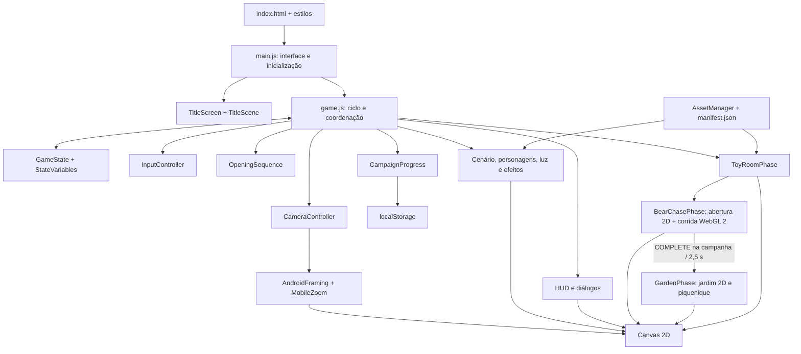

# O Quarto dos Brinquedos

Uma aventura de plataformas e exploração em Canvas 2D, com uma perseguição em 3D, feita para jogar no navegador. Uma menina acorda em um quarto cheio de brinquedos e, acompanhada por uma fadinha, precisa encontrar o caminho entre objetos que se transformam em apoios para os seus saltos.

A experiência combina abertura narrativa, diálogos, plataformas ilustradas, iluminação de um quarto escuro e uma sala de brinquedos explorável. O projeto utiliza **JavaScript com módulos ES, HTML e Canvas 2D**; a perseguição usa **Three.js e WebGL 2**, carregados apenas ao entrar nessa fase. O servidor Node.js atende o desenvolvimento local; a jogabilidade roda no navegador.

## A experiência

- **Quarto escuro:** percurso de plataforma com 22 apoios, cena do castelo e progressão dos saltos durante a fuga.
- **Percurso de retorno:** 16 apoios, deslocamento na direção oposta e passagem pelo portal final.
- **Sala de brinquedos:** exploração com visão superior, coleta de oito objetos, recorrência misteriosa, investigação e aquisição da espada.
- **Arena imaginária:** transformação da mesma sala e quatro inimigos com defesa, esquiva e contra-ataque. Recuar anima a caminhada; durante o golpe inimigo ela firma a base para defender. Cada personagem tem efeitos sonoros próprios. A vitória contra o urso conduz à perseguição.
- **Perseguição 3D:** abertura ilustrada, corrida automática em um quarto curvo, desvio dos brinquedos lançados pelo urso e ida ao baú quando ele é alcançado.
- **Um dia no jardim:** Yuna sai de casa com Nanda e atravessa grama, pedrinhas, rios, rodas e nuvens até o piquenique. Abelhas, minhocas e três perseguições de besouro combinam saltos com reações sensoriais; o EASY oferece resgate sem morte.
- **Tela inicial:** menina lendo, Novo jogo, Carregar jogo, Modo fácil e Opções. A poltrona permanece sobre o tapete ao reenquadrar para celular. A qualidade gráfica está reservada para uma atualização futura.
- **Narrativa:** falas avançam automaticamente nos tempos autorados; clique/toque adianta um balão. No jardim, abertura e piquenique têm personagens em camadas e atuação contínua.
- **Progresso local:** opções de continuar e recomeçar a campanha, com confirmação antes do reinício.
- **Apresentação móvel:** áreas seguras para diálogos e controles; no retorno após a porta falsa, enquadramento contínuo que não segue o arco de cada salto.

## Manual para novas equipes

O [diário humano do projeto](docs/DIARIO-HUMANO.md) apresenta as decisões de produto. Relatórios técnicos, QA e homologações ficam exclusivamente no acervo de IA.

Toda IA deve começar pelo [diário compartilhado](docs/diario-ia/README.md), conforme `AGENTS.md`.

Consulte o [manual de desenvolvimento e integração](docs/MANUAL-DESENVOLVIMENTO.md) para preparação do ambiente, arquitetura, controllers, renderização, assets, persistência, testes e publicação. A [referência de métodos por módulo](docs/REFERENCIA-METODOS.md) mapeia assinaturas e pontos de implementação para orientar a leitura do código. O [dicionário de dependências](docs/DEPENDENCIAS.md) resume bibliotecas, versões e locais de uso. O [mapa da arquitetura e entidades](docs/ARQUITETURA.md) cobre todos os módulos, proprietários de estado e contratos. O [catálogo de comandos](docs/COMANDOS.md) reúne todos os aliases e ferramentas.

### Orientações para o designer

Quem trabalhar no visual deve começar pelo [guia de edição de sprites](docs/sprites/GUIA-DESIGNERS.md). Ele explica onde estão as artes, onde são usadas no código e como preservar a identidade visual, as proporções, a transparência e as âncoras sem alterar a física do jogo.

Consulte o [mapa completo de imagens e consumidores](docs/sprites/MAPA-SPRITES.md), o [mapa de recortes das pranchas](docs/sprites/RECORTES.md) e os [desenhos remanescentes em código](docs/sprites/DESENHOS-EM-CODIGO.md) para localizar os elementos que serão editados. Após mudanças, atualize o inventário com `npm run docs:sprites` e registre a entrega, a validação e as pendências no diário compartilhado.

## Executar localmente

Utilize **Node.js 24**, versão configurada no workflow de publicação, e npm.

```sh
git clone https://github.com/luciussama/legendGirl.git
cd legendGirl
npm ci
npm run dev
```

Abra **http://localhost:3000**. `npm start` executa o mesmo servidor. Para escolher outra porta em shells compatíveis:

```sh
PORT=3001 npm run dev
```

Sirva o projeto por HTTP: módulos JavaScript e carregamento do manifesto de recursos dependem desse contexto. Abrir `index.html` diretamente pelo sistema de arquivos não equivale à execução pelo servidor.

O `package-lock.json` deve permanecer versionado na raiz junto com `package.json`. Ele é usado por `npm ci` e pela chave de cache do GitHub Actions. Ao mudar dependências, atualize e versione os dois arquivos.

Consulte o [guia técnico do primeiro salto](docs/TUTORIAL-PRIMEIRO-SALTO.md) para estados, entradas, persistência, feedback visual e manutenção.

## Controles

| Contexto | Entrada | Ação |
| --- | --- | --- |
| Primeiro salto (`FIRST_JUMP_TUTORIAL`) | Toque primário, clique esquerdo, Espaço ou nova pressão de A | Saltar e concluir o tutorial, se o salto for aceito |
| Fases de plataforma | Toque ou clique na área de jogo | Saltar ou avançar a interação ativa |
| Fases de plataforma | Espaço ou seta para cima | Saltar ou avançar a interação ativa |
| Fases de plataforma | Botão X de controle compatível com o mapeamento esperado | Saltar ou avançar a interação ativa |
| Sala de brinquedos | WASD ou setas | Movimentar a personagem |
| Sala de brinquedos | Espaço, E, Enter ou F | Pegar ou entregar ao baú; o objeto carregado fica nas mãos até a entrega |
| Sala de brinquedos com gamepad padrão | Analógico esquerdo e nova pressão de X (índice 2) | Movimentar e pegar/entregar |
| Sala de brinquedos em tela sensível ao toque | Joystick virtual à esquerda e botão de ação à direita | Movimentar e interagir |
| Arena com teclado | A/D ou esquerda/direita; W/cima; S/baixo; E/Espaço/Enter/F; R | Andar; pular; abaixar; espada; especial |
| Arena com gamepad padrão | D-pad; A (salto); X (espada); Y (especial) | Combate horizontal; analógico não substitui o D-pad nesse perfil |
| Arena em touch | Direcional, espada e especial | Andar, pular, abaixar e atacar; especial uma vez por batalha |
| Perseguição 3D | A/D, esquerda/direita, D-pad ou analógico esquerdo | Desviar lateralmente durante a corrida automática |
| Perseguição 3D em touch | Segurar uma lateral do canvas e arrastar para trocar de lado | Desviar; não há comando de salto ou espada nessa fase |
| Jardim | A/D ou esquerda/direita; Espaço, W ou cima | Andar e pular; soltar pulo encurta a subida |
| Jardim em touch/gamepad | ◀ ▶ e PULAR simultâneos; analógico/D-pad e A/X | Andar e pular; durante o besouro, a corrida para frente é automática e só o pulo fica sob controle |
| Falas narrativas | Clique/toque no quadro; em cenas modais, em qualquer ponto do canvas | Adiantar um balão, sem produzir salto, ataque ou coleta |
| Cenas do jardim | Enter/Espaço ou A/X; S ou “Pular (S)” após ver a cena | Adiantar uma fala ou pular uma cena já vista |
| Interface geral | P / botão de pausa | Pausar ou continuar |
| Interface geral | M / botão de áudio | Alternar o som |

As entradas respeitam os bloqueios das cenas e o estado da personagem. Nos percursos do quarto, o deslocamento horizontal é conduzido pelo jogo; o jogador controla o momento do salto. No jardim, anda e pula livremente, exceto nas perseguições breves do besouro. Durante a fuga do quarto, caminhar por muito tempo nos apoios intermediários pode permitir que a rolagem alcance a personagem. Após conquistar o pedestal final, a câmera acompanha a aproximação da porta falsa.

## Arquitetura

A coordenação usa RuntimeContext, ViewportController, CameraQaObserver, DarkRoomRenderPipeline e DarkRoomNarrative por composição. `GameState` é a fonte dos campos de gameplay; os espelhos locais e o Proxy narrativo foram removidos. A fronteira de orientação do viewport foi preservada. A Toy Room separa entrada, movimento, interação, história, tutorial, efeitos, câmera, cena e persistência. Combate e arena têm componentes próprios e ainda conservam acessos amplos à sala. Veja [arquitetura, entidades e contratos](docs/ARQUITETURA.md).

O código separa estado, controle, desenho e recursos, com `game.js` coordenando o fluxo principal. Parte da lógica de movimento, colisões e narrativa ainda reside nesse coordenador: a organização é modular, mas não constitui uma engine genérica ou um sistema ECS.



### Entrada e coordenação

[`src/js/main.js`](src/js/main.js) conecta os elementos HTML ao jogo: menu inicial, continuar/recomeçar, pausa, áudio e ferramentas de desenvolvimento. Ele cria a instância por meio de `createGame`.

[`src/js/game.js`](src/js/game.js) mantém o ciclo com `requestAnimationFrame`, atualiza o mundo e desenha cada quadro. O tempo decorrido é normalizado para uma referência de 60 quadros por segundo, com `dt` limitado entre 0,5 e 1,2. Trata-se de um passo variável limitado, e não de uma simulação com acumulador de passos fixos.

O coordenador também seleciona o modo ativo: o quarto usa seu fluxo de plataformas; a sala de brinquedos delega atualização e renderização a `ToyRoomPhase`.

### Estado e regras de jogo

| Módulo | Responsabilidade |
| --- | --- |
| [`config.js`](src/js/config.js) | Configuração do chão, plataformas, portas, estados iniciais e progressão de atributos |
| [`StateVariables.js`](src/js/state/StateVariables.js) | Valores iniciais das variáveis da campanha |
| [`GameState.js`](src/js/state/GameState.js) | Operações de estado, reinícios, derrota, prontidão e transições narrativas |
| [`game.js`](src/js/game.js) | Integração de movimento, salto, resolução de pousos e gatilhos de progressão |
| [`InputController.js`](src/js/controllers/InputController.js) | Entradas de ponteiro, teclado e leitura de gamepad para as fases de plataforma |

`game.js` lê e escreve os campos de gameplay diretamente em `GameState`. `syncViewportToState` e `syncViewportFromState` conservam somente a fronteira de orientação/apresentação. Um campo novo precisa de proprietário, default, leitores/escritores e decisão explícita de persistência; não introduza outro espelho de gameplay.

### Câmera e apresentação móvel

[`CameraController.js`](src/js/controllers/CameraController.js) faz somente rolagem lateral durante a jogabilidade. A altura é fixa por viewport e a câmera não reposiciona a menina nem interrompe seu salto. Zoom e movimentos livres pertencem às cenas narrativas.

`getDarkRoomScrollFrame`, em `CameraPresentation.js`, define o quadro vertical de todas as seções, incluindo fuga e retorno. `getPhase3ScrollFrame` conserva o contrato do retorno como alias desse quadro fixo. A apresentação móvel usa escala fixa por viewport, até 0,8, e reserva o rodapé para o toque. Em paisagem abre o quadro para conter o arco inteiro dos saltos. Não consulta altura do pulo, pouso, fada ou próximo apoio para reenquadrar a ação. A pressão lateral do percurso continua ativa; a região horizontal do pedestal final encerra essa pressão, independentemente do índice do apoio.

`AndroidFraming` e os limites dinâmicos de `MobileZoom` são exclusivos das cenas. `DialogueSafeArea` mantém os textos na área segura; `MobileDialogueRegion` separa fala e atuação. A narração usa quadro pastel superior. Mudanças de orientação recalculam o viewport; saltos e pousos não podem fazê-lo.

Correções de alcance ou contato pertencem à distância do salto, à superfície dos pés ou à superfície física do objeto, conforme `AGENTS.md`. Não alterar a câmera para compensá-las.

### Renderização e recursos

[`AssetManager.js`](src/js/assets/AssetManager.js) carrega [`assets/manifest.json`](assets/manifest.json), prepara imagens e mantém caches de imagens e regiões. Os renderizadores consomem esses recursos:

- `entities/`: desenho e animação da menina e da fadinha.
- `environment/`: paredes, objetos, plataformas e iluminação.
- `effects/`: partículas, acabamento visual e transições.
- `ui/`: HUD, retratos, caixas de diálogo e cálculo da área segura.
- `debug/`: inspeção técnica do atlas.

A iluminação usa um canvas auxiliar e acompanha a transformação real da cena. A camada de interface é desenhada em coordenadas de tela. Arte e sons ficam principalmente em `assets/`; também existem recursos em `src/assets/` e `src/audio/`. Consulte as referências e o manifesto antes de mover arquivos.

### Narrativa e persistência

[`OpeningSequence.js`](src/js/cinematics/OpeningSequence.js) controla o relógio da abertura, falas, poses e revelação do cenário. As seis sequências posteriores do quarto estão em `DarkRoomNarrative`, selecionadas pelo coordenador com `GameState`. `ToyRoomStory` trata recorrência, investigação e espada. `DialogueRenderer` compartilha caixa/retrato entre fases; renderizadores narrativos adaptam conteúdo e tempos.

`DialogueFlow` registra os quadros visíveis e consome a entrada antes do gameplay. `game.advanceDialogue` encaminha cada pedido ao dono da sequência. Durante uma fala não modal, os demais controles continuam funcionando; durante uma cena, o gesto de leitura não atravessa a transição. Consulte o [padrão de diálogos](docs/diario-ia/padroes/DIALOGOS-E-CENAS.md).

[`CampaignProgress.js`](src/js/state/CampaignProgress.js) serializa uma seleção explícita do estado e usa `localStorage`. O jogo salva periodicamente durante a campanha e em eventos de saída/ocultação da página. O registro inclui estado narrativo e, quando aplicável, a sala de brinquedos. Se o armazenamento falhar, existe uma alternativa em memória para a sessão.

O progresso pertence ao navegador e à origem utilizados. Não há conta de usuário, banco de dados ou sincronização de campanha entre dispositivos. `Carregar jogo` restaura o estado e a dificuldade salvos. `Novo jogo` pede confirmação quando há progresso, limpa a campanha e reinicia a abertura com a dificuldade escolhida no título. O botão `Modo fácil` afeta somente a próxima aventura nova.

### Sala de brinquedos

[`ToyRoomPhase.js`](src/js/toy-room/ToyRoomPhase.js) compõe os subsistemas e mantém seleção de modos, transições, ciclo de vida e API pública. Entrada, interação, história, tutorial e persistência usam contextos específicos; movimento, consultas de mundo, câmera, fada e efeitos recebem as referências atuais. `ToyRoomSceneRenderer` compõe cenário, entidades, HUD e falas com dados do quadro. `ToyRoomArenaPhase` transforma/restaura a sala e configura `ToyRoomBattle` com os perfis da arena. Veja o [catálogo completo](docs/ARQUITETURA.md#catálogo-completo-dos-módulos-javascript).

Os arquivos `toyRoom.js` e `input.js` servem como pontos de reexportação para os módulos correspondentes, preservando caminhos de importação existentes. O sistema de áudio em `audio.js` é integrado ao jogo por `AudioController`, com músicas, efeitos, controle de volume e silenciamento.

## Organização do repositório

```text
.
├── index.html                 # Página principal
├── server.js                  # Servidor local
├── package.json               # Dependências e comandos
├── package-lock.json          # Resolução versionada das dependências
├── assets/                    # Manifesto, arte e áudio
├── src/
│   ├── css/                   # Estilos da interface
│   └── js/
│       ├── main.js            # Integração com a página
│       ├── game.js            # Coordenação do jogo
│       ├── config.js          # Configuração do mundo
│       ├── assets/            # Carregamento e atlas
│       ├── cinematics/        # Abertura e introdução da sala
│       ├── controllers/       # Entrada, áudio e câmera
│       ├── state/             # Estado, dificuldade e persistência
│       ├── runtime/           # Agregação explícita de serviços
│       ├── narrative/         # Sequências do quarto e narrador
│       ├── rendering/         # Composição visual do quarto
│       ├── entities/          # Personagens
│       ├── environment/       # Cenário e iluminação
│       ├── effects/           # Efeitos visuais
│       ├── ui/                # Interface desenhada no canvas
│       ├── bear-chase/        # Domínio, câmera, modelos, materiais e áudio da perseguição 3D
│       ├── garden/            # Domínio lateral, contato por pixels, encontros, cenas e áudio do jardim
│       ├── toy-room/          # Exploração, narrativa, espada e arena
│       └── debug/             # Ferramentas de inspeção
├── scripts/                   # Geração de recursos, documentação, diário e execução de QA temporário
├── docs/diario-ia/            # Acervo de máquina e QA recuperável em ambiente temporário
└── .github/workflows/          # Publicação no GitHub Pages
```

## Testes e verificações

```sh
npm test
npm run check-assets
npm run lint
npm run build
```

| Comando | Escopo |
| --- | --- |
| `npm test` | Regressões do quarto, sala, entrada, diálogos, persistência, arena, balanceamento, contrato do tutorial e domínio da perseguição |
| `npm run check-assets` | Verificação dos recursos registrados |
| `npm run lint` | Verificação de sintaxe de `server.js` e `scripts/check-assets.js`; não é uma análise estática de todo o projeto |
| `npm run test:pages` | Referências das páginas e compatibilidade dos caminhos com publicação em subpasta |
| `npm run build` | Validação das páginas; não transpila JavaScript nem gera um pacote em `dist/` |
| `npm run journal:qa -- script:test-opening-sequence.js` | Sequência, poses, falas e persistência da abertura |
| `npm run journal:qa -- script:test-physics-scenarios.js` | Cenários adicionais de física e alinhamento das plataformas |

### Percurso completo no navegador

As páginas e scripts de QA estão arquivados no diário de IA. Os comandos de teste recuperam suas fontes apenas em um diretório temporário, preservam os resultados no acervo e apagam o ambiente ao concluir. Fontes e resultados de QA permanecem exclusivamente em `docs/diario-ia/`; as páginas de teste são recuperadas temporariamente e não entram no site publicado.

Inicie **uma instância dedicada do Chrome**, com perfil separado e `--remote-debugging-port=9222`. Os comandos do diário iniciam um servidor temporário em porta livre e encerram o ambiente após registrar o resultado. Consulte os [pré-requisitos de QA](docs/COMANDOS.md#ambiente-e-funcionamento).

```sh
npm run journal:qa -- script:verify-full-browser.js
npm run journal:qa -- script:verify-full-browser.js desktop
npm run journal:qa -- script:verify-full-browser.js iphone
```

O teste percorre abertura, plataformas, transições e sala de brinquedos. Ele busca momentos de salto usando snapshots entre tentativas e avança o código real de atualização em passos controlados. Na sala, usa vetores do joystick virtual e verifica a entrega dos oito objetos.


As validações móveis automatizadas utilizam emulação no Chrome desktop. Elas não substituem testes em aparelhos reais, especialmente de Safari/WebKit, gestos do sistema, áudio e conforto dos controles.

## Publicação

O workflow do GitHub Pages publica HTML, módulos JavaScript e recursos estáticos. O site publicado não depende do Express; o servidor Node.js atende o desenvolvimento local.

Se o Actions informar que não encontrou o lockfile, confira o commit usado pela execução: `package-lock.json` precisa existir **naquele commit**, na raiz. Reexecutar uma execução antiga não faz checkout automaticamente de um commit novo.

## Convenções de manutenção

Siga as instruções de [`AGENTS.md`](AGENTS.md): comentários, documentação, interface e diagnósticos novos devem estar em português do Brasil, preservando nomes técnicos e APIs.

Ao alterar apresentação, mantenha física, geometria de colisão e posições do mundo separadas das transformações de renderização. Não desenhe linhas auxiliares de pouso ou hitboxes sobre as ilustrações na apresentação normal; inspeções técnicas pertencem ao modo de depuração.

Mudanças em física ou progressão exigem revisão das referências e dos testes de percurso preservados no diário de IA. Mudanças de arte exigem conferência do manifesto e dos recortes do atlas. Mudanças em estado persistente exigem revisão dos defaults, proprietários e captura/restauração da campanha e da sala.

### Dificuldades e pousos

O modo NORMAL tem alcances próprios nos três percursos de plataformas. Os blocos, tambor e almofadão da aproximação recebem ajuda discreta de pouso. No retorno após a porta falsa, o apoio considera a faixa dos sapatos e o cruzamento descendente do topo entre quadros. O FÁCIL conserva sua assistência mais ampla. Nenhuma linha técnica de contato aparece no jogo normal.

Na arena, o FÁCIL amplia o alcance da espada e reduz a agressividade dos inimigos, mantendo os corações e os sinais dos golpes. Na perseguição, são três vidas no NORMAL e seis no FÁCIL. O NORMAL usa até três brinquedos por lançamento e pares a cada segundo nos 15% finais. Os detalhes estão nos [guias da arena](docs/arena/GUIA-ARENA.md) e da [perseguição](docs/bear-chase/GUIA-PREVIA.md).

A vitória da arena passa por tela escura e revela o urso caído, com a menina portando a espada. O save inclui a perseguição de campanha; o seletor de debug continua isolado. Depois da captura e do retorno ao baú, a campanha apresenta o resultado por 150 ticks (2,5 s na base de 60 Hz) e abre o jardim; a prévia de debug permanece no resultado. A derrota oferece nova tentativa nessa fase. A cena obrigatória da menina verificando o urso caído cobre o carregamento do 3D e aguarda, se necessário. A corrida só é liberada após imagens decodificadas, piso validado na GPU, mapas enviados e materiais compilados. A confirmação do piso no Safari do usuário continua pendente.

O [jardim](docs/garden/GUIA-JARDIM.md) tem simulação própria, câmera somente lateral e save de domínio v10 dentro de `toyRoomGarden`. O NORMAL usa três corações e checkpoints; o EASY conserva seis corações e resgates animados de Nanda, sem morte. No fim, as falas se encerram automaticamente e o piquenique permanece animado.

Depois de três derrotas completas, somadas entre as partes da campanha no NORMAL, aparece “deseja tentar no fácil?”. Sim mantém a parte atual da aventura e salva a mudança para o FÁCIL; Não mantém a dificuldade. A perseguição informa “A menina não alcançou o urso. Tentar novamente?” e permite reiniciar sua tentativa pela própria tela.
