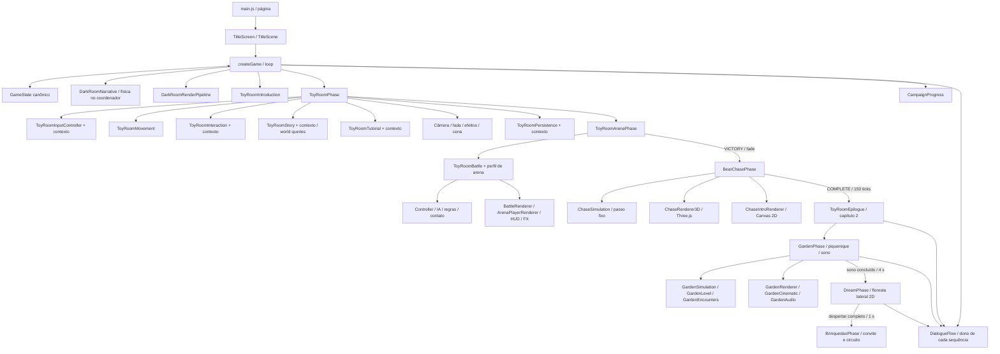

# Arquitetura e contratos do aplicativo

Revisão: 29/10/2026. Descreve o código atual: quarto, exploração, arena, perseguição, jardim, capítulos, atuação articulada, leitura compartilhada e diário incremental. Planos históricos não representam componentes implementados. O [manual](MANUAL-DESENVOLVIMENTO.md) explica manutenção e integração; a [referência de métodos](REFERENCIA-METODOS.md) complementa este catálogo com assinaturas. O [catálogo de comandos](COMANDOS.md) cobre automações e QA. Resultados de execução pertencem ao [diário de IA](diario-ia/README.md).

## Composição e limites

`src/js/bear-chase/` atende dois caminhos separados: `startChasePreview()` pelo
seletor de debug e `startChaseCampaign()` após a vitória do urso na arena. A campanha
escurece a arena, prepara as artes ilustradas e revela `BEAR_DOWN`. O renderer 3D
é preparado durante a introdução obrigatória; sua prontidão visual condiciona a arrancada. Seu snapshot `toyRoomChaseCampaign` integra a persistência
da Toy Room; o estado do acesso isolado de debug permanece fora do save. Saves antigos continuam
válidos. `BearChasePhase` recebe canvas, serviço de áudio, disponibilidade e
dificuldade, sem receber a sala inteira. `ChasePatterns` distribui os grupos por progresso e dificuldade, preservando um corredor nos grupos densos. `ChaseSimulation` mantém dados serializáveis
e passo fixo; `ChaseInput`, `ChaseAudio`, `ChaseHUD` e `ChaseRenderer3D` isolam os
adaptadores. Three.js é importado tardiamente de `src/vendor/three/`. Veja
[contratos e ciclo de vida](bear-chase/GUIA-PREVIA.md) e o
[manual da transição](bear-chase/MANUAL-TRANSICAO-VITORIA-ARENA-FUGA.md).

`GameState` é a fonte dos campos de gameplay do quarto. `game.js` não mantém cópias locais da narrativa/progressão/câmera nem usa Proxy narrativo. A barreira `syncViewportToState`/`syncViewportFromState` permanece para a orientação; sua ordem afeta a apresentação móvel. `RuntimeContext` agrega referências existentes e não funciona como registro global de serviços.

A arquitetura usa funções, instâncias e adaptadores por domínio. Não há `GamePhaseDirector`, HFSM genérica ou `DarkRoomPhysicsSystem` implantados. Física dos saltos/pousos e seleção do fluxo ainda residem em `game.js`. `ToyRoomBattle` e `ToyRoomArenaPhase` ainda recebem a sala completa; `BattleRenderer` também usa integração ampla com a batalha. Não confundir as extrações concluídas com desacoplamento global.

O loop normaliza o tempo para 60 Hz e limita dt a 0,5–1,2. Pausa impede update e mantém render. A arena limita a entrada própria de dt e a simulação de combate usa subpassos; isso não transforma o loop global em passo fixo. Desenho não deve alterar gameplay, mas há efeitos existentes: callbacks publicam orientação e a história registra o viewport apresentado. Preserve essas fronteiras.

## Proprietários e contratos dos dados

| Entidade / estado | Proprietário e campos | Leitura, escrita e persistência |
| --- | --- | --- |
| `baby` do quarto | `createBabyState`/`GameState`: x/y/w/h, vx/vy, gravidade, impulsos, onGround, animação, apoio atual e flags de controle/narrativa. | Física em game.js, resolvedor DarkRoomContact e comandos de GameState escrevem; renderizadores leem. `CampaignProgress.restoreState` preserva a referência do objeto. |
| `fairy` do quarto | `createFairyState`/GameState: posição, alvo, voo, partículas e pose narrativa. | Guia e narrativa atualizam; FairyRenderer apresenta. Não é a fada da Toy Room. |
| Campanha | `StateVariables`: dificuldade, modo bedroom/toy-room, escape/phase3, prontidão, abertura, câmera e temporizadores. | `captureState` parte dos defaults e exclui runtime, orientação e entradas transitórias. Detalhes abaixo. |
| Jogador da Toy Room | `ToyRoomInitialEntities`: posição/velocidade, speed 3,8, radius 20, direction, facing, facingAngle, animTime, isMoving, carriedItem, stepTimer. | Movimento/ações/combate escrevem; apresentação lê. `restore` pode substituir o objeto; adaptadores consultam a referência atual. |
| Fada da Toy Room | x/y, targetX/targetY, flutterTime, wingAngle e particles. | Tutorial/história fornecem guia; Companion atualiza o voo. A câmera segue o alvo narrativo único. |
| Móveis | Sete objetos com id/type/x/y/w/h; o baú inclui lidOpen/glowAlpha/isTarget. | Colisão usa os retângulos na ordem do catálogo; cenário usa a arte; arena deriva suas estruturas desses móveis. |
| Brinquedos | Oito IDs: teddy, train, robot, bunny, duck, blocks, drum, jack. Cada um tem nome, tipo, posição, dimensões, weight, isCarried/isOrganized e bounceOffset. | ToyActions mantém identidade e flags; história pode acrescentar returnGeneration. `carriedItem` aponta ao mesmo objeto da lista e é religado por ID no restore. |
| Entrada da sala | keysDown, touchState, gamepadState, ponteiros/botões de arena e actionBtnPressed. | InputController usa o contexto da fase; HUD e combate leem a mesma fonte. Blur/pausa/restore/saída limpam entradas; Maps e listeners não vão ao save. |
| História da sala | recurrenceActive, returnedToyCount, pendingReturns, returnDialogueElapsed, investigationStage/Elapsed, sword, swordPickupElapsed, swordEquipped e attackElapsed/Direction; arenaCompleted pode ser acrescentado no retorno. | `ToyRoomStory` decide transições/tempos; renderer só apresenta os dados. Estado salvo em toyRoomStory. |
| Tutorial da sala | active, step, origin, target, cooldown e device na instância; conclusão em toyRoomTutorialCompleted. | Contexto expõe oito campos, com setters só para conclusão e gameplayState. Progresso transitório da instrução não é serializado; restore retoma a orientação quando aplicável. |
| Batalha | `ToyRoomBattle.state`: mode, index, elapsed, player HP, enemy, history, transition, ending, cooldown/immunity, salto/agachamento/defesa, espada, hitstop, impacto/recuo e memórias. | Controller/IA/regras/contato atualizam; snapshot copia o estado serializável. Ativação começa a menina com 3 HP. |
| Inimigo ativo | actor, hp/maxHp, x/facing, state/elapsed, attack/index, landed, enrage/enrageShown e campos de resposta/evasão/memória recente. | Apenas um inimigo ativo; ordem train → robot → dinosaur → bear. Perfis de arena e legado têm HP/medidas diferentes. |
| Arena | status/elapsed/completed, destino de retorno (sala ou fuga), resultado e snapshot da exploração; câmera, FX, áudio e chefe têm snapshots próprios. | `ToyRoomArenaPhase` restaura a exploração com preserveArena para evitar recursão, reconfigura legado/arena, limpa controles e só direciona vitórias à fuga. |
| Fuga da campanha | `toyRoomChaseCampaign` guarda estado versionado e posição musical; ausente em saves anteriores e no acesso isolado de debug. | `ToyRoomPersistence` valida a consistência com `arenaCompleted` e retoma a etapa salva sob fade antes de avançar o estado. |
| Epílogo do quarto | `ToyRoomEpilogue`: active, index, age, time e origem campaign. | `toyRoomEpilogue` versão 1 salva índice/idade/tempo somente na campanha ativa. A origem da prévia é propagada até o jardim e não contamina o save. |
| Jardim da campanha | `GardenPhase.state`: domínio v11, `story`, `presentation`, `encounters`, jogador, fada, nuvens, inimigos, histórico de apoios e resgate. | `toyRoomGarden` contém `{version:1,state}`; a versão do envelope da fase difere da versão 11 do domínio. Restore da sala prioriza jardim, epílogo e perseguição, nessa ordem. Entrada de debug fica fora do save. |
| Sonho da campanha | `DreamPhase.state`: domínio5 com travessia aérea, viagens, dano/queda e domínio próprio do pesadelo/despertar; migra domínios1/2/3/4. | `toyRoomDream` envelope1 e posição musical; restaura antes de jardim/epílogo/fuga. Prévia fica fora do save. |
| Brinquedão da campanha | `BrinquedaoPhase.state`: domínio4, corpo, apoio, embalo, checkpoints e história. | `toyRoomBrinquedao` envelope1 e posição musical, restaurado antes dos modos anteriores; prévia não salva. |
| Leitura compartilhada | `DialogueFlow`: WeakMap por canvas com quadro atual, limites transformados, profundidade de composição e dispensa visual. | Temporização e índice pertencem ao dono da cena; no jardim, `story` é salvo. DOM, callbacks e listeners nunca entram no snapshot. |
| Recursos | Imagens, regiões, manifestos e status nos carregadores; poses/âncoras em módulos de dados. | Não são serializados. No quarto, recortes e transparência afetam o perfil extraído por `DarkRoomContact`; exigem QA das superfícies. Demais fases conservam seus contratos de colisão. |

A Toy Room mede 1600 × 1200. Suas ações têm debounce de 250 ms, coleta abaixo de 88 unidades e armazenamento abaixo de 160. O item carregado permanece nas mãos até a entrega ao baú; a primitiva legada de soltura não é uma ação disponível ao jogador. Desde a investigação, `canCollectToys` bloqueia coleta comum e prioriza a espada. A escolha de interação ocorre antes do movimento do quadro. As entradas têm prioridade teclado → gamepad ativo → toque ativo. Não antecipar contagem ou trocar a ordem das chamadas aleatórias durante uma extração.

## Fluxos, câmeras e persistência

Quarto: abertura → primeiro salto → plataformas/castelo → fuga → porta falsa/reviravolta → demonstração do retorno → plataformas de retorno → portal. `currentPhaseMode` permanece bedroom até a transição para toy-room; os demais estágios usam flags próprias. O [guia do primeiro salto](TUTORIAL-PRIMEIRO-SALTO.md) descreve CUTSCENE/FIRST_JUMP_TUTORIAL/GAMEPLAY_NORMAL e a migração.

Sala: `TOY_ROOM_GAMEPLAY`/`TOY_ROOM_TUTORIAL` → recorrência/investigação da história (`COLLECTING`, `INVESTIGATION`, `SEEKING_SWORD`, `PICKUP`, `EQUIPPED`) → transformação/arena. A arena usa `IDLE`, `TRANSFORMING`, `COMBAT`, `RETURNING`, `COMPLETE`; a batalha usa BATTLE/VICTORY/DEFEAT. Esses estados pertencem a proprietários distintos, não a uma única enumeração intercambiável.

A câmera do quarto conserva a pressão lateral/derrota, com altura e escala fixas no gameplay; não modifica a personagem. CameraPresentation interpola somente cenas; AndroidFraming/limites dinâmicos de MobileZoom não atuam nos saltos. Na Toy Room, `story.cameraTarget()` segue a menina, exceto a revelação temporária da espada, quando segue a fada. A guia de brinquedos não desloca o enquadramento. Na arena, ArenaCamera aproxima os atores próximos e abre suavemente quando se afastam, reservando espaço para golpes, HUD, controles e transporte ao baú; o antigo design de câmera fixa não descreve esse perfil.

`legendGirl.campaign.v1` armazena `{version, state, opening, platforms, toyRoom}`. A captura do estado exclui toyRoomInstance, gameStarted, loopStarted, lastTime, lastJumpTime, lastDialogueAdvanceTime, standbyActivatedTime, failMessageTimer, isPortrait e lastUsedInputDevice. Relógios/DOM/áudio/input/controllers ficam fora do pacote. Estado da abertura e marca de conclusão têm ciclo próprio; `newCampaign` limpa a campanha e a conclusão conforme sua implementação.

A sala salva câmera, banners, player/fairy/furniture/toys, contagem, conclusão do tutorial, carriedItemId e snapshots de história, batalha e arena. `includeArena:false` evita capturar arena dentro da exploração de retorno; `preserveArena:true` evita reconstruí-la durante o retorno. Não substituir objetos carregados por cópias desconectadas da lista. Campos legados de facing e saves sem snapshot da arena têm tratamento específico; isso não constitui migração genérica para qualquer formato.

O autosave ocorre periodicamente e em pagehide/visibilitychange; não grava antes de iniciar, durante a introdução da sala ou em sessão de debug. Continuar/iniciar normalmente encerra o modo de debug. Preferências de áudio/dificuldade/UI não constituem um backend de campanha. `createCampaignProgress` usa alternativa em memória quando o storage falha, sem garantir sobrevivência ao fechamento.

## Catálogo completo dos módulos JavaScript

Cada arquivo de `src/js` tem uma linha abaixo. A coluna de contratos enumera declarações exportadas e reexports nomeados; métodos de classe, auxiliares, getters e fábricas são detalhados na [referência](REFERENCIA-METODOS.md). Objetos de entidade são dados, não classes novas.

| Módulo | Responsabilidade e fronteira | Contratos exportados |
| --- | --- | --- |
| [assets/AssetManager.js](../src/js/assets/AssetManager.js) | Manifesto principal, carregamento/cache de imagens e recortes; prontidão e erros por recurso. | `AssetManager`, `createAssetManager` |
| [assets/currentScenery.js](../src/js/assets/currentScenery.js) | Catálogo das ilustrações decorativas atuais e seu desenho, com calibração visual por objeto. | `CURRENT_SCENERY`, `drawCurrentScenery` |
| [assets/darkRoomAtlas.js](../src/js/assets/darkRoomAtlas.js) | Coordenadas do atlas consolidado, consulta e validação dos limites de recorte. | `SHEET_WIDTH`, `SHEET_HEIGHT`, `SPRITESHEET_PATH`, `darkRoomAtlas`, `validateAtlasRegion`, `getDarkRoomAtlasRegion` |
| [assets/index.js](../src/js/assets/index.js) | Ponto de reexportação dos contratos existentes; não cria estado nem um loop próprio. | `AssetManager`, `createAssetManager`, `darkRoomAtlas`, `validateAtlasRegion`, `getDarkRoomAtlasRegion`, `SHEET_WIDTH`, `SHEET_HEIGHT` |
| [assets/illustratedGirl.js](../src/js/assets/illustratedGirl.js) | Metadados derivados da menina girl-v2: pranchas, poses, âncoras e envelopes dos pés; não decide física. | `GIRL_V2_REFERENCE_HEIGHT`, `GIRL_V2_SETS`, `GIRL_V2_FRAMES`, `GIRL_V2_FOOT_BOUNDS` |
| [assets/officialCharacter.js](../src/js/assets/officialCharacter.js) | Hash da fonte oficial e metadados das poses; dados derivados, sem lógica de movimento. | `OFFICIAL_SOURCE_SHA256`, `OFFICIAL_FRAMES` |
| [audio.js](../src/js/audio.js) | Sistema Web Audio e músicas HTMLAudio; ganho mestre, mudo, síntese e amostras gravadas da arena, com pausa e limpeza de efeitos. | `createAudioSystem` |
| [audio/GameSoundEffects.js](../src/js/audio/GameSoundEffects.js) | WAVs fornecidos: cache por contexto, vozes de pulo/lama e loops de asas com panorâmica e limpeza. | `GAME_SOUNDS`, `preloadGameSounds`, `GameSoundEffects` |
| [audio/InsectSoundscape.js](../src/js/audio/InsectSoundscape.js) | Emissores nos corpos de abelhas/besouros do jardim e sonho, intensidade por voo e atenuação espacial. | `insectEmitters`, `audibleInsects` |
| [bear-chase/BearChasePhase.js](../src/js/bear-chase/BearChasePhase.js) | Compõe a fuga, adapta o tempo do loop, revela a abertura ilustrada enquanto prepara/verifica o 3D e controla pausa, entradas, snapshot e descarte. | `BearChasePhase` |
| [bear-chase/ChaseAudio.js](../src/js/bear-chase/ChaseAudio.js) | Controla trilha, passos, ganho, pausa e restauração da posição musical. | `ChaseAudio` |
| [bear-chase/ChaseBearAnimation.js](../src/js/bear-chase/ChaseBearAnimation.js) | Calcula poses e articulações do urso sem modificar o domínio. | `ChaseBearAnimation` |
| [bear-chase/ChaseBearModel.js](../src/js/bear-chase/ChaseBearModel.js) | Constrói o urso volumétrico com materiais e hierarquia próprios. | `ChaseBearModel` |
| [bear-chase/ChaseCamera.js](../src/js/bear-chase/ChaseCamera.js) | Calcula enquadramento, balanço e transição ao baú a partir do progresso. | `chaseCameraFrame` |
| [bear-chase/ChaseConfig.js](../src/js/bear-chase/ChaseConfig.js) | Parâmetros em unidades de mundo e segundos; auxiliares numéricos. | `CHASE_CONFIG`, `clamp`, `damp` |
| [bear-chase/ChaseGirlAnimation.js](../src/js/bear-chase/ChaseGirlAnimation.js) | Resolve apoios no espaço do quadril com os comprimentos do modelo; anima espada, cabelo, saia e tropeço. | `ChaseGirlAnimation` |
| [bear-chase/ChaseFairyModel.js](../src/js/bear-chase/ChaseFairyModel.js) | Modela núcleo de luz e asas em volume, com órbita ao redor da menina e rastro instanciado. | `ChaseFairyModel` |
| [bear-chase/ChaseGirlModel.js](../src/js/bear-chase/ChaseGirlModel.js) | Constrói malhas, materiais e articulações da menina; compartilha comprimentos e altura da sola em `proportions`. | `ChaseGirlModel` |
| [bear-chase/ChaseGirlPalette.js](../src/js/bear-chase/ChaseGirlPalette.js) | Paleta regional derivada das amostras rastreáveis da arte de arena. | `GIRL_PALETTE` |
| [bear-chase/ChaseHUD.js](../src/js/bear-chase/ChaseHUD.js) | Apresenta vidas e instruções sem decidir dano ou progressão. | `renderChaseHUD` |
| [bear-chase/ChaseHealth.js](../src/js/bear-chase/ChaseHealth.js) | Deriva vidas e derrota a partir de dificuldade e impactos. | `CHASE_FALL_DURATION`, `chaseMaxLives`, `chaseLives`, `isChaseDefeat` |
| [bear-chase/ChaseInput.js](../src/js/bear-chase/ChaseInput.js) | Converte teclado, ponteiro e gamepad em intenção lateral; libera listeners. | `ChaseInput` |
| [bear-chase/ChaseIntroRenderer.js](../src/js/bear-chase/ChaseIntroRenderer.js) | Apresenta a introdução ilustrada e o corte de largada em Canvas 2D. | `isChaseIntro`, `chaseIntroFade`, `ChaseIntroRenderer` |
| [bear-chase/ChaseLighting.js](../src/js/bear-chase/ChaseLighting.js) | Compõe luzes de sala e da fada; duas fontes de sombra, com recursos próprios e acompanhamento no percurso. | `ChaseLighting` |
| [bear-chase/ChasePacing.js](../src/js/bear-chase/ChasePacing.js) | Deriva intensidade, velocidade, cadência, voo e margem de reação. | `smoothProgress`, `chaseIntensity`, `chasePacing` |
| [bear-chase/ChasePatterns.js](../src/js/bear-chase/ChasePatterns.js) | Distribui grupos e corredor livre por progresso e dificuldade. | `chasePattern` |
| [bear-chase/ChaseRenderer3D.js](../src/js/bear-chase/ChaseRenderer3D.js) | Compõe cena WebGL; valida o piso na GPU com alternativa linear, envia mapas, compila materiais, monta modelos e descarta recursos. | `ChaseRenderer3D` |
| [bear-chase/ChaseRoom.js](../src/js/bear-chase/ChaseRoom.js) | Constrói superfícies e decoração fixa ao longo do traçado. | `ChaseRoom` |
| [bear-chase/ChaseRoute.js](../src/js/bear-chase/ChaseRoute.js) | Referenciais do percurso contínuo e pontos de emboscada. | `ROUTE_NODES`, `routeFrame`, `routePoint`, `ROUTE_AMBUSHES` |
| [bear-chase/ChaseSimulation.js](../src/js/bear-chase/ChaseSimulation.js) | Cria, restaura e avança estado serializável, colisões, RNG e eventos. | `createChaseState`, `restoreChaseState`, `hitsObstacle`, `stepChase` |
| [bear-chase/ChaseToyModels.js](../src/js/bear-chase/ChaseToyModels.js) | Adaptador de compatibilidade para o trem do catálogo. | `ChaseToyModels` |
| [bear-chase/props/BlockCastleProp.js](../src/js/bear-chase/props/BlockCastleProp.js) | Constrói o castelo de blocos decorativo. | `BlockCastleProp` |
| [bear-chase/props/BlocksProp.js](../src/js/bear-chase/props/BlocksProp.js) | Constrói o grupo de blocos arremessável. | `BlocksProp` |
| [bear-chase/props/BookshelfProp.js](../src/js/bear-chase/props/BookshelfProp.js) | Constrói a estante decorativa. | `BookshelfProp` |
| [bear-chase/props/BunnyProp.js](../src/js/bear-chase/props/BunnyProp.js) | Constrói o coelho arremessável. | `BunnyProp` |
| [bear-chase/props/ChasePropCatalog.js](../src/js/bear-chase/props/ChasePropCatalog.js) | Catálogo, instâncias, limites e liberação dos objetos do percurso. | `ChasePropCatalog` |
| [bear-chase/props/ChasePropResources.js](../src/js/bear-chase/props/ChasePropResources.js) | Compartilha e controla materiais, texturas e geometrias dos objetos. | `ChasePropResources`, `PropParts` |
| [bear-chase/props/DecorativeGeometry.js](../src/js/bear-chase/props/DecorativeGeometry.js) | Primitivas de geometria para os objetos decorativos. | `oval`, `profile`, `rounded`, `curve`, `rod`, `outline` |
| [bear-chase/props/DecorativeProps.js](../src/js/bear-chase/props/DecorativeProps.js) | Fábricas dos objetos decorativos adicionais. | `decorativeFactories` |
| [bear-chase/props/OakCabinetProp.js](../src/js/bear-chase/props/OakCabinetProp.js) | Constrói o armário baixo ilustrado. | `OakCabinetProp` |
| [bear-chase/props/PictorialMaterialAssets.js](../src/js/bear-chase/props/PictorialMaterialAssets.js) | Mapeia atlas ilustrados usados nos materiais dos objetos. | `PICTORIAL_ATLASES` |
| [bear-chase/props/PilotPropResources.js](../src/js/bear-chase/props/PilotPropResources.js) | Reexporta recursos de objetos por compatibilidade com consumidores anteriores. | `PilotPropResources`, `PropParts` |
| [bear-chase/props/ToyChestProp.js](../src/js/bear-chase/props/ToyChestProp.js) | Constrói o baú articulado usado no encerramento. | `ToyChestProp` |
| [bear-chase/props/TrainProp.js](../src/js/bear-chase/props/TrainProp.js) | Constrói o trem volumétrico do catálogo. | `TrainProp` |
| [chapters/ChapterCard.js](../src/js/chapters/ChapterCard.js) | Gravuras e títulos de abertura, com avanço de leitura sem atualizar física. | `renderChapterCard` |
| [chapters/ChapterArt.js](../src/js/chapters/ChapterArt.js) | Recortes e âncoras medidos das novas pinturas de atuação. | `CHAPTER_ART` |
| [chapters/ToyRoomEpilogue.js](../src/js/chapters/ToyRoomEpilogue.js) | Cena do quarto arrumado, leitura, facepalm e passagem ao capítulo2; snapshot próprio. | `ToyRoomEpilogue`, `TOY_ROOM_EPILOGUE` |
| [cinematics/OpeningSequence.js](../src/js/cinematics/OpeningSequence.js) | Abertura: relógio, cues, poses, falas, conclusão local e snapshot recuperável. | `OPENING_STORAGE_KEY`, `OPENING_DIALOGUE`, `OpeningSequence` |
| [cinematics/ToyRoomIntroduction.js](../src/js/cinematics/ToyRoomIntroduction.js) | Transição ilustrada para a sala: planos cinematográficos, poses próprias, estágios, eventos e callback de conclusão. | `TOY_ROOM_INTRO_STAGES`, `ToyRoomIntroduction` |
| [config.js](../src/js/config.js) | Geometria do quarto/apoios/portas, fábricas baby/fairy e parâmetros de progressão dos saltos. | `DEBUG_COLLISIONS`, `GAME_CONFIG`, `FLOOR_Y`, `createBabyState`, `CUTSCENE_DIALOGUE`, `getApproachJumpSpeed`, `getEscapeStats`, `getPhase3Stats`, `createFairyState`, `platforms`, `exitDoor`, `phase3Platforms`, `trueExitDoor`, `roomScenery` |
| [controllers/AndroidFraming.js](../src/js/controllers/AndroidFraming.js) | Reserva inferior e elevação visual Android, sem modificar a física. | `androidFrameOffset`, `createAndroidFraming` |
| [controllers/AudioController.js](../src/js/controllers/AudioController.js) | Integra áudio, preferências e foco/visibilidade à página; delegações e ciclo de vida. | `AudioController`, `createAudioController` |
| [controllers/CameraController.js](../src/js/controllers/CameraController.js) | Rolagem lateral e pressão de atraso; quadro vertical fixo no gameplay e zoom somente narrativo; nunca corrige o corpo. | `CameraController`, `createCameraController` |
| [controllers/CameraPresentation.js](../src/js/controllers/CameraPresentation.js) | Quadro fixo de gameplay e histórico/interpolação exclusivamente narrativa; não consulta saltos ou pousos. | `getDarkRoomScrollFrame`, `getPhase3ScrollFrame`, `CameraPresentation` |
| [controllers/EscapeFairyGuide.js](../src/js/controllers/EscapeFairyGuide.js) | Escolhe próximo apoio/porta e atualiza o movimento da fada na fuga por amortecimento crítico. | `getEscapeGuideTarget`, `updateEscapeFairyGuide` |
| [controllers/InputController.js](../src/js/controllers/InputController.js) | Ponteiro/teclado/gamepad do quarto; debounce, bloqueios, dispositivo e confirmação do primeiro salto. | `InputController`, `bindInput` |
| [controllers/MobileZoom.js](../src/js/controllers/MobileZoom.js) | Detecção móvel e composição fixa no gameplay; âncora/limites somente nas cenas. | `isMobileDevice`, `getDarkRoomMobileFrame`, `getMobileZoomFrame` |
| [controllers/ViewportController.js](../src/js/controllers/ViewportController.js) | Resize dos canvases e iluminação; callback de orientação, sem decidir zoom ou safe area. | `createViewportController` |
| [debug/AtlasDebugger.js](../src/js/debug/AtlasDebugger.js) | Inspeção técnica das regiões do atlas; validação e overlay optativo. | `AtlasDebugger`, `createAtlasDebugger` |
| [debug/CameraQaObserver.js](../src/js/debug/CameraQaObserver.js) | Observador opcional de câmera ativado por parâmetro e callback; sem nova câmera ou simulação. | `createCameraQaObserver` |
| [effects/ArtFinish.js](../src/js/effects/ArtFinish.js) | Acabamento de cor/atmosfera em coordenadas de tela. | `applyArtFinish` |
| [effects/ParticleSystem.js](../src/js/effects/ParticleSystem.js) | Buffers e evolução/desenho de poeira, brilho e rastros do quarto. | `ParticleSystem`, `createParticleSystem` |
| [effects/TransitionEffects.js](../src/js/effects/TransitionEffects.js) | Íris do portal e efeitos de transição com relógio fornecido pelo coordenador. | `TransitionEffects`, `transitionEffects` |
| [effects/index.js](../src/js/effects/index.js) | Ponto de reexportação dos contratos existentes; não cria estado nem um loop próprio. | `ParticleSystem`, `createParticleSystem`, `TransitionEffects`, `transitionEffects` |
| [entities/BabyRenderer.js](../src/js/entities/BabyRenderer.js) | Seleção/recorte das poses oficiais da menina no quarto; desenho ancorado aos pés. | `BabyRenderer`, `babyRenderer` |
| [entities/GirlLocomotion.js](../src/js/entities/GirlLocomotion.js) | Compõe pernas, sola e atuação corporal a partir das pinturas originais; sem física. | `sampleGirlLocomotion`, `girlGaitDirection`, `drawGirlLocomotion`, `girlLocomotionDistance`, `renderGirlRun`, `applyGirlBodyTransform` |
| [entities/GirlGait.js](../src/js/entities/GirlGait.js) | Amostra a passada e reação corporal; fixa a perspectiva lateral para combinar pernas e torso. | `sampleGirlLocomotion`, `girlGaitDirection` |
| [entities/GirlBodyLayers.js](../src/js/entities/GirlBodyLayers.js) | Recorta e mantém em cache braços, torso, vestido, cabeça e cabelo; compartilha transformação das mãos/carga. | `drawGirlUpperBody`, `applyGirlBodyTransform` |
| [assets/GirlLocomotionArt.js](../src/js/assets/GirlLocomotionArt.js) | Metadados da variante artística preservada; sem consumidor na caminhada vigente. | `GIRL_LOCOMOTION_ART` |
| [entities/FairyRenderer.js](../src/js/entities/FairyRenderer.js) | Desenho da fada e efeitos visuais associados, sem decidir seu deslocamento. | `FairyRenderer`, `fairyRenderer` |
| [entities/index.js](../src/js/entities/index.js) | Ponto de reexportação dos contratos existentes; não cria estado nem um loop próprio. | `BabyRenderer`, `babyRenderer`, `FairyRenderer`, `fairyRenderer` |
| [environment/BackgroundRenderer.js](../src/js/environment/BackgroundRenderer.js) | Parede, piso, janelas, parallax e decoração; cobertura calculada pela matriz real. | `getBackgroundViewport`, `BackgroundRenderer`, `backgroundRenderer` |
| [environment/LightingSystem.js](../src/js/environment/LightingSystem.js) | Canvas auxiliar, recortes de luz, máscara, brilho e vinheta; acompanha a matriz da cena. | `LightingSystem`, `createLightingSystem` |
| [environment/DarkRoomContact.js](../src/js/environment/DarkRoomContact.js) | Extrai contornos de apoio da arte carregada; resolve sapatos completos, descida varrida e união urso/livros. | `DarkRoomContact`, `getDarkRoomFeet` |
| [environment/PlatformRenderer.js](../src/js/environment/PlatformRenderer.js) | Arte de plataformas/portas, superfícies visuais e descarte; não resolve pousos. | `PLATFORM_SURFACES`, `PlatformRenderer`, `platformRenderer` |
| [environment/StorybookPlatforms.js](../src/js/environment/StorybookPlatforms.js) | Desenhos de objetos/materiais existentes; restrições de linhas de contato continuam em AGENTS.md. | `drawContactEdge`, `drawStorybookPlatform` |
| [environment/index.js](../src/js/environment/index.js) | Ponto de reexportação dos contratos existentes; não cria estado nem um loop próprio. | `BackgroundRenderer`, `backgroundRenderer`, `PlatformRenderer`, `platformRenderer`, `LightingSystem`, `createLightingSystem` |
| [environment/nightWindows.js](../src/js/environment/nightWindows.js) | Posições compartilhadas das janelas usadas pelo fundo e pela iluminação. | `NIGHT_WINDOWS` |
| [garden/GardenEncounters.js](../src/js/garden/GardenEncounters.js) | Abelhas, minhocas, perseguições de besouro, reativação e validação dos encontros persistidos. | `GARDEN_BEETLES`, `createGardenEncounters`, `tickGardenBee`, `tickGardenWorm`, `tickGardenBeetles`, `resetGardenPanic`, `sweptGardenContact`, `restoreGardenEncounters` |
| [garden/GardenNarrative.js](../src/js/garden/GardenNarrative.js) | Abertura com revelação de Yuna e encerramento ilustrado com Nanda sentada. | `GARDEN_OPENING`, `GARDEN_ENDING`, `GARDEN_OPENING_DURATION`, `gardenNarrativeCard` |
| [garden/GardenCinematic.js](../src/js/garden/GardenCinematic.js) | Cenas na altura dos olhos, com planos e atuação em camadas, independentes da câmera jogável. | `gardenCinematicMoment`, `renderGardenCinematic` |
| [garden/GardenCinematicArt.js](../src/js/garden/GardenCinematicArt.js) | Recortes e âncoras das oito atuações e das camadas da abelha. | `GARDEN_ACTING`, `GARDEN_BEE_LAYERS` |
| [garden/GardenPicnicArt.js](../src/js/garden/GardenPicnicArt.js) | Composição lateral da chegada, com âncora no plano da toalha. | `GARDEN_PICNIC` |
| [garden/GardenBeetleArt.js](../src/js/garden/GardenBeetleArt.js) | Recortes estáveis do corpo e das asas do besouro. | `GARDEN_BEETLE` |
| [garden/GardenBeetleRenderer.js](../src/js/garden/GardenBeetleRenderer.js) | Voo com corpo único e asas articuladas. | `drawGardenBeetle` |
| [garden/GardenBeeRenderer.js](../src/js/garden/GardenBeeRenderer.js) | Corpo estável e asas articuladas continuamente, sem alternância de silhuetas. | `drawGardenBee` |
| [garden/GardenInsectArt.js](../src/js/garden/GardenInsectArt.js) | Atlas de insetos gerado a partir das fontes aprovadas. | `INSECT_FRAMES` |
| [garden/GardenFearArt.js](../src/js/garden/GardenFearArt.js) | Pranchas e recortes próprios da atuação completa de medo, registrados pelo apoio físico original. | `FEAR_FILES`, `FEAR_FRAMES` |
| [garden/GardenArt.js](../src/js/garden/GardenArt.js) | Recortes derivados das pinturas do jardim e âncoras da menina; não altera o domínio. | `GARDEN_ART` |
| [garden/GardenVisualArt.js](../src/js/garden/GardenVisualArt.js) | Recortes decorativos do pilar, peixes e plantas aquáticas, sem contatos físicos. | `AQUATIC_FRAMES` |
| [garden/GardenAudio.js](../src/js/garden/GardenAudio.js) | MP3 Blues Shuffle Loop em repetição e sinais curtos do jardim, com volume, pausa e descarte. | `GardenAudio` |
| [ui/TouchGameControls.js](../src/js/ui/TouchGameControls.js) | D-pad mobile contínuo com oito direções e pulo amplo; geometria CSS compartilhada pelo toque e desenho. | `mobileGameControls`, `drawMobileGameControls` |
| [garden/GardenInput.js](../src/js/garden/GardenInput.js) | Combina teclado, toque e gamepad; instala e remove controles próprios da fase. | `gardenControls`, `GardenInput` |
| [garden/GardenContact.js](../src/js/garden/GardenContact.js) | Contato pelas solas e pela superfície ilustrada; escolha compartilhada da pose. | `gardenFeet`, `gardenContactHeight`, `gardenGirlPose` |
| [garden/GardenContactData.js](../src/js/garden/GardenContactData.js) | Dados gerados dos pixels dos sapatos e dos apoios; sem leitura de imagem durante o gameplay. | `GARDEN_CONTACT` |
| [garden/GardenLevel.js](../src/js/garden/GardenLevel.js) | Configuração do percurso, inimigos, checkpoints e posição dos apoios móveis em segundos. | `GARDEN`, `GARDEN_HOME`, `GARDEN_TERRAINS`, `GARDEN_WHEEL`, `GARDEN_WHEELS`, `GARDEN_AERIAL`, `GARDEN_FINAL_START`, `GARDEN_GOAL`, `GARDEN_WIDTH`, `GARDEN_PLATFORMS`, `GARDEN_ENEMIES`, `GARDEN_WATERS`, `GARDEN_SECTIONS`, `GARDEN_CHECKPOINTS`, `GARDEN_LEGACY_CHECKPOINTS`, `GARDEN_PLATFORM_BY_ID`, `gardenPlatforms`, `cloudStatus`, `gardenSection`, `gardenSurfaceY`, `gardenTerrainAt` |
| [garden/GardenPhase.js](../src/js/garden/GardenPhase.js) | Compõe domínio, arte, controles e áudio; coordena prontidão, pausa, retry, snapshot e descarte. | `GardenPhase` |
| [garden/GardenDefeatPresentation.js](../src/js/garden/GardenDefeatPresentation.js) | Poses e relógios visuais dos insetos derrotados, sem mover corpos de colisão; saída gradual ou queda animada. | `gardenDefeatFrame`, `advanceGardenDefeats` |
| [garden/GardenRenderer.js](../src/js/garden/GardenRenderer.js) | Carrega o manifesto dedicado e desenha pinturas, HUD e controles com câmera somente lateral. | `GardenRenderer` |
| [garden/GardenSimulation.js](../src/js/garden/GardenSimulation.js) | Domínio serializável do jardim: saltos, pouso varrido, pisão, dano, checkpoints e validação do restore. | `createGardenState`, `retryGarden`, `restoreGardenState`, `stepGarden` |
| [game.js](../src/js/game.js) | Fábrica createGame, loop, estado canônico, física do quarto, seleção dos modos, persistência e integração. | `createGame` |
| [input.js](../src/js/input.js) | Ponto de reexportação dos contratos existentes; não cria estado nem um loop próprio. | `InputController`, `bindInput` |
| [main.js](../src/js/main.js) | Bootstrap DOM; menu, dificuldade, continuar/recomeçar, pausa/áudio, layout e seletor de revisão desde as cenas de entrada. | Inicialização DOM ou reexportações; consultar o módulo. |
| [narrative/DarkRoomNarrative.js](../src/js/narrative/DarkRoomNarrative.js) | Atualizações das seis sequências narrativas do quarto com contexto explícito e GameState canônico. | `updateStandbyNarrative`, `updateTransicaoStandbyNarrative`, `updateCasteloNarrative`, `updateReviravoltaNarrative`, `updateTutorialRetornoNarrative`, `updatePortalNarrative` |
| [narrative/DialogueControls.js](../src/js/narrative/DialogueControls.js) | Aviso de avanço automático e comandos dentro da moldura; botão separado para cena já vista no jardim. | `dialogueControlsHeight`, `drawDialogueControls` |
| [narrative/DialogueFlow.js](../src/js/narrative/DialogueFlow.js) | Registro dos balões e consumo de gesto completo/Enter modal, com proteção de repetição e soltura fora do canvas. | `beginDialogueFrame`, `endDialogueFrame`, `offerDialogue`, `setDialogueBounds`, `getDialogueBounds`, `isDialogueModal`, `installDialogueAdvance` |
| [narrative/PoeticNarrator.js](../src/js/narrative/PoeticNarrator.js) | Textos narrativos e quadro superior em papel creme, moldura pastel e fonte manuscrita local, sem retrato; topInset permite reservar espaço para controles do host. | `POETIC_LINES`, `getPauseNarration`, `renderPoeticNarration` |
| [rendering/DarkRoomRenderPipeline.js](../src/js/rendering/DarkRoomRenderPipeline.js) | Composição do quarto: apresentação/camadas/luz/HUD/diálogos; recebe valores e callbacks do quadro. | `renderDarkRoom` |
| [runtime/RuntimeContext.js](../src/js/runtime/RuntimeContext.js) | Agrega as instâncias state/audio/camera/assets/input/effects/campaign; não é contêiner global nem novo estado. | `createRuntimeContext` |
| [state/CampaignDefeats.js](../src/js/state/CampaignDefeats.js) | Conta uma derrota por tentativa e conserva a oferta do fácil a cada três perdas entre fases. | `recordCampaignDefeat`, `clearCampaignDefeat` |
| [state/CampaignProgress.js](../src/js/state/CampaignProgress.js) | Captura/restauração/validação da campanha v1 e storage com alternativa em memória. | `CAMPAIGN_STORAGE_KEY`, `captureState`, `restoreState`, `createCampaignProgress` |
| [state/GameDifficulty.js](../src/js/state/GameDifficulty.js) | Normalização NORMAL/EASY, margem de pouso e intensidade da guia dos brinquedos. | `normalizeDifficulty`, `EASY_LANDING_MARGIN`, `EASY_LANDING_DEPTH`, `easyLanding`, `toyGuideBlend` |
| [state/GameState.js](../src/js/state/GameState.js) | Defaults e comandos de progresso, prontidão, narrativa, derrota e reinício do quarto. | `GameState`, `createGameState` |
| [state/StateVariables.js](../src/js/state/StateVariables.js) | Fábrica dos dados iniciais da campanha e das entidades baby/fairy. | `createDefaultStateVariables` |
| [toy-room/ArenaAudioProfile.js](../src/js/toy-room/ArenaAudioProfile.js) | Intensidade/percussão da música contínua da espada, sons e retomada do áudio da sala. | `ArenaAudioProfile` |
| [toy-room/ArenaBoss.js](../src/js/toy-room/ArenaBoss.js) | Apresentação/estado persistível do Urso e ativação da fúria na arena. | `ArenaBoss` |
| [toy-room/ArenaSoundEffects.js](../src/js/toy-room/ArenaSoundEffects.js) | MP3s por evento/personagem, pré-carga, trechos, ganho por voz e interrupção no mixer mestre; não serializa recursos. | `ARENA_SOUND_FILES`, `ArenaSoundEffects` |
| [toy-room/ArenaSpecialAttack.js](../src/js/toy-room/ArenaSpecialAttack.js) | Especial único: carga, câmera, aura, raio, dano e consumo persistido na batalha. | `ARENA_SPECIAL`, `RAINBOW_COLORS`, `beginArenaSpecial`, `updateArenaSpecial`, `specialCameraFrame`, `renderSpecialSwordAura`, `renderArenaSpecialBeam`, `ARENA_SPECIAL_CLOSEUP_FILE`, `renderArenaSpecialCloseup` |
| [toy-room/ArenaCamera.js](../src/js/toy-room/ArenaCamera.js) | Aproximação e abertura suaves do combate, com folgas para pinturas, golpes, HUD e controles. | `ArenaCamera` |
| [toy-room/ArenaCombatContact.js](../src/js/toy-room/ArenaCombatContact.js) | Calcula se cada golpe existente do inimigo toca a menina, considerando salto/agachamento. | `arenaEnemyContact` |
| [toy-room/ArenaCombatRules.js](../src/js/toy-room/ArenaCombatRules.js) | Janelas da espada e proteção dos inimigos compartilhadas por simulação e HUD. | `ARENA_SWORD`, `arenaEnemyImpactEnd`, `arenaEnemyGuarding` |
| [toy-room/ArenaDifficulty.js](../src/js/toy-room/ArenaDifficulty.js) | Seleciona alcance e agressividade por modo, preservando os perfis originais no NORMAL. | `arenaDifficulty` |
| [toy-room/ArenaEnemies.js](../src/js/toy-room/ArenaEnemies.js) | Perfis de HP, corpos, velocidades e pressão dos quatro inimigos; desenho de presença. | `ARENA_ENEMIES`, `renderArenaEnemyPresence` |
| [toy-room/ArenaEnemyAI.js](../src/js/toy-room/ArenaEnemyAI.js) | Memória curta de comportamento, evasão e seleção determinística do repertório existente. | `selectArenaEnemyAttack`, `updateArenaEnemyAI` |
| [toy-room/ArenaEnvironment.js](../src/js/toy-room/ArenaEnvironment.js) | Parede/piso, tapete e móveis ancorados por profundidade; frente do baú derivada dos materiais da sala. | `renderArenaEnvironment`, `renderArenaTemple` |
| [toy-room/ArenaGirlAnimationFrames.js](../src/js/toy-room/ArenaGirlAnimationFrames.js) | Metadados de poses, âncoras e escala das pranchas da menina na arena. | `ARENA_GIRL_REFERENCE_HEIGHT`, `ARENA_GIRL_ANIMATION_FRAMES` |
| [toy-room/ArenaHUD.js](../src/js/toy-room/ArenaHUD.js) | Layout, nomes, corações, proteção, ameaça, abertura e estado do chefe. | `ARENA_ENEMY_NAMES`, `arenaHUDLayout`, `renderArenaHUD` |
| [toy-room/ArenaPlayerAnimation.js](../src/js/toy-room/ArenaPlayerAnimation.js) | Estado visual de corrida, agachamento, salto e espada; amostragem das poses e eventos do gesto. | `ARENA_ATTACK_VISUAL_DURATION`, `createPlayerAnimation`, `beginArenaPlayerAttack`, `updateArenaPlayerAnimation`, `sampleArenaPlayerAnimation` |
| [toy-room/ArenaPlayerController.js](../src/js/toy-room/ArenaPlayerController.js) | Especializa o controlador de combate com parâmetros e movimento da arena. | `ARENA_TUNING`, `ArenaPlayerController` |
| [toy-room/ArenaPlayerRenderer.js](../src/js/toy-room/ArenaPlayerRenderer.js) | Carrega/desenha poses da menina na arena, incluindo mistura, dano e ataque. | `ArenaPlayerRenderer` |
| [toy-room/ArenaScale.js](../src/js/toy-room/ArenaScale.js) | Escala relativa da fantasia e consulta dos limites visuais dos atores. | `ARENA_SCALE`, `ARENA_PLAYER_HEIGHT`, `arenaActorBounds` |
| [toy-room/BattleAssets.js](../src/js/toy-room/BattleAssets.js) | Carrega manifesto e imagens de combate por URLs relativas ao módulo; propaga falhas. | `loadBattleManifest`, `loadBattleImages` |
| [toy-room/BattleConfig.js](../src/js/toy-room/BattleConfig.js) | Ordem dos inimigos, constantes e parâmetros do combate legado; não carrega a implementação. | `BATTLE_ORDER`, `BATTLE_PLAYER_VISUAL_SCALE`, `BATTLE_TUNING`, `BATTLE_TRANSITION_DURATION` |
| [toy-room/BattleGirlFrames.js](../src/js/toy-room/BattleGirlFrames.js) | Hash e regiões das poses originais da menina com espada. | `BATTLE_GIRL_SOURCE_SHA256`, `BATTLE_GIRL_FRAMES` |
| [toy-room/BattlePlayerBounds.js](../src/js/toy-room/BattlePlayerBounds.js) | Limites derivados das poses e da luva do Rocket Punch; não são novos sprites. | `BATTLE_PLAYER_BOUNDS`, `BATTLE_ROCKET_GLOVE_BOUNDS` |
| [toy-room/BattlePresentation.js](../src/js/toy-room/BattlePresentation.js) | Projeções, geometria de contato compartilhada com apresentação e desenho de golpes específicos. | `BATTLE_PLAYER_HALF_WIDTH`, `rocketPunchProjection`, `rocketPunchTouchesPlayer`, `renderRocketPunch`, `BATTLE_LASER_HEIGHT`, `BATTLE_CROUCH_FRAME`, `BATTLE_JUMP_VISUAL_SCALE`, `renderBattleCrouch`, `battlePlayerJumpOffset`, `laserProjection`, `BATTLE_TRAIN_BODY`, `trainDrive`, `renderTrainWalk` |
| [toy-room/BattleRenderer.js](../src/js/toy-room/BattleRenderer.js) | Desenho do combate, quadros dos inimigos, HUD legado, transições e impactos; usa o perfil de apresentação ativo. | `battleAnimationFrame`, `renderBattle`, `renderBattleImpact` |
| [toy-room/DamageAudio.js](../src/js/toy-room/DamageAudio.js) | Perfis e síntese de impacto/reação por ator, encaminhados ao ganho mestre. | `DAMAGE_AUDIO_PROFILES`, `scheduleDamageSound` |
| [toy-room/DamageSpriteFrames.js](../src/js/toy-room/DamageSpriteFrames.js) | Metadados gerados dos seis quadros de dano de cada ator, com âncoras/dimensões. | `DAMAGE_SPRITE_FRAMES` |
| [toy-room/EnemyMovementAudio.js](../src/js/toy-room/EnemyMovementAudio.js) | Síntese por ator e cadência de deslocamento real; sem gravações externas. | `scheduleEnemyMovement` |
| [toy-room/ImpactFX.js](../src/js/toy-room/ImpactFX.js) | Partículas, arcos, faíscas de bloqueio, flash e tremor da arena; snapshot/restore próprios. | `ImpactFX` |
| [toy-room/PlayerController.js](../src/js/toy-room/PlayerController.js) | Movimento horizontal, salto/agachamento, defesa ao recuar, orientação para o inimigo, recuperação, recuo e animação física do combate. | `PlayerController` |
| [toy-room/RoomEnvironmentRenderer.js](../src/js/toy-room/RoomEnvironmentRenderer.js) | Ilustra arquitetura, piso, detalhes e móveis da exploração. | `RoomEnvironmentRenderer`, `roomEnvironmentRenderer` |
| [toy-room/SwordAudio.js](../src/js/toy-room/SwordAudio.js) | Síntese distinta para corte no ar, acerto e bloqueio da espada. | `scheduleSwordSound` |
| [toy-room/ToyCarryPresentation.js](../src/js/toy-room/ToyCarryPresentation.js) | Pose de transporte, perfis de escala/âncora por brinquedo e composição dos contatos das mãos. | `CARRY_PROFILES`, `renderToyCarry` |
| [toy-room/ToyRenderer.js](../src/js/toy-room/ToyRenderer.js) | Desenha os brinquedos atuais no chão e transportados, preservando seleção e materiais. | `ToyRenderer`, `toyRenderer` |
| [toy-room/ToyRoomArenaBuilder.js](../src/js/toy-room/ToyRoomArenaBuilder.js) | Deriva estruturas, bases visuais e origem do baú sem modificar a geometria dos móveis da exploração. | `ToyRoomArenaBuilder` |
| [toy-room/ToyRoomArenaPhase.js](../src/js/toy-room/ToyRoomArenaPhase.js) | Orquestra transformação, combate, destino de saída, fade de vitória e snapshot da arena; ainda retém a sala completa. | `ARENA_TRANSFORMATION_DURATION`, `ARENA_VICTORY_FADE_DURATION`, `ToyRoomArenaPhase` |
| [toy-room/ToyRoomBattle.js](../src/js/toy-room/ToyRoomBattle.js) | Simula a luta e transferência de corações; perfis alternam legado/arena; ainda retém a sala completa. | `transferHeart`, `ToyRoomBattle`, `BATTLE_ORDER`, `BATTLE_PLAYER_VISUAL_SCALE`, `BATTLE_TUNING`, `BATTLE_TRANSITION_DURATION`, `battleAnimationFrame` |
| [toy-room/ToyRoomCamera.js](../src/js/toy-room/ToyRoomCamera.js) | Calcula câmera e frame da exploração com alvo narrativo explícito; não escolhe o alvo. | `updateToyRoomCamera`, `getToyRoomCameraFrame` |
| [toy-room/ToyRoomCompanion.js](../src/js/toy-room/ToyRoomCompanion.js) | Atualiza tutorial, escolha de brinquedo-guia, voo e rastro da fada com atores do quadro. | `updateToyRoomCompanion` |
| [toy-room/ToyRoomEffects.js](../src/js/toy-room/ToyRoomEffects.js) | Emissão/evolução de brilhos, confetes, poeira e animação do baú; mantém ordem aleatória. | `spawnToyRoomSparkles`, `spawnToyRoomConfetti`, `initializeToyRoomSunMotes`, `updateToyRoomEffects` |
| [toy-room/ToyRoomEntities.js](../src/js/toy-room/ToyRoomEntities.js) | Desenha menina/fada da exploração com recursos oficiais e pose de transporte. | `ToyRoomEntities`, `toyRoomEntities` |
| [toy-room/ToyRoomEnvironmentAssets.js](../src/js/toy-room/ToyRoomEnvironmentAssets.js) | Resolve recortes e imagens ambientais existentes, sem acessar regras da exploração. | `createToyRoomEnvironmentAssets` |
| [toy-room/ToyRoomInitialEntities.js](../src/js/toy-room/ToyRoomInitialEntities.js) | Cria jogador, fada, móveis e oito brinquedos com objetos mutáveis próprios por sala. | `createToyRoomInitialEntities` |
| [toy-room/ToyRoomInputBindings.js](../src/js/toy-room/ToyRoomInputBindings.js) | Dados de mapeamento compartilhados por controle e mensagens: TOY_ROOM_INPUT. | `TOY_ROOM_INPUT` |
| [toy-room/ToyRoomInputContext.js](../src/js/toy-room/ToyRoomInputContext.js) | Adapta estado atual, canvas e callbacks da fase ao controlador de entrada. | `createToyRoomInputContext` |
| [toy-room/ToyRoomInputController.js](../src/js/toy-room/ToyRoomInputController.js) | Teclado/toque/gamepad, coordenadas, hit testing, captura/liberação de ponteiros e listeners. | `ToyRoomInputController` |
| [toy-room/ToyRoomInteraction.js](../src/js/toy-room/ToyRoomInteraction.js) | Decide ação/proximidade, debounce e feedback; mantém ordem de efeitos, narrativa e contagem. | `ToyRoomInteraction` |
| [toy-room/ToyRoomInteractionContext.js](../src/js/toy-room/ToyRoomInteractionContext.js) | Getters/setters/callbacks específicos da interação, sem cópias dos atores. | `createToyRoomInteractionContext` |
| [toy-room/ToyRoomMovement.js](../src/js/toy-room/ToyRoomMovement.js) | Vetor de exploração, peso, orientação, passos, integração e colisão com limites/móveis. | `updateToyRoomMovement`, `resolveToyRoomCollisions` |
| [toy-room/ToyRoomOrientation.js](../src/js/toy-room/ToyRoomOrientation.js) | Escolhe brinquedo elegível como guia visual, conservando o alvo quando adequado. | `nearestToyGuide` |
| [toy-room/ToyRoomPersistence.js](../src/js/toy-room/ToyRoomPersistence.js) | Serializa/restaura sala, religa item por ID e retoma os subsistemas na ordem existente. | `ToyRoomPersistence` |
| [toy-room/ToyRoomPersistenceContext.js](../src/js/toy-room/ToyRoomPersistenceContext.js) | Acesso explícito aos campos persistidos e callbacks de retomada, sempre atuais. | `createToyRoomPersistenceContext` |
| [toy-room/ToyRoomPhase.js](../src/js/toy-room/ToyRoomPhase.js) | Compõe serviços e entidades, coordena perseguição isolada e fuga de campanha, mantém ciclo de vida/transições e delegações públicas. | `ToyRoomPhase`, `createToyRoom` |
| [toy-room/ToyRoomSceneFrame.js](../src/js/toy-room/ToyRoomSceneFrame.js) | Monta os dados e callbacks atuais de um quadro de apresentação da sala. | `createToyRoomSceneFrame` |
| [toy-room/ToyRoomSceneRenderer.js](../src/js/toy-room/ToyRoomSceneRenderer.js) | Compõe cenário, entidades por Y, efeitos, HUD, tutorial e narrativa na ordem original. | `renderToyRoomScene` |
| [toy-room/ToyRoomLighting.js](../src/js/toy-room/ToyRoomLighting.js) | Geometria das duas janelas e incidência da luz solar no piso2D; consulta pura. | `TOY_ROOM_WINDOWS`, `getToyRoomFloorLight` |
| [toy-room/ToyRoomShadows.js](../src/js/toy-room/ToyRoomShadows.js) | Máscaras visuais em cache por carregador, projeção/contato e seleção de emissores ativos; sem física ou dados de save. | `prepareToyRoomShadows`, `getToyRoomShadowItems`, `renderToyRoomShadows` |
| [toy-room/ToyRoomStory.js](../src/js/toy-room/ToyRoomStory.js) | Recorrência, investigação, espada, comandos e relógios narrativos; recebe contexto restrito. | `createToyRoomStoryState`, `ToyRoomStory`, `drawToySword` |
| [toy-room/ToyRoomStoryContext.js](../src/js/toy-room/ToyRoomStoryContext.js) | Integra mundo, atores, exploração, fluxo, controles, áudio e apresentação à história. | `createToyRoomStoryContext` |
| [toy-room/ToyRoomStoryRenderer.js](../src/js/toy-room/ToyRoomStoryRenderer.js) | Recortes e desenho da espada/gesto/falas; recebe dados, sem decidir progressão. | `createStoryAttackFrames`, `drawToySword`, `renderStoryWorldObject`, `renderStoryAttackSprite`, `renderStoryHeldObject`, `renderStoryBeat` |
| [toy-room/ToyRoomToyActions.js](../src/js/toy-room/ToyRoomToyActions.js) | Transições de pegar/guardar/soltar/devolver brinquedos, preservando a identidade dos objetos. | `pickUpToy`, `storeToyInChest`, `releaseCarriedToy`, `returnToyToFloor` |
| [toy-room/ToyRoomTutorial.js](../src/js/toy-room/ToyRoomTutorial.js) | Etapas movement/pickup, alvo, mensagens e conclusão; recebe contrato restrito de oito campos. | `ToyRoomTutorial`, `TOY_ROOM_INPUT` |
| [toy-room/ToyRoomTutorialContext.js](../src/js/toy-room/ToyRoomTutorialContext.js) | Getters atuais de atores/brinquedos/câmera e setters somente de conclusão/modo. | `createToyRoomTutorialContext` |
| [toy-room/ToyRoomTutorialRenderer.js](../src/js/toy-room/ToyRoomTutorialRenderer.js) | Desenho da orientação com dados do quadro e layout seguro, sem receber sala/tutorial. | `renderToyRoomTutorial` |
| [toy-room/ToyRoomUI.js](../src/js/toy-room/ToyRoomUI.js) | HUD de exploração, joystick, ação, faixas e contagem; consome estado atual de apresentação. | `ToyRoomUI`, `toyRoomUI` |
| [toy-room/ToyRoomWorldQueries.js](../src/js/toy-room/ToyRoomWorldQueries.js) | Consultas de piso livre/alcançável e viewport com dependências explícitas e referências atuais. | `createToyRoomWorldQueries` |
| [toy-room/index.js](../src/js/toy-room/index.js) | Ponto de reexportação dos contratos existentes; não cria estado nem um loop próprio. | `ToyRenderer`, `toyRenderer`, `RoomEnvironmentRenderer`, `roomEnvironmentRenderer`, `ToyRoomEntities`, `toyRoomEntities`, `ToyRoomUI`, `toyRoomUI`, `ToyRoomPhase`, `createToyRoom` |
| [toyRoom.js](../src/js/toyRoom.js) | Ponto de reexportação dos contratos existentes; não cria estado nem um loop próprio. | Inicialização DOM ou reexportações; consultar o módulo. |
| [ui/DialogueRenderer.js](../src/js/ui/DialogueRenderer.js) | Caixa/retrato/nome/quebra de texto compartilhados pelas fases e adaptação de falas do quarto. | `DialogueRenderer`, `dialogueRenderer` |
| [ui/DialogueSafeArea.js](../src/js/ui/DialogueSafeArea.js) | Interseção viewport/canvas/insets e posição segura da caixa de diálogo. | `intersectCanvasSafeArea`, `getDialogueSafeArea`, `getDialogueBoxY` |
| [ui/FirstJumpTutorial.js](../src/js/ui/FirstJumpTutorial.js) | Mensagens por dispositivo e prompt animado/reduced-motion do primeiro salto; não conclui a regra física. | `renderDarkRoomTouchHint`, `FIRST_JUMP_MESSAGES`, `getFirstJumpTutorialDevice`, `getFirstJumpFeedback`, `renderFirstJumpTutorial` |
| [ui/HudRenderer.js](../src/js/ui/HudRenderer.js) | Faixas/progresso do percurso lateral em coordenadas de tela. | `HudRenderer`, `hudRenderer` |
| [ui/MobileDialogueRegion.js](../src/js/ui/MobileDialogueRegion.js) | Divisão móvel entre cena e texto; painel superior para narração e inferior para conversas existentes. | `getMobileDialogueRegions`, `renderMobileDialogueRegion` |
| [ui/MobileUILayout.js](../src/js/ui/MobileUILayout.js) | Layout seguro único para HUD/controles, hit testing e atualização por mudança de viewport. | `calculateMobileUILayout`, `getMobileUILayout`, `isActionControlHit`, `arenaMobileControlsLayout`, `hitArenaMobileControl`, `arenaDirectionVector`, `attachMobileUILayout` |
| [ui/TitleScene.js](../src/js/ui/TitleScene.js) | Compõe o quarto e a menina lendo com pernas articuladas; observa visibilidade, tamanho e movimento reduzido para controlar seu RAF; câmera comum mantém a poltrona no tapete. | `TITLE_SCENE_LAYOUT`, `titleSceneFrame`, `TitleScene` |
| [ui/TitleScreen.js](../src/js/ui/TitleScreen.js) | Coordena novo jogo, carregamento, modo fácil, opções e confirmação de reinício por callbacks do coordenador principal. | `TitleScreen` |
| [ui/index.js](../src/js/ui/index.js) | Ponto de reexportação dos contratos existentes; não cria estado nem um loop próprio. | `HudRenderer`, `hudRenderer`, `DialogueRenderer`, `dialogueRenderer`, `renderFirstJumpTutorial`, `getFirstJumpFeedback`, `getFirstJumpTutorialDevice`, `FIRST_JUMP_MESSAGES` |
| [dream-forest/DreamArt.js](../src/js/dream-forest/DreamArt.js) | Recortes de escalada e contornos de apoio medidos das pinturas. | `DREAM_CLIMB`, `DREAM_INSECTS`, `DREAM_PROFILES`, `DREAM_LEAF`, `DREAM_BEE`, `DREAM_SPIDER`, `DREAM_BRANCH`, `DREAM_CLIMB_CYCLE`, `DREAM_CLIMB_CONTACTS` |
| [dream-forest/DreamBeetle.js](../src/js/dream-forest/DreamBeetle.js) | Cache das partes originais e articulação de asas, patas e cabeça, com casco de apoio rígido. | `prepareDreamBeetle`, `dreamBeetlePose`, `drawDreamBeetle` |
| [dream-forest/DreamIllustratedSprites.js](../src/js/dream-forest/DreamIllustratedSprites.js) | Registro em cache das folhas pintadas, caule ilustrado e asas animadas da abelhinha do bem. | `prepareDreamIllustrations`, `drawDreamLeaf`, `dreamBeeWingPose`, `drawDreamBee`, `drawDreamBranch`, `drawDreamWeb`, `drawDreamGrass`, `prepareDreamBackdrop`, `drawDreamBackdrop` |
| [dream-forest/DreamClimb.js](../src/js/dream-forest/DreamClimb.js) | Ciclo visual de subida por distância, mãos no contorno pintado e poses para alcançar o lombo. | `dreamClimbContact`, `dreamClimbPose`, `drawDreamClimb` |
| [dream-forest/DreamInput.js](../src/js/dream-forest/DreamInput.js) | Eixo vertical e salto separado em teclado/gamepad/toque; reutiliza liberação de GardenInput. | `dreamControls`, `nightmareControls`, `dreamMobileWebInput`, `DreamInput` |
| [dream-forest/DreamLevel.js](../src/js/dream-forest/DreamLevel.js) | Floresta lateral, consultas espaciais e poses determinísticas de gramas/insetos. | `DREAM`, `DREAM_SECTIONS`, `DREAM_OBJECTS`, `DREAM_WIDTH`, `DREAM_BY_ID`, `dreamNearby`, `dreamObjectFrame`, `dreamGrassX`, `dreamSurface` |
| [dream-forest/DreamPhase.js](../src/js/dream-forest/DreamPhase.js) | Ciclo próprio de carga, áudio configurado, controles, pausa, snapshot e descarte. | `DreamPhase` |
| [dream-forest/DreamRenderer.js](../src/js/dream-forest/DreamRenderer.js) | Pintura azulada, formas limitadas ao viewport e interface sem renderer3D. | `DreamRenderer` |
| [dream-forest/DreamGlider.js](../src/js/dream-forest/DreamGlider.js) | Percurso vertical, lançamento, inércia, silhuetas e reinício do planador. | `DREAM_GLIDE`, `DREAM_GLIDE_THORNS`, `dreamGlideRoute`, `dreamGliderPose`, `dreamGliderContact`, `beginDreamGlide`, `stepDreamGlide` |
| [dream-forest/DreamGliderArt.js](../src/js/dream-forest/DreamGliderArt.js) | Máscaras opacas das pinturas, geradas por prepare-dream-glider.js. | `DREAM_GLIDER_ART` |
| [dream-forest/DreamGliderRenderer.js](../src/js/dream-forest/DreamGliderRenderer.js) | Folha, espinhos e pouso em terra no planalto. | `drawDreamGlideThorns`, `drawDreamLaunchLeaf`, `drawDreamGlider`, `renderDreamLanding` |
| [dream-forest/DreamWeb.js](../src/js/dream-forest/DreamWeb.js) | Colisão da menina com aranhas e trecho real de seda disponível para escalada. | `dreamSpiderContact`, `dreamWebCanGrab` |
| [dream-forest/DreamStealthLevel.js](../src/js/dream-forest/DreamStealthLevel.js) | Solo contínuo, relevos naturais, pedras/troncos, poças de lama, poses físicas e checkpoints do trecho final. | `STEALTH_LEVEL`, `STEALTH_PLATFORMS`, `STEALTH_COVERS`, `STEALTH_MUD`, `stealthGround`, `stealthMudAt`, `stealthPose`, `stealthCheckpoint` |
| [dream-forest/DreamMud.js](../src/js/dream-forest/DreamMud.js) | Lagos irregulares, fundo/margens, entrada natural, nado, emergência e escalada com pose e oclusão compartilhadas. | `DREAM_MUD_LAKES`, `mudWaterline`, `mudLakeAt`, `mudBankY`, `mudGround`, `createMudState`, `enterDreamMud`, `stepDreamMud`, `mudActor`, `mudOccludesPoint`, `mudCheckpoint` |
| [dream-forest/DreamSpiderPuppet.js](../src/js/dream-forest/DreamSpiderPuppet.js) | Prepara e articula oito membros da aranha pintada, preservando ciclo e contato físicos. | `prepareDreamSpider`, `drawDreamSpider` |
| [dream-forest/DreamNightmare.js](../src/js/dream-forest/DreamNightmare.js) | Trecho final furtivo: pedras, patrulha determinística, raios contra alfa, golpe fatal, captura e despertar; sem dependência de viewport. | `NIGHTMARE`, `NIGHTMARE_INTRO`, `NIGHTMARE_WAKE`, `NIGHTMARE_ROCKS`, `nightmarePatrol`, `nightmareLights`, `nightmareRayEnd`, `nightmareBeam`, `nightmareVisibility`, `beginDreamNightmare`, `nightmareReading`, `advanceNightmareDialogue`, `migrateNightmare`, `validateNightmare`, `stepDreamNightmare` |
| [dream-forest/DreamRoach.js](../src/js/dream-forest/DreamRoach.js) | Articulação da pintura original: seis patas em tripés, cabeça, antenas e alcance da pata com duas juntas; olhos físicos compartilham transformação. | `ROACH_JOINTS`, `ROACH_STEP_SECONDS`, `solveRoachLeg`, `dreamRoachLegPoints`, `prepareDreamRoach`, `dreamRoachPose`, `dreamRoachPoint`, `drawDreamRoach`, `drawDreamRoachReach`, `destroyDreamRoach` |
| [dream-forest/DreamNightmareArt.js](../src/js/dream-forest/DreamNightmareArt.js) | Recortes, silhuetas opacas, amostras corporais e posição dos olhos, gerados das fontes. | `DREAM_NIGHTMARE_ART` |
| [dream-forest/DreamNightmareLighting.js](../src/js/dream-forest/DreamNightmareLighting.js) | Volume suave, penumbra nos abrigos e reflexos na superfície da lama, em buffer temporário. | `DreamNightmareLighting` |
| [dream-forest/DreamNightmareCinematic.js](../src/js/dream-forest/DreamNightmareCinematic.js) | Decupagem e composição próprias da captura: cenário na altura dos olhos, atuação em camadas, close e alcance da criatura. | `nightmareCinematicShot`, `drawNightmareCinematicGirl`, `renderNightmareCinematic` |
| [dream-forest/DreamNightmareEntrance.js](../src/js/dream-forest/DreamNightmareEntrance.js) | Chegada em terra, revelação atrás das árvores, susto e fuga até a pedra. | `nightmareEntranceMoment`, `renderNightmareEntrance` |
| [dream-forest/DreamRoachEffects.js](../src/js/dream-forest/DreamRoachEffects.js) | Contatos dos tripés, poeira e tremor determinísticos da composição. | `roachFootfall`, `roachScreenShake`, `drawRoachDust` |
| [dream-forest/DreamNightmareRenderer.js](../src/js/dream-forest/DreamNightmareRenderer.js) | Carga tardia, enquadramento fixo, barrancos registrados no solo físico, ambiente sem tarjas de cor, barata, iluminação e piquenique. | `DreamNightmareRenderer` |
| [dream-forest/DreamOpening.js](../src/js/dream-forest/DreamOpening.js) | Sete momentos autorados, leitura por fala e duração mínima de atuação antes da travessia. | `DREAM_OPENING_BEATS`, `dreamOpeningBeat`, `advanceDreamOpening`, `stepDreamOpening` |
| [dream-forest/DreamOpeningRenderer.js](../src/js/dream-forest/DreamOpeningRenderer.js) | Cena própria de Yuna e Nanda em escala comum, contato das mãos e saída solitária. | `renderDreamOpening` |
| [dream-forest/DreamSilence.js](../src/js/dream-forest/DreamSilence.js) | Ruído filtrado e dois parciais suaves; ciclo de vida controlado por pausa, mudo e descarte. | `DreamSilence` |
| [dream-forest/DreamAudio.js](../src/js/dream-forest/DreamAudio.js) | Especializa GardenAudio: zunido na abertura, transição para Misty Blues, Bug attack na chegada da barata, grito e despertar. | `DreamAudio` |
| [dream-forest/DreamSimulation.js](../src/js/dream-forest/DreamSimulation.js) | Leitura, aderência/escalada, transporte, saltos, checkpoints e domínio serializável. | `DREAM_INTRO`, `createDreamState`, `restoreDreamState`, `advanceDreamDialogue`, `retryDream`, `stepDream` |

| [brinquedao/BrinquedaoArt.js](../src/js/brinquedao/BrinquedaoArt.js) | Recortes, máscaras e recursos derivados do gerador. | `BRINQUEDAO_ART` |
| [brinquedao/BrinquedaoAudio.js](../src/js/brinquedao/BrinquedaoAudio.js) | GardenAudio especializado com trilha enviada e sem emissores de asas. | `BrinquedaoAudio` |
| [brinquedao/BrinquedaoCinematic.js](../src/js/brinquedao/BrinquedaoCinematic.js) | Atores e cenário em camadas, enquadramento narrativo e leitura segura. | `drawBrinquedaoGirl`, `drawBrinquedaoFairy`, `renderBrinquedaoCinematic` |
| [brinquedao/BrinquedaoLevel.js](../src/js/brinquedao/BrinquedaoLevel.js) | Circuito, curvas, materiais, desníveis e checkpoints próprios. | `BRINQUEDAO`, `BRINQUEDAO_TRACKS`, `BRINQUEDAO_STEPS`, `BRINQUEDAO_BY_ID`, `BRINQUEDAO_CHECKPOINTS`, `BRINQUEDAO_SECTIONS`, `brinquedaoSurface`, `brinquedaoSlope`, `brinquedaoMainAt`, `brinquedaoNearby` |
| [brinquedao/BrinquedaoPhase.js](../src/js/brinquedao/BrinquedaoPhase.js) | Carga, entrada, pausa, snapshot e descarte da fase. | `BrinquedaoPhase` |
| [brinquedao/BrinquedaoRenderer.js](../src/js/brinquedao/BrinquedaoRenderer.js) | Composição lateral inicial, altitude na continuação e escala fixa por viewport, HUD e controles. | `BrinquedaoRenderer` |
| [brinquedao/BrinquedaoSimulation.js](../src/js/brinquedao/BrinquedaoSimulation.js) | Estado serializável, embalo, salto, colisões, bolinhas e recuperação. | `createBrinquedaoState`, `restoreBrinquedaoState`, `recoverBrinquedao`, `stepBrinquedao` |
| [brinquedao/BrinquedaoStory.js](../src/js/brinquedao/BrinquedaoStory.js) | Sete momentos do convite com avanço automático ou unitário. | `BRINQUEDAO_INTRO`, `advanceBrinquedaoStory` |
| [brinquedao/BrinquedaoTerrain.js](../src/js/brinquedao/BrinquedaoTerrain.js) | Caches de material pintado registrados sobre superfícies físicas. | `prepareBrinquedaoParts`, `drawBrinquedaoTerrain`, `drawBrinquedaoBallsFront` |

| [brinquedao/BrinquedaoExtension.js](../src/js/brinquedao/BrinquedaoExtension.js) | Segunda metade: trampolins, castelos, pontes que cedem, rampa e limites dos vãos. | `BRINQUEDAO_EXTENSION_TRACKS`, `BRINQUEDAO_ELASTIC`, `brinquedaoDeathY` |
| [brinquedao/BrinquedaoObstacles.js](../src/js/brinquedao/BrinquedaoObstacles.js) | Contatos e impulsos físicos, colapso e relógios serializados das atrações. | `createBrinquedaoObstacles`, `brinquedaoBridgeSolid`, `contactBrinquedao`, `hitBrinquedaoElastic`, `launchBrinquedaoSky`, `validateBrinquedaoObstacles` |
| [brinquedao/BrinquedaoAttractions.js](../src/js/brinquedao/BrinquedaoAttractions.js) | Caches dos novos componentes e composição pintada de castelos, lonas e painel elástico. | `prepareBrinquedaoAttractions`, `drawBrinquedaoCastles`, `drawBrinquedaoSpring`, `drawBrinquedaoElastic`, `drawBrinquedaoSideMats` |

| [brinquedao/BrinquedaoRecovery.js](../src/js/brinquedao/BrinquedaoRecovery.js) | Apoios inferiores, calhas e colisão varrida de lonas laterais, com impulso e recuo persistidos. | `BRINQUEDAO_RECOVERY_TRACKS`, `BRINQUEDAO_SIDE_MATS`, `brinquedaoRicochetAge`, `hitBrinquedaoSideMat` |
| [brinquedao/BrinquedaoTubes.js](../src/js/brinquedao/BrinquedaoTubes.js) | Trajetórias arredondadas e piso interno. | `BRINQUEDAO_INSIDE`, `BRINQUEDAO_TUBES`, `brinquedaoTubePose`, `brinquedaoInsideFloor` |
| [brinquedao/BrinquedaoFish.js](../src/js/brinquedao/BrinquedaoFish.js) | Peixes de corda, aviso e dano. | `brinquedaoFishSpecs`, `brinquedaoFishPose`, `brinquedaoFishTouches` |
| [brinquedao/BrinquedaoInterior.js](../src/js/brinquedao/BrinquedaoInterior.js) | Três seções, dois acertos e retry na piscina. | `createBrinquedaoInterior`, `beginBrinquedaoInterior`, `retryBrinquedaoInterior`, `stepBrinquedaoInterior`, `validateBrinquedaoInterior` |
| [brinquedao/BrinquedaoInteriorRenderer.js](../src/js/brinquedao/BrinquedaoInteriorRenderer.js) | Portal, tubos, peixes, bolinhas e corações. | `prepareBrinquedaoInterior`, `drawBrinquedaoInteriorDoor`, `renderBrinquedaoInterior` |

## Integração, recursos e ciclo de vida

A tela inicial usa `TitleScreen` para as escolhas e `TitleScene` para a pintura
animada em um canvas próprio. `main.js` fornece as ações de nova campanha e
carregamento; o menu consulta a existência de progresso e confirma a substituição.
Modo fácil afeta a próxima aventura nova; carregar respeita a dificuldade salva.
As opções apresentam qualidade automática ainda desabilitada. A cena pausa seu
RAF quando o menu ou a aba ficam ocultos e respeita movimento reduzido.
As duas imagens ficam em `assets/art/title-screen/`, com origem e resolução
nativa em `prompts.json`; o canvas em 1920×1080 não transforma o fundo em uma
exportação nativa Full HD. `TITLE_SCENE_LAYOUT` fixa o quarto e a poltrona; `titleSceneFrame` reenquadra a composição inteira com foco na menina no retrato.

Falhas ao preparar a fuga da campanha descartam a fase parcial e devolvem os
controles à sala. O diálogo `chase-error-dialog` informa o erro e permite voltar
à sala; ele não depende do elemento legado `ui-feedback`, oculto na interface.

`main.js` usa a API retornada por createGame: start/newCampaign/hasProgress/saveProgress/getDifficulty; doJump e consultas; pausa; retry/reset/restart; áudio; startToyRoomPhase/startToyRoomIntroduction/startDebugPhase; referências de subsistemas e destroy. Os callbacks usados são onGameOver, onSaveStatus e onNarrativeEvent. Métodos internos update/render/loop são acessíveis apenas por instrumentação de QA, sem API distribuída de avanço manual.

Os contextos de entrada, interação, história, persistência e tutorial são adaptadores específicos. Getters leem referências atuais; objetos de quadro transportam dados para desenho. Não capturar player/toys/furniture permanentemente ao construir um adaptador, pois restore substitui os objetos da sala. A fábrica createToyRoom preserva update/render/triggerAction/destroy/instance.

A API destroy existente remove os recursos previstos em cada módulo, mas createGame ainda exige auditoria para uso de múltiplas instâncias: seu RAF/resize não têm encerramento global uniforme. A sala remove listeners pelo InputController; áudio libera vozes e respeita foco/mudo/ganho mestre. Documentar uma limitação não a transforma em correção implementada.

`assets/manifest.json` atende o carregador principal; batalha e menina da arena têm carregadores/manifestos dedicados. Os módulos de frames são dados derivados. Guias e metadados nas pastas de arte preservam origem/prompts. `metadata.json` da raiz pertence à integração com o host; uma capacidade ali declarada não implica que o jogo faça chamadas à Gemini ou tenha um servidor de IA. O servidor Express entrega arquivos e mantém a API local de classificação de sprites; não armazena campanha remota.

A [documentação de comandos](COMANDOS.md) cobre servidor, produção, geração, acervo e QA. A CI verifica assets/lint/build e publica arquivos estáticos ao receber push em main; não roda a suíte completa. Um merge local não publica o site. Resultados/testes permanecem exclusivamente no diário, e fontes de QA são recuperadas em diretório temporário.

## Página, estilos e revisão visual local

| Superfície | Contrato |
| --- | --- |
| `index.html`, `src/css/styles.css`, `src/css/title-screen.css` | Canvas `gameCanvas`, menu `start-overlay`, dificuldade, botão iniciar/continuar e dialog de confirmação de recomeço; overlay de derrota, retry/retorno; botões de pausa/áudio. |
| `main.js` | Conecta esses IDs à API do jogo; o ícone `btn-debug-phase-toggle` abre `debug-phase-panel`/`debug-phase-select`, fecha ao escolher/clicar fora/Escape e devolve o foco conforme a ação. |
| `MobileUILayout` | Mantém controles Canvas e hit testing alinhados com bitmap/CSS/insets; seletores/overlays da página isolam as entradas do jogo. O antigo ui-feedback permanece oculto visualmente. |
| `metadata.json` | Nome/descrição e capacidades declaradas pelo host; não cria uma API Gemini de gameplay. |

A ferramenta de revisão em `tools/sprite-review/index.html` é um aplicativo local de apoio, excluído do Pages. `review.css` define cartões, filtros, transparência e modal; `review.js` carrega catálogo/escolhas, filtra/pagina, mostra prévias, mantém rascunho em localStorage e exporta o JSON. Classificar não apaga imagens.

| Módulo de apoio | Contrato e efeitos |
| --- | --- |
| [catalog.js](../tools/sprite-review/catalog.js) | `itemId(file,region,signature)` e `buildCatalog(root)`: enumera arquivos, recortes e assinaturas e reúne hashes/referências. É indício estático, não prova de ausência de uso dinâmico. |
| [store.js](../tools/sprite-review/store.js) | `createReviewStore({catalogPath,selectionPath})` retorna catalog/read/save. Valida versão do catálogo/revisão/decisões, serializa gravações em fila e publica JSON por rename. `localReviewRequest` restringe gravação a loopback, Host local e Origin compatível. |
| [apply.js](../tools/sprite-review/apply.js) | `applySelections({root,catalog,selection,apply=false,includeReferenced=false})`: simula por padrão, valida alvos/hashes e só aplica com opção explícita, mantendo cópia recuperável em quarentena. Recortes/código são alvos específicos. |
| [review.js](../tools/sprite-review/review.js) | Inicialização, filtros, cartões, prévias, revisão otimista, autosave local e download da seleção. Não é importado pelo jogo. |

`server.js` instala GET `/api/sprite-review/catalog`, GET `/api/sprite-review/selections` e POST `/api/sprite-review/selections` com JSON de até 1 MB. Revisão conflitante responde 409, gravação não local 403 e payload inválido 400. PORT escolhe a porta; SPRITE_REVIEW_SELECTION_PATH permite usar seleção temporária no QA. Depois instala express.static na raiz e escuta em 0.0.0.0. A proteção de gravação da revisão não é uma autenticação geral do servidor.

Catálogo e seleção ficam em `docs/sprite-review/`; o JSON histórico de classificação não concede autorização para apagar novos assets. Scripts build-sprite-review/apply-sprite-review são seus pontos de CLI; [COMANDOS](COMANDOS.md) descreve aplicação e simulação. Essa API de desenvolvimento não existe no site estático publicado.

## Particularidades do quarto e da fuga

Nos três percursos do quarto, `DarkRoomContact` usa contornos opacos da arte a partir da altura nominal e o envelope dos sapatos completos. A descida é varrida no dt real; subida e entrada por baixo não pousam. Urso/livros compartilham apoio contínuo sem renumerar plataformas. EASY conserva margem lateral assistida. Os perfis são preparados após as imagens carregarem; não entram no save. A câmera de gameplay faz somente rolagem lateral, com altura e escala fixas por viewport.

A fuga converte o dt legado para segundos e acumula passos de 1/60 s, limitando a contribuição por atualização a 0,2 s. A revelação de campanha dura 0,4 s e bloqueia simulação/entrada. A sequência é BEAR_DOWN → GIRL_APPROACH → BEAR_RISE → CHASE_START → RUNNING → CAUGHT → CHEST_RETURN → COMPLETE; perder todas as vidas leva a FALLING → GAME_OVER, sem captura. `ToyRoomPhase` acumula 150 ticks em COMPLETE e chama `startEpilogue` tanto na campanha quanto na prévia. O epílogo apresenta o capítulo 2 e chama `startGarden`, preservando a origem do acesso. GAME_OVER abre a nova tentativa pela interface da campanha.

O piso usa a arte existente em `environment-sheet.png`, recorte (27,151) de 186×48. `floorTexture` prepara 256×64 e envia RGBA por DataTexture com nove mipmaps explícitos, linhas invertidas e repetição 9×2. A causa do piso preto relatado no Safari não foi confirmada; a confirmação nesse navegador continua pendente. WebGL 2 permite texturas NPOT: a dimensão anterior, isoladamente, não demonstra defeito.

## Derrotas e oferta de ajuda

`defeatCount`, `defeatPending` e `easyOfferPending` pertencem ao estado da campanha e são salvos. `CampaignDefeats` conta uma vez por tentativa; o coordenador recebe derrota do quarto por GameState e da arena/fuga por `ToyRoomPhase.onDefeat`. Perder um coração ou ainda estar em FALLING não conta. A cada três derrotas no NORMAL, `easy-mode-dialog` pergunta “deseja tentar no fácil?”. Recusar mantém NORMAL; outra oferta só aparece após mais três perdas. No EASY não há oferta. Campanha nova zera a contagem; debug permanece isolado; recarga conserva contagem e resposta pendente sem contar novamente.

Aceitar aplica EASY ao estado, à sala, ao perfil da arena e à perseguição, salva e retoma: checkpoint da seção do quarto; mesmo adversário e dano já causado na arena; mesmo progresso/posição na fuga, com vidas recuperadas e dois segundos de imunidade. Nova tentativa comum da fuga reinicia sua abertura sem recriar renderer ou recursos GPU. `onGameOver({phase,offerEasy})` fornece os dados da tela, e a API expõe `continueOnEasy`/`declineEasyOffer`. A derrota da fuga diz “A menina não alcançou o urso. Tentar novamente?”. O diálogo bloqueia controles de gameplay e aceita teclado, toque/mouse e gamepad.

### Prontidão visual, defesa e áudio gravado

A abertura da fuga possui prontidão independente do 3D: `introReady` permite a cena ilustrada, e `ready` exige todas as imagens decodificadas, piso amostrado na GPU, texturas enviadas e materiais compilados. A espera ocorre no fim de GIRL_APPROACH, junto ao urso caído; o domínio não acumula tempo de corrida. `prepareFloor` valida a cadeia manual e, se ela falhar, tenta a mesma arte com filtro linear, sem mipmaps. Falhas definitivas usam o diálogo de recuperação da campanha. A causa original do piso preto no Safari continua sem comprovação.

Na arena, recuo livre usa animação de caminhada. Durante a preparação/janela ofensiva inimiga, recuar firma a base em guarda; a recuperação do golpe libera a caminhada. `PlayerController`, `ArenaPlayerAnimation` e a separação de corpos em `ToyRoomBattle` compartilham essa regra. Os efeitos gravados de `ArenaSoundEffects` são selecionados pelos eventos do perfil de áudio, passam pelo ganho mestre e são interrompidos no ciclo de vida; a síntese cobre efeitos sem arquivo/disponibilidade. O especial emite `player_special` uma vez no lançamento. Nada disso acrescenta recursos de áudio ao save.

## Apresentação compartilhada da menina e transporte na arena

`illustratedGirl.js` é metadado gerado das pinturas `girl-v2`, com referência de 256 px e âncoras de pés/rosto. `BabyRenderer`, `ArenaGirlAnimationFrames`, retratos e transporte compartilham essas fontes. `ToyCarryPresentation` mantém cache dos brinquedos por carregador e compõe mãos em primeiro plano; desenho não modifica carga/save. `ArenaEnvironment` usa baú aberto e recorte frontal; `ToyRoomBattle.transitionPlacement` separa elevação interior e percurso ao combate, sem mudar o relógio. O modelo 3D da corrida acompanha vestido creme/rosa e duas marias-chiquinhas; agrupamento de detalhes por articulação e bordado instanciado limitam chamadas de desenho.

## Jardim: fase lateral do dia seguinte

`src/js/garden/` contém domínio puro (`GardenSimulation`, `GardenLevel`, `GardenEncounters`), controles (`GardenInput`), desenho (`GardenRenderer` e metadados de arte), cenas (`GardenNarrative`, `GardenCinematic`), trilha MP3/sinais (`GardenAudio`) e composição (`GardenPhase`). É um submodo da Toy Room com corpos e física independentes da exploração e do quarto. `startGarden` descarta a perseguição, seus controles e áudio antes de preparar o jardim. A campanha chega após o epílogo do quarto arrumado e a gravura do capítulo 2; debug oferece entrada direta ou o encerramento completo pela perseguição. `toyRoomGarden` persiste domínio e checkpoint, com recursos e controles reconstruídos ao restaurar.

O domínio v11 usa geometria de seis composições, morros arredondados com pequenas faixas de grama, faces/quinas sólidas e seção aérea central com três rodas, nuvens e ilhas de pedrinhas. `GARDEN.version` é 7; não confundir esse metadado de configuração com a versão do save. Consultas espaciais limitam o trabalho por subpasso. O contato usa solas e perfis das pinturas; curvas gráficas são cacheadas na carga. Parede vegetal, pilares, peixes e plantas são apresentação. A câmera conserva enquadramento vertical fixo. Terrenos, nuvens, lagartas de dois pisões, formigas, resgates imortais EASY e migrações v1–v11 estão no [guia do jardim](garden/GUIA-JARDIM.md).

Cinco abelhas alternam rasantes A→B/B→A com repouso fixo, aviso de 0,5 s, arco de 1,25 s e intervalo de 1,8 s. Quatro minhocas emergem por proximidade e não aceitam pisão. Três besouros inofensivos provocam corrida automática e rearmam na retomada: nos dois rios, termina com os pés em chão firme na outra margem; nas nuvens finais, dura seis segundos ativos; entram visualmente de fora da borda esquerda em 0,85 s. `GardenFearArt` fornece atuação visual completa sem substituir os dados físicos de contato.

`story` guarda índice/tempo das falas e marcas de cenas vistas; `presentation` guarda a orientação do primeiro besouro. `GardenInput` entrega pulsos de avanço/skip e consome a entrada da transição; `GardenPhase` combina marcas do snapshot com `legendgirl:garden:scenes:v1`. `GardenCinematic` separa atuação contínua de leitura automática com avanço opcional. Depois da abertura, há três segundos de descida pela escada, com fade limitado aos primeiros 0,45 s. Na conclusão, o último quadro desaparece e Yuna e Nanda permanecem adormecidas na toalha. Queda NORMAL mantém mundo e música durante FALLING (2,4 s) e GAME_OVER, antes das opções de tentativa e da oferta EASY.

O fluxo de leitura compartilhado está em `narrative/DialogueFlow.js`: registro dos balões visíveis, captura de clique/toque e consumo da entrada antes de ações físicas. `game.advanceDialogue` encaminha para o dono da sequência, que conserva os tempos automáticos existentes. Aberturas e `ToyRoomStory` oferecem métodos de avanço de uma fala; quarto escuro distingue narrador e personagem dentro da mesma etapa. O jardim avança por prazo ou entrada, com domínio v11 preservando rasantes A/B e fuga de rio além dos seis segundos; conclusões v8–v10 retomam os quadros novos de sono sem repetir a travessia. Regras vigentes e temporizações: [padrões de diálogos e cenas](diario-ia/padroes/DIALOGOS-E-CENAS.md). `DialogueControls` reserva o rodapé dentro da moldura, sem criar outra tarja sobre o cenário. Enter adianta uma fala somente nas cenas modais com balão visível; repetição, soltura e clique sintético do gesto são consumidos. Controles/tutoriais e entradas fora de quadros não modais permanecem independentes. O botão “Pular cena” do jardim só aparece para cena já vista, com alvo de44CSS e indicação da tecla S; o dono continua validando a marca de cena vista. Não há skip global novo nem mudança dos tempos autorados.

## Armazenamento do diário de desenvolvimento

`ai-journal.py` expõe os comandos npm e usa `journal_store.py` para gravar envelopes JSON completos no SQLite local. Documentos essenciais permanecem acessíveis em texto; histórico e anexos são recuperados pelo banco. Lotes JSONL/gzip imutáveis em `docs/diario-ia/segmentos/` acompanham o Git e permitem restauração e união de contribuições por ID. O executor `run-qa-from-journal.py` consulta o banco e recupera automações/fixtures somente em diretório temporário. `finish` e `sync` exportam os objetos pendentes; um banco com pendências não é descartável. Regras de operação e recuperação no [README do diário](diario-ia/README.md). Essa infraestrutura não participa do runtime do jogo.

Na exploração 2D, `ToyRoomMovement` resolve a posição antes de atualizar `isMoving`, `animTime` e os passos. A cadência acompanha a distância percorrida, inclusive com carga e analógico parcial. No quarto escuro, `game.js` avança `animTime` somente pelo deslocamento horizontal entre dois estados apoiados, após resolver o contato; ar, pouso e reposicionamentos narrativos não acumulam caminhada. Metadados, poses, envelope físico dos sapatos e câmeras permanecem independentes dessa cadência.

A locomoção exploratória de `BabyRenderer`, `ToyRoomEntities` e `ToyCarryPresentation` usa `GirlLocomotion`. `GirlGait` coordena apoio, absorção do peso, impulso e recuperação por distância, com ciclo de300px da pintura e perspectiva lateral uniforme. A direção física do piso não gira as pernas isoladamente: subida, descida e diagonais usam o mesmo perfil do torso, com espelhamento para esquerda/direita. A cadência não altera velocidade física. O relógio acompanha a distância percorrida; o contorno medido da sola mantém a altura ao girar a bota. `GirlBodyLayers` recorta camadas originais em cache: tronco inclina e comprime no apoio, braços alternam, cabeça compensa parte da rotação e vestido/cabelo têm atraso discreto. Transporte usa a mesma transformação no corpo, mãos, objeto e dedos em primeiro plano. `runBlend` continua apresentação opcional do save, com partida/assentamento em oito ticks e repouso integral original. Textura da pele/calçados e envelopes físicos anteriores são preservados; não há novo bitmap nem dependência da variante de peças novas.

Na exploração da sala, `ToyRoomSceneRenderer` desenha as sombras após piso/tapetes/trilhos e antes dos corpos ordenados por profundidade. `ToyRoomLighting` compartilha as posições das janelas e a diagonal solar dos feixes. `ToyRoomShadows` rasteriza a pintura opaca e mede os apoios somente na preparação, chamada pelo construtor de `ToyRoomPhase`; inclui os oito brinquedos carregados. Máscaras não armazenam posições de mundo. Render consulta as posições vigentes, exclui itens carregados/organizados do piso e combina a carga à silhueta de Yuna. Contatos acompanham a base visível; projeção recebe diagonal, atenuação e desfoque pré-calculado. Tapetes recebem a mesma sombra e os corpos a ocultam. Nenhum Canvas entra no save. O plano de fundo da arena e as chamadas independentes dos renderizadores mantêm o desenho anterior.

## Floresta lateral dos sonhos

A decisão atual de 30/10 substitui o antigo plano3D/furtividade por travessia aérea2D de cerca de cinco minutos. `DreamPhase` sucede o sono do jardim e mantém origem, pausa, áudio e persistência próprios. `ToyRoomPersistence` inclui `toyRoomDream` somente em campanha e o restaura antes dos outros modos. `DreamSimulation` e `DreamLevel` compartilham curvas das gramas e contornos medidos dos insetos com o desenho; deslocamentos dos apoios transportam os pés. Detalhes no [guia do sonho](dream-forest/GUIA-SONHO.md).

A continuação dos caules do sonho é desenhada até além da borda inferior do viewport. Aderência testa todos os objetos próximos, com cruzamento relativo e os dois lados da haste, incluindo abaixo da lâmina. `climb.u` conserva a escala antiga e aceita o prolongamento inferior; a face de contato é mantida até saltar. O bloqueio de reagarre restringe somente o objeto de origem.

Quatro besouros substituem os 27 anteriores. `DreamLevel` descreve rotas curvas de altitude variável e indexa todo o corredor do voo. `DreamSimulation` registra o embarque em `rides` e transporta Yuna pelo deslocamento do apoio; `retryDream` reinicia os transportes a partir do checkpoint. O domínio2 migra posições antigas afetadas para folhas estáveis. O envelope de `DreamPhase` continua versão1. `DreamBeetle` articula a pintura em cache sem alterar seu PNG nem o perfil físico.

As folhas estáveis do sonho usam `folha-plataforma-v1.png`, com registro da silhueta em cache nas duas larguras existentes. O caule ilustrado se prolonga abaixo da tela. A abelha do sonho usa corpo com cotonete e asas separadas de `abelhinha-do-bem-v1.png`; o batimento deriva do relógio salvo, sem alterar o apoio. Os perfis físicos anteriores e as pinturas do jardim permanecem preservados.

Após a folha aprovada `rest-4`, seis fios escaláveis acompanham aranhas verticais. `DreamWeb` verifica seda existente e colisão com o corpo; `DreamSimulation` registra um único dano e queda, inclusive antes da recuperação EASY. Fios não carregam a menina com o recolhimento, nem a aranha oferece apoio. Domínio3 inclui hits/fallCause; saves antigos da área substituída retornam à folha. O galho de chegada inicia caminhada automática e planador. DreamGlider substitui os galhos provisórios por42 obstáculos pintados, voo pesado, grandes mudanças de altitude e reinício local após dano. Somente o voo acompanha a altura pela câmera. Domínio4 inclui estado de voo e migra a antiga área de galhos para o lançamento; envelope1 preservado.

A escalada usa yuna-escalada-v2.png: quatro poses com flexão/extensão de braços/pernas e duas poses de subida ao topo. DreamClimb ancora a mão ao corpo ilustrado do inseto ou à haste, com inclinação contínua durante o empurrão dos pés. Contornos visuais são medidos por alfa das pinturas, separados de DREAM_PROFILES e dos corpos físicos. O ciclo depende de climb.u e da distância local; repouso/vento não fazem as pernas marcharem. Pose em pé, saltos, colisões e saves permanecem iguais.

`DreamPhase.update` adapta a entrada por `dreamMobileWebInput` somente para celular em teias de aranha. A identificação reutiliza isMobileDevice de MobileZoom, sem critérios de largura/touch do renderer. Subida usa a velocidade normal até a altura de preparo e preserva prioridade dos comandos manuais. A simulação e o save não recebem flags de aparelho nem mudanças de física; desktop e demais apoios recebem a entrada original.

A revisão5 conserva esse domínio aéreo e acrescenta `state.nightmare` para o último trecho. DreamSimulation completa o pouso no planalto antes de abrir a cinemática de entrada em DreamNightmare. O renderer próximo usa câmera fixa por viewport no STEALTH e recorta os feixes pelas mesmas silhuetas da detecção. A captura final autorada termina em NIGHTMARE_WAKE/COMPLETE, na toalha, dentro de DreamPhase; não reinicia GardenPhase nem a passagem do sono para o sonho. DreamAudio seleciona a trilha a partir desse estágio e as flags salvas evitam repetir o grito.

O trecho final usa nightmare7 no domínio6/envelope1. A subida dos relevos exige salto e a câmera não participa da correção dos pés. O solo é contínuo; a oclusão dos abrigos e os pixels da pose também valem no ar. Exposição contínua à luz, e não o estado de salto, dispara a captura. A faixa Bug attack começa na aparição e toca em loop sem governar a duração da cena. Contratos de controle/estado no guia do sonho.

DreamMud persiste modo dry/enter/swim/climb, lago ativo, origem e profundidade da transição e distância de braçada no domínio local6. Saves anteriores migram para uma posição protegida dentro do lago quando necessário; domínio aéreo5 e envelope1 continuam preservados. A massa dos morros usa pintura de terra contínua sobre a mesma crista física.

`DreamNightmareLighting` compõe luz volumétrica suave em Canvas, resposta dos abrigos e reflexos superficiais da lama. Interseções visuais com chão/água limitam o volume; raios de detecção e regras de exposição permanecem em `DreamNightmare`. Buffers não entram no save. A margem direita do último lago inicia imediatamente a cena final; caminhada de2,7s, aproximação/captura até6s e corte direto ao despertar. A câmera de gameplay conserva altura e escala fixas.

Na lama, DreamMud.mudActor usa uma atuação própria em yuna-saida-lama-v2: palmas apoiadas na terra, esforço/recuo, joelho, arrasto e sola no pouso. `support` seleciona a âncora por pose e também ancora as amostras opacas da detecção; a última etapa converge à posição física já existente. Duração1,9s, simulação de deslocamento e persistência conservadas. A escalada aérea de DreamClimb continua separada.

O final usa DreamNightmareCinematic em vez de forest/frame do gameplay. Entrada na lama agora tem salto com posição dos pés no arco, quatro poses próprias e uma imagem transparente de respingos no contato. Nightmare7 migra a entrada antiga para submersão, validando o save antes; domínio aéreo5/envelope1 conservados.

## Amostras de pulo, lama e asas

`audio/GameSoundEffects` compartilha a decodificação por AudioContext sem agendar efeitos atrasados. `audio.js` encaminha pulos normais, longos e `player_jump` da arena ao WAV fornecido. `GardenAudio` usa o mesmo arquivo no jardim/sonho e recebe `mud-impact`. O ganho do pulo é0,325, metade do inicial0,65, também ao atualizar vozes ativas; os cruzamentos de 0,12 s e 0,68 s na entrada da lama emitem decolagem e impacto, sem mudar física, câmera ou save. Apenas a decolagem automática da lama consulta a janela local de 180 ms para evitar repetir a vocalização de um salto imediatamente anterior; saltos normais aceitos continuam sempre audíveis.

`audio/InsectSoundscape` consulta as posições e estados reais: abelhas em voo/rasante e besouros do jardim e do trecho aéreo do sonho. Até três loops próximos têm panorâmica e volume por distância e energia de voo. Pausa/mudo/descarte param as fontes; alteração do volume atualiza vozes ativas. O pesadelo não recebe asas de besouros que ficaram no domínio aéreo. Fonte original de asas preservada, fora das URLs de runtime; derivados e proveniência em [áudios fornecidos](../assets/audio/effects/README.md).

Os três relevos anteriores aos lagos são preparados por `DreamNightmareRenderer.prepareTerrain`: colunas da pintura de terra existente registram a borda opaca no perfil de `stealthGround`, começando o barranco exatamente na subida física. A face desce até o piso e sua base dissolve entre850e970unidades. Piso e terra recebem a mesma luz ambiente sobre seus pixels; foi retirada a tarja retangular que começava emy520e cortava a coloração do cenário. Os três caches são criados na carga e liberados no descarte. A mensagem de salto só aparece na aproximação de um barranco. Geometria, apoios, detecção, dificuldade e câmera não dependem dessa composição.

A revisão de asas usa `wings-insects-v2.wav` (fonte `wings-bugs2.wav`) no canal `beetle`, comum aos besouros do jardim e do sonho. Os canais `bee`/`dive` usam o novo `wings-bee-v2.wav`, derivado exclusivamente do `wings-bee.wav` fornecido para todas as abelhas, incluindo rasantes. Não muda emissores, distância, ganho mestre, pausa, física ou save. O original e o recorte antigo de besouro permanecem preservados fora das URLs de runtime.

No mobile, `TouchGameControls` fornece D-pad contínuo de oito direções, células de56–64CSS e pulo com alvo96×96CSS, no jardim e em todos os trechos do sonho. No voo, somente o eixo vertical influencia a simulação; os demais comandos não alteram sua física. `DreamPhase` e `DreamRenderer` passam o estágio para compartilhar geometria de toque/desenho. `GardenInput` aceita essa caixa explícita e preserva o teste circular anterior para todos os alvos sem hitBox. Detecção móvel vem de isMobileDevice, não da largura da janela. Teclado, gamepad, física do voo/espinhos e demais fases conservam os contratos.

## Chegada e peso da barata

Após os últimos espinhos, GLIDE_LANDING apresenta em tela cheia o fim da sustentação: preocupação, folha escapando, queda e amortecimento no meio do terreno. A atuação chega ao chão em2,4s e recupera o equilíbrio até3,6s. O apoio lógico dream-finish é estático, a2400unidades de altura, abaixo de todo o corredor aéreo; não é mais desenhado como um recorte de terra no voo. A pré-carga da barata começa nos últimos2000unidades do voo ou na aterrissagem. NIGHTMARE_FALL conserva o identificador do save, mas representa chegada em terra, sem queda.

DreamNightmareEntrance usa coordenadas cinematográficas próprias. Mantém falas de6/14s, automáticas ou adiantadas individualmente; nos8s da revelação, a barata emerge atrás das árvores, Yuna reage, corre e se esconde na primeira pedra. A perseguição começa nesse abrigo. Bug attack toca desde o primeiro quadro da cinemática. Domínio5/envelope1/nightmare7 preservados.

DreamRoach usa joelhos sobre pintura opaca, segmentos sobrepostos, juntas protegidas, tripés anatômicos de1,3s e cinemática inversa com flexão/comprimentos preservados. A captura aproxima o corpo para manter a garra no alcance. DreamRoachEffects sincroniza poeira e tremor com os contatos; roach-step/roach-stomp disparam impactos graves. O tremor desloca apenas a composição em pixels CSS, com interface estável e iluminação acompanhando o deslocamento; não altera a câmera física ou as posições. Pausa/save conservam a fase.

nightmareVisibility com detection:true estreita apenas o núcleo lógico do EASY para0,045rad. Luz desenhada conserva0,17rad no EASY e0,21rad no NORMAL, com a mesma extensão e oclusão. NORMAL e prefixo aéreo preservam suas regras.

O pântano usa uma faixa central de chão pintado em camadas dissolvidas, sob as patas, sombras nos contatos e troncos/tocos que cruzam a silhueta da barata. O fundo tem paralaxe lateral discreta; objetos decorativos não entram na colisão nem na oclusão física. Retrato mobile reserva208CSS no rodapé por um enquadramento fixo por viewport. Feixes físicos, rig, alcance, apoios e dificuldade permanecem iguais.

GardenInput interpreta nomes compostos (up-left etc.) simultaneamente nos eixos. O centro do D-pad é neutro, mantendo a captura para retomar o arrasto; outro dedo pode continuar em PULAR. Jardim interpreta cima como pulo, incluindo diagonais; sonho separa eixo vertical de PULAR. GardenAudio multiplica somente bee/dive por2, incluindo vozes ativas, antes do ganho mestre. Besouros/pulo/lama conservam seus níveis; pausa/mudo/descarte continuam comuns.

## Abertura do sonho com Nanda

Novos jogos começam em OPENING. DreamOpening mantém sete momentos de3/6/7/3/7/8/4s: desorientação, descoberta, primeira tentativa, silêncio, pedido de ajuda, decisão e partida. As duas falas de Yuna são as autoradas pelo usuário. O gesto dispensa somente a fala visível; se o mínimo da atuação ainda não terminou, o movimento continua em silêncio antes do próximo momento. Sem gesto, cada fala avança pelo prazo. Na saída, controles são limpos e jumpHeld impede salto herdado. As duas orientações mecânicas antigas aparecem como narração não modal durante a primeira jogabilidade.

Domínio6 acrescenta story.opening:{index,age,time,dismissed} e story.tutorial. O relógio contínuo de atuação é distinto do tempo do momento/fala. Saves1–5 conservam gameplay ou a INTRO legada, sem repetir a nova abertura. Envelope1 e nightmare7 não mudam. Restore valida índices, durações e tipos; OPENING não move o mundo físico.

DreamOpeningRenderer mede antecipadamente todas as molduras para reservar os rostos, inclusive em paisagem. A pintura da floresta, Nanda dormindo em nanda-gestos-v1 e quatro poses novas de Yuna são camadas independentes. Escala é calibrada pelo corpo/cabeças, sem usar a caixa das asas para fazer Nanda minúscula. Mãos e reação ao balanço compartilham a âncora no corpo da irmã; Nanda conserva os olhos fechados. A partida escurece a cena em1,2s.

DreamAudio mantém música pausada durante a abertura e suprime asas do gameplay. DreamSilence combina ruído bandpass1100Hz e senos2450/3120Hz em ganhos suaves, com volume mestre. Na partida, a partir de2,8s, o zunido cede à Misty Blues por1,2s; RUNNING já tem a faixa ativa. Pausa/mudo/descarte param e desconectam os nós. Nenhum WAV novo foi criado.

## Brinquedão após o despertar

`ToyRoomPhase.updateActiveMode` prioriza `brinq`. O sonho concluído com `nightmare.completed` abre o convite após60 ticks disponíveis, sem avançar durante pausa. `startBrinquedao` descarta outros modos, remove a entrada da sala e conserva a origem da campanha. `ToyRoomPersistence` e seu contexto incluem `toyRoomBrinquedao` antes dos modos anteriores. `game.js` encaminha leitura, pausa e acesso de debug.

`BrinquedaoPhase`, `BrinquedaoRenderer` e `BrinquedaoAudio` são as três novas classes. Level/Simulation/Story/Terrain/Cinematic são módulos funcionais; Art contém dados derivados. A entrada reutiliza GardenInput e o áudio estende GardenAudio. O domínio próprio não altera a física do jardim ou sonho. Corpo, checkpoint e relógios são serializados; recursos e entrada são transitórios. Detalhes no [guia](brinquedao/GUIA-BRINQUEDAO.md).

A nova pose `openingLook` corrige a torção anatômica na descoberta de Nanda. `prepare-dream-nightmare` mede o componente completo e DreamOpeningRenderer o ancora nos pés, preservando física, falas e gestos ajoelhados.

## Brinquedão: impulsos e vãos com derrota

O domínio2 amplia o circuito para35.600unidades, conservando o envelope1 e migrando a antiga chegada concluída para RUNNING. Extension é a fonte de geometria; Obstacles resolve contatos descendentes, energia do painel lateral, lançamento no lábio e solidez das pontes por relógio. Simulation usa os mesmos subpassos para detectar impactos sem atravessar a lona ou o painel em velocidades altas. Não existe chão substituto nos vãos; conexão entre apoios exige proximidade real.

Attractions mede/extrai a prancha nova em memória e compõe castelos, deformação das lonas e painel. Terrain projeta o material da rampa, mantém postes e faz as peças de madeira caírem/rodarem após perder apoio. Renderer segue a altitude apenas na continuação, sem mudar escala ou física, dissolvendo a borda do jardim ao revelar o céu. Quarto escuro e outras fases mantêm suas câmeras.

GAME_OVER congela o domínio, pausa áudio e é reportado uma vez por tentativa pela ToyRoom. createGame consulta esse modo, main identifica BRINQUEDÃO e retryDefeat limpa a marca de notificação após retomar o terraço. Persistência guarda bridges/springs/wall/bounces/launches e failures; pausa/carga não consomem prazos. Detalhes e controles no [guia atualizado](brinquedao/GUIA-BRINQUEDAO.md).

## Recuperação inferior do Brinquedão

BrinquedaoRecovery fornece geometria secundária marcada recovery/upper, separada dos apoios usados por checkpoints. Level combina os dados; Simulation conecta os patamares inferiores e aplica colisão lateral antes de integrar os novos impulsos. Calhas usam curva em U e materiais espelhados sobre a curva física. Camas laterais são componentes da lona existente girados em memória, com apoio/molas para fora e superfície para dentro.

Domínio3 acrescenta bumpers/ricochets/recoveryLandings, migra saves1/2 e permite os impulsos maiores das lonas de retorno. Pausa e carga suspendem o relógio comum. O limite fatal mais baixo permite cair nesses apoios; os demais vãos continuam sujeitos a derrota. Corpo inteiro e lona recebem recuo breve, mantendo cabeça e tronco juntos. A direção permanece disponível, com resposta reduzida durante0,18s após impacto. Não foram criadas classes ou dependências novas.

O estágio INTERIOR delega a BrinquedaoInterior, com nove tubos/piscinas e dois danos por tentativa. Corpo e relógios locais são persistidos no domínio4/envelope1. COMPLETE antigo migra para a entrada; COMPLETE4 exige o interior concluído. O renderer projeta o material do tubo na trajetória e compõe peixes entre camadas de bolinhas.
