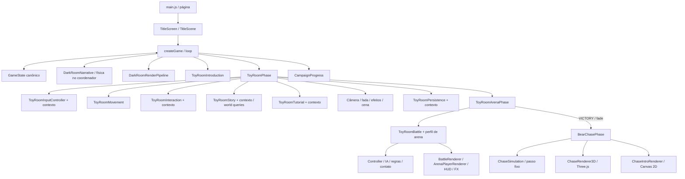

# Arquitetura e contratos do aplicativo

Revisão: 22/10/2026. Descreve o código atual, incluindo a tela inicial, a fuga de campanha e as correções de pouso e de envio do piso; planos históricos não representam componentes implementados. O [manual](MANUAL-DESENVOLVIMENTO.md) explica manutenção e integração; a [referência de métodos](REFERENCIA-METODOS.md) complementa este catálogo com assinaturas. O [catálogo de comandos](COMANDOS.md) cobre automações e QA. Resultados de execução pertencem ao [diário de IA](diario-ia/README.md).

## Composição e limites

`src/js/bear-chase/` atende dois caminhos separados: `startChasePreview()` pelo
seletor de debug e `startChaseCampaign()` após a vitória do urso na arena. A campanha
escurece a arena, prepara as artes ilustradas e revela `BEAR_DOWN`. O renderer 3D
é preparado durante a introdução obrigatória; sua prontidão visual condiciona a arrancada. Seu snapshot `toyRoomChaseCampaign` integra a persistência
da Toy Room; o estado do acesso isolado de debug permanece fora do save. Saves antigos continuam
válidos. `BearChasePhase` recebe canvas, serviço de áudio, disponibilidade e
dificuldade, sem receber a sala inteira. `ChasePatterns` distribui os grupos por progresso e dificuldade, preservando um corredor nos grupos densos. `ChaseSimulation` mantém dados serializáveis
e passo fixo; `ChaseInput`, `ChaseAudio`, `ChaseHUD` e `ChaseRenderer3D` isolam os
adaptadores. Three.js é importado tardiamente de `src/vendor/three/`. Veja
[contratos e ciclo de vida](bear-chase/GUIA-PREVIA.md) e o
[manual da transição](bear-chase/MANUAL-TRANSICAO-VITORIA-ARENA-FUGA.md).

`GameState` é a fonte dos campos de gameplay do quarto. `game.js` não mantém cópias locais da narrativa/progressão/câmera nem usa Proxy narrativo. A barreira `syncViewportToState`/`syncViewportFromState` permanece para a orientação; sua ordem afeta a apresentação móvel. `RuntimeContext` agrega referências existentes e não funciona como registro global de serviços.

A arquitetura usa funções, instâncias e adaptadores por domínio. Não há `GamePhaseDirector`, HFSM genérica ou `DarkRoomPhysicsSystem` implantados. Física dos saltos/pousos e seleção do fluxo ainda residem em `game.js`. `ToyRoomBattle` e `ToyRoomArenaPhase` ainda recebem a sala completa; `BattleRenderer` também usa integração ampla com a batalha. Não confundir as extrações concluídas com desacoplamento global.

O loop normaliza o tempo para 60 Hz e limita dt a 0,5–1,2. Pausa impede update e mantém render. A arena limita a entrada própria de dt e a simulação de combate usa subpassos; isso não transforma o loop global em passo fixo. Desenho não deve alterar gameplay, mas há efeitos existentes: callbacks publicam orientação e a história registra o viewport apresentado. Preserve essas fronteiras.

## Proprietários e contratos dos dados

| Entidade / estado | Proprietário e campos | Leitura, escrita e persistência |
| --- | --- | --- |
| `baby` do quarto | `createBabyState`/`GameState`: x/y/w/h, vx/vy, gravidade, impulsos, onGround, animação, apoio atual e flags de controle/narrativa. | Física em game.js e comandos de GameState escrevem; renderizadores leem. `CampaignProgress.restoreState` preserva a referência do objeto. |
| `fairy` do quarto | `createFairyState`/GameState: posição, alvo, voo, partículas e pose narrativa. | Guia e narrativa atualizam; FairyRenderer apresenta. Não é a fada da Toy Room. |
| Campanha | `StateVariables`: dificuldade, modo bedroom/toy-room, escape/phase3, prontidão, abertura, câmera e temporizadores. | `captureState` parte dos defaults e exclui runtime, orientação e entradas transitórias. Detalhes abaixo. |
| Jogador da Toy Room | `ToyRoomInitialEntities`: posição/velocidade, speed 3,8, radius 20, direction, facing, facingAngle, animTime, isMoving, carriedItem, stepTimer. | Movimento/ações/combate escrevem; apresentação lê. `restore` pode substituir o objeto; adaptadores consultam a referência atual. |
| Fada da Toy Room | x/y, targetX/targetY, flutterTime, wingAngle e particles. | Tutorial/história fornecem guia; Companion atualiza o voo. A câmera segue o alvo narrativo único. |
| Móveis | Sete objetos com id/type/x/y/w/h; o baú inclui lidOpen/glowAlpha/isTarget. | Colisão usa os retângulos na ordem do catálogo; cenário usa a arte; arena deriva suas estruturas desses móveis. |
| Brinquedos | Oito IDs: teddy, train, robot, bunny, duck, blocks, drum, jack. Cada um tem nome, tipo, posição, dimensões, weight, isCarried/isOrganized e bounceOffset. | ToyActions mantém identidade e flags; história pode acrescentar returnGeneration. `carriedItem` aponta ao mesmo objeto da lista e é religado por ID no restore. |
| Entrada da sala | keysDown, touchState, gamepadState, ponteiros/botões de arena e actionBtnPressed. | InputController usa o contexto da fase; HUD e combate leem a mesma fonte. Blur/pausa/restore/saída limpam entradas; Maps e listeners não vão ao save. |
| História da sala | recurrenceActive, returnedToyCount, pendingReturns, returnDialogueElapsed, investigationStage/Elapsed, sword, swordPickupElapsed, swordEquipped e attackElapsed/Direction; arenaCompleted pode ser acrescentado no retorno. | `ToyRoomStory` decide transições/tempos; renderer só apresenta os dados. Estado salvo em toyRoomStory. |
| Tutorial da sala | active, step, origin, target, cooldown e device na instância; conclusão em toyRoomTutorialCompleted. | Contexto expõe oito campos, com setters só para conclusão e gameplayState. Progresso transitório da instrução não é serializado; restore retoma a orientação quando aplicável. |
| Batalha | `ToyRoomBattle.state`: mode, index, elapsed, player HP, enemy, history, transition, ending, cooldown/immunity, salto/agachamento/defesa, espada, hitstop, impacto/recuo e memórias. | Controller/IA/regras/contato atualizam; snapshot copia o estado serializável. Ativação começa a menina com 3 HP. |
| Inimigo ativo | actor, hp/maxHp, x/facing, state/elapsed, attack/index, landed, enrage/enrageShown e campos de resposta/evasão/memória recente. | Apenas um inimigo ativo; ordem train → robot → dinosaur → bear. Perfis de arena e legado têm HP/medidas diferentes. |
| Arena | status/elapsed/completed, destino de retorno (sala ou fuga), resultado e snapshot da exploração; câmera, FX, áudio e chefe têm snapshots próprios. | `ToyRoomArenaPhase` restaura a exploração com preserveArena para evitar recursão, reconfigura legado/arena, limpa controles e só direciona vitórias à fuga. |
| Fuga da campanha | `toyRoomChaseCampaign` guarda estado versionado e posição musical; ausente em saves anteriores e no acesso isolado de debug. | `ToyRoomPersistence` valida a consistência com `arenaCompleted` e retoma a etapa salva sob fade antes de avançar o estado. |
| Recursos | Imagens, regiões, manifestos e status nos carregadores; poses/âncoras em módulos de dados. | Não são serializados. Escala/âncora visual não redefine hitbox, apoio ou física. |

A Toy Room mede 1600 × 1200. Suas ações têm debounce de 250 ms, coleta abaixo de 88 unidades, armazenamento abaixo de 160 e soltura a 42 à frente, com limites existentes. A escolha de interação ocorre antes do movimento do quadro. As entradas têm prioridade teclado → gamepad ativo → toque ativo. Não antecipar contagem ou trocar a ordem das chamadas aleatórias durante uma extração.

## Fluxos, câmeras e persistência

Quarto: abertura → primeiro salto → plataformas/castelo → fuga → porta falsa/reviravolta → demonstração do retorno → plataformas de retorno → portal. `currentPhaseMode` permanece bedroom até a transição para toy-room; os demais estágios usam flags próprias. O [guia do primeiro salto](TUTORIAL-PRIMEIRO-SALTO.md) descreve CUTSCENE/FIRST_JUMP_TUTORIAL/GAMEPLAY_NORMAL e a migração.

Sala: `TOY_ROOM_GAMEPLAY`/`TOY_ROOM_TUTORIAL` → recorrência/investigação da história (`COLLECTING`, `INVESTIGATION`, `SEEKING_SWORD`, `PICKUP`, `EQUIPPED`) → transformação/arena. A arena usa `IDLE`, `TRANSFORMING`, `COMBAT`, `RETURNING`, `COMPLETE`; a batalha usa BATTLE/VICTORY/DEFEAT. Esses estados pertencem a proprietários distintos, não a uma única enumeração intercambiável.

A câmera do quarto conserva a pressão lateral/derrota, com altura e escala fixas no gameplay; não modifica a personagem. CameraPresentation interpola somente cenas; AndroidFraming/limites dinâmicos de MobileZoom não atuam nos saltos. Na Toy Room, `story.cameraTarget()` segue a menina, exceto a revelação temporária da espada, quando segue a fada. A guia de brinquedos não desloca o enquadramento. Na arena, ArenaCamera enquadra os atores ampliados; o antigo design de câmera fixa não descreve esse perfil.

`legendGirl.campaign.v1` armazena `{version, state, opening, platforms, toyRoom}`. A captura do estado exclui toyRoomInstance, gameStarted, loopStarted, lastTime, lastJumpTime, lastDialogueAdvanceTime, standbyActivatedTime, failMessageTimer, isPortrait e lastUsedInputDevice. Relógios/DOM/áudio/input/controllers ficam fora do pacote. Estado da abertura e marca de conclusão têm ciclo próprio; `newCampaign` limpa a campanha e a conclusão conforme sua implementação.

A sala salva câmera, banners, player/fairy/furniture/toys, contagem, conclusão do tutorial, carriedItemId e snapshots de história, batalha e arena. `includeArena:false` evita capturar arena dentro da exploração de retorno; `preserveArena:true` evita reconstruí-la durante o retorno. Não substituir objetos carregados por cópias desconectadas da lista. Campos legados de facing e saves sem snapshot da arena têm tratamento específico; isso não constitui migração genérica para qualquer formato.

O autosave ocorre periodicamente e em pagehide/visibilitychange; não grava antes de iniciar, durante a introdução da sala ou em sessão de debug. Continuar/iniciar normalmente encerra o modo de debug. Preferências de áudio/dificuldade/UI não constituem um backend de campanha. `createCampaignProgress` usa alternativa em memória quando o storage falha, sem garantir sobrevivência ao fechamento.

## Catálogo completo dos módulos JavaScript

Cada arquivo de `src/js` tem uma linha abaixo. A coluna de contratos enumera declarações exportadas e reexports nomeados; métodos de classe, auxiliares, getters e fábricas são detalhados na [referência](REFERENCIA-METODOS.md). Objetos de entidade são dados, não classes novas.

| Módulo | Responsabilidade e fronteira | Contratos exportados |
| --- | --- | --- |
| [assets/AssetManager.js](../src/js/assets/AssetManager.js) | Manifesto principal, carregamento/cache de imagens e recortes; prontidão e erros por recurso. | `AssetManager`, `createAssetManager` |
| [assets/currentScenery.js](../src/js/assets/currentScenery.js) | Catálogo das ilustrações decorativas atuais e seu desenho, com calibração visual por objeto. | `CURRENT_SCENERY`, `drawCurrentScenery` |
| [assets/darkRoomAtlas.js](../src/js/assets/darkRoomAtlas.js) | Coordenadas do atlas consolidado, consulta e validação dos limites de recorte. | `SHEET_WIDTH`, `SHEET_HEIGHT`, `SPRITESHEET_PATH`, `darkRoomAtlas`, `validateAtlasRegion`, `getDarkRoomAtlasRegion` |
| [assets/index.js](../src/js/assets/index.js) | Ponto de reexportação dos contratos existentes; não cria estado nem um loop próprio. | `AssetManager`, `createAssetManager`, `darkRoomAtlas`, `validateAtlasRegion`, `getDarkRoomAtlasRegion`, `SHEET_WIDTH`, `SHEET_HEIGHT` |
| [assets/officialCharacter.js](../src/js/assets/officialCharacter.js) | Hash da fonte oficial e metadados das poses; dados derivados, sem lógica de movimento. | `OFFICIAL_SOURCE_SHA256`, `OFFICIAL_FRAMES` |
| [audio.js](../src/js/audio.js) | Sistema Web Audio e músicas HTMLAudio; ganho mestre, mudo, síntese e amostras gravadas da arena, com pausa e limpeza de efeitos. | `createAudioSystem` |
| [bear-chase/BearChasePhase.js](../src/js/bear-chase/BearChasePhase.js) | Compõe a fuga, adapta o tempo do loop, revela a abertura ilustrada enquanto prepara/verifica o 3D e controla pausa, entradas, snapshot e descarte. | `BearChasePhase` |
| [bear-chase/ChaseAudio.js](../src/js/bear-chase/ChaseAudio.js) | Controla trilha, passos, ganho, pausa e restauração da posição musical. | `ChaseAudio` |
| [bear-chase/ChaseBearAnimation.js](../src/js/bear-chase/ChaseBearAnimation.js) | Calcula poses e articulações do urso sem modificar o domínio. | `ChaseBearAnimation` |
| [bear-chase/ChaseBearModel.js](../src/js/bear-chase/ChaseBearModel.js) | Constrói o urso volumétrico com materiais e hierarquia próprios. | `ChaseBearModel` |
| [bear-chase/ChaseCamera.js](../src/js/bear-chase/ChaseCamera.js) | Calcula enquadramento, balanço e transição ao baú a partir do progresso. | `chaseCameraFrame` |
| [bear-chase/ChaseConfig.js](../src/js/bear-chase/ChaseConfig.js) | Parâmetros em unidades de mundo e segundos; auxiliares numéricos. | `CHASE_CONFIG`, `clamp`, `damp` |
| [bear-chase/ChaseGirlAnimation.js](../src/js/bear-chase/ChaseGirlAnimation.js) | Calcula passadas, apoio dos pés, espada, cabelo, saia e tropeço. | `ChaseGirlAnimation` |
| [bear-chase/ChaseGirlModel.js](../src/js/bear-chase/ChaseGirlModel.js) | Constrói malhas, materiais e articulações da menina. | `ChaseGirlModel` |
| [bear-chase/ChaseGirlPalette.js](../src/js/bear-chase/ChaseGirlPalette.js) | Paleta regional derivada das amostras rastreáveis da arte de arena. | `GIRL_PALETTE` |
| [bear-chase/ChaseHUD.js](../src/js/bear-chase/ChaseHUD.js) | Apresenta vidas e instruções sem decidir dano ou progressão. | `renderChaseHUD` |
| [bear-chase/ChaseHealth.js](../src/js/bear-chase/ChaseHealth.js) | Deriva vidas e derrota a partir de dificuldade e impactos. | `CHASE_FALL_DURATION`, `chaseMaxLives`, `chaseLives`, `isChaseDefeat` |
| [bear-chase/ChaseInput.js](../src/js/bear-chase/ChaseInput.js) | Converte teclado, ponteiro e gamepad em intenção lateral; libera listeners. | `ChaseInput` |
| [bear-chase/ChaseIntroRenderer.js](../src/js/bear-chase/ChaseIntroRenderer.js) | Apresenta a introdução ilustrada e o corte de largada em Canvas 2D. | `isChaseIntro`, `chaseIntroFade`, `ChaseIntroRenderer` |
| [bear-chase/ChaseLighting.js](../src/js/bear-chase/ChaseLighting.js) | Configura iluminação, sombras e seu acompanhamento no percurso. | `ChaseLighting` |
| [bear-chase/ChasePacing.js](../src/js/bear-chase/ChasePacing.js) | Deriva intensidade, velocidade, cadência, voo e margem de reação. | `smoothProgress`, `chaseIntensity`, `chasePacing` |
| [bear-chase/ChasePatterns.js](../src/js/bear-chase/ChasePatterns.js) | Distribui grupos e corredor livre por progresso e dificuldade. | `chasePattern` |
| [bear-chase/ChaseRenderer3D.js](../src/js/bear-chase/ChaseRenderer3D.js) | Compõe cena WebGL; valida o piso na GPU com alternativa linear, envia mapas, compila materiais, monta modelos e descarta recursos. | `ChaseRenderer3D` |
| [bear-chase/ChaseRoom.js](../src/js/bear-chase/ChaseRoom.js) | Constrói superfícies e decoração fixa ao longo do traçado. | `ChaseRoom` |
| [bear-chase/ChaseRoute.js](../src/js/bear-chase/ChaseRoute.js) | Referenciais do percurso contínuo e pontos de emboscada. | `ROUTE_NODES`, `routeFrame`, `routePoint`, `ROUTE_AMBUSHES` |
| [bear-chase/ChaseSimulation.js](../src/js/bear-chase/ChaseSimulation.js) | Cria, restaura e avança estado serializável, colisões, RNG e eventos. | `createChaseState`, `restoreChaseState`, `hitsObstacle`, `stepChase` |
| [bear-chase/ChaseToyModels.js](../src/js/bear-chase/ChaseToyModels.js) | Adaptador de compatibilidade para o trem do catálogo. | `ChaseToyModels` |
| [bear-chase/props/BlockCastleProp.js](../src/js/bear-chase/props/BlockCastleProp.js) | Constrói o castelo de blocos decorativo. | `BlockCastleProp` |
| [bear-chase/props/BlocksProp.js](../src/js/bear-chase/props/BlocksProp.js) | Constrói o grupo de blocos arremessável. | `BlocksProp` |
| [bear-chase/props/BookshelfProp.js](../src/js/bear-chase/props/BookshelfProp.js) | Constrói a estante decorativa. | `BookshelfProp` |
| [bear-chase/props/BunnyProp.js](../src/js/bear-chase/props/BunnyProp.js) | Constrói o coelho arremessável. | `BunnyProp` |
| [bear-chase/props/ChasePropCatalog.js](../src/js/bear-chase/props/ChasePropCatalog.js) | Catálogo, instâncias, limites e liberação dos objetos do percurso. | `ChasePropCatalog` |
| [bear-chase/props/ChasePropResources.js](../src/js/bear-chase/props/ChasePropResources.js) | Compartilha e controla materiais, texturas e geometrias dos objetos. | `ChasePropResources`, `PropParts` |
| [bear-chase/props/DecorativeGeometry.js](../src/js/bear-chase/props/DecorativeGeometry.js) | Primitivas de geometria para os objetos decorativos. | `oval`, `profile`, `rounded`, `curve`, `rod`, `outline` |
| [bear-chase/props/DecorativeProps.js](../src/js/bear-chase/props/DecorativeProps.js) | Fábricas dos objetos decorativos adicionais. | `decorativeFactories` |
| [bear-chase/props/OakCabinetProp.js](../src/js/bear-chase/props/OakCabinetProp.js) | Constrói o armário baixo ilustrado. | `OakCabinetProp` |
| [bear-chase/props/PictorialMaterialAssets.js](../src/js/bear-chase/props/PictorialMaterialAssets.js) | Mapeia atlas ilustrados usados nos materiais dos objetos. | `PICTORIAL_ATLASES` |
| [bear-chase/props/PilotPropResources.js](../src/js/bear-chase/props/PilotPropResources.js) | Reexporta recursos de objetos por compatibilidade com consumidores anteriores. | `PilotPropResources`, `PropParts` |
| [bear-chase/props/ToyChestProp.js](../src/js/bear-chase/props/ToyChestProp.js) | Constrói o baú articulado usado no encerramento. | `ToyChestProp` |
| [bear-chase/props/TrainProp.js](../src/js/bear-chase/props/TrainProp.js) | Constrói o trem volumétrico do catálogo. | `TrainProp` |
| [cinematics/OpeningSequence.js](../src/js/cinematics/OpeningSequence.js) | Abertura: relógio, cues, poses, falas, conclusão local e snapshot recuperável. | `OPENING_STORAGE_KEY`, `OPENING_DIALOGUE`, `OpeningSequence` |
| [cinematics/ToyRoomIntroduction.js](../src/js/cinematics/ToyRoomIntroduction.js) | Transição ilustrada para a sala: planos cinematográficos, poses próprias, estágios, eventos e callback de conclusão. | `TOY_ROOM_INTRO_STAGES`, `ToyRoomIntroduction` |
| [config.js](../src/js/config.js) | Geometria do quarto/apoios/portas, fábricas baby/fairy e parâmetros de progressão dos saltos. | `DEBUG_COLLISIONS`, `GAME_CONFIG`, `FLOOR_Y`, `createBabyState`, `CUTSCENE_DIALOGUE`, `getApproachJumpSpeed`, `getEscapeStats`, `getPhase3Stats`, `createFairyState`, `platforms`, `exitDoor`, `phase3Platforms`, `trueExitDoor`, `roomScenery` |
| [controllers/AndroidFraming.js](../src/js/controllers/AndroidFraming.js) | Reserva inferior e elevação visual Android, sem modificar a física. | `androidFrameOffset`, `createAndroidFraming` |
| [controllers/AudioController.js](../src/js/controllers/AudioController.js) | Integra áudio, preferências e foco/visibilidade à página; delegações e ciclo de vida. | `AudioController`, `createAudioController` |
| [controllers/CameraController.js](../src/js/controllers/CameraController.js) | Rolagem lateral e pressão de atraso; quadro vertical fixo no gameplay e zoom somente narrativo; nunca corrige o corpo. | `CameraController`, `createCameraController` |
| [controllers/CameraPresentation.js](../src/js/controllers/CameraPresentation.js) | Quadro fixo de gameplay e histórico/interpolação exclusivamente narrativa; não consulta saltos ou pousos. | `getDarkRoomScrollFrame`, `getPhase3ScrollFrame`, `CameraPresentation` |
| [controllers/EscapeFairyGuide.js](../src/js/controllers/EscapeFairyGuide.js) | Escolhe próximo apoio/porta e atualiza o movimento da fada na fuga por amortecimento crítico. | `getEscapeGuideTarget`, `updateEscapeFairyGuide` |
| [controllers/InputController.js](../src/js/controllers/InputController.js) | Ponteiro/teclado/gamepad do quarto; debounce, bloqueios, dispositivo e confirmação do primeiro salto. | `InputController`, `bindInput` |
| [controllers/MobileZoom.js](../src/js/controllers/MobileZoom.js) | Detecção móvel e composição fixa no gameplay; âncora/limites somente nas cenas. | `isMobileDevice`, `getMobileZoomFrame` |
| [controllers/ViewportController.js](../src/js/controllers/ViewportController.js) | Resize dos canvases e iluminação; callback de orientação, sem decidir zoom ou safe area. | `createViewportController` |
| [debug/AtlasDebugger.js](../src/js/debug/AtlasDebugger.js) | Inspeção técnica das regiões do atlas; validação e overlay optativo. | `AtlasDebugger`, `createAtlasDebugger` |
| [debug/CameraQaObserver.js](../src/js/debug/CameraQaObserver.js) | Observador opcional de câmera ativado por parâmetro e callback; sem nova câmera ou simulação. | `createCameraQaObserver` |
| [effects/ArtFinish.js](../src/js/effects/ArtFinish.js) | Acabamento de cor/atmosfera em coordenadas de tela. | `applyArtFinish` |
| [effects/ParticleSystem.js](../src/js/effects/ParticleSystem.js) | Buffers e evolução/desenho de poeira, brilho e rastros do quarto. | `ParticleSystem`, `createParticleSystem` |
| [effects/TransitionEffects.js](../src/js/effects/TransitionEffects.js) | Íris do portal e efeitos de transição com relógio fornecido pelo coordenador. | `TransitionEffects`, `transitionEffects` |
| [effects/index.js](../src/js/effects/index.js) | Ponto de reexportação dos contratos existentes; não cria estado nem um loop próprio. | `ParticleSystem`, `createParticleSystem`, `TransitionEffects`, `transitionEffects` |
| [entities/BabyRenderer.js](../src/js/entities/BabyRenderer.js) | Seleção/recorte das poses oficiais da menina no quarto; desenho ancorado aos pés. | `BabyRenderer`, `babyRenderer` |
| [entities/FairyRenderer.js](../src/js/entities/FairyRenderer.js) | Desenho da fada e efeitos visuais associados, sem decidir seu deslocamento. | `FairyRenderer`, `fairyRenderer` |
| [entities/index.js](../src/js/entities/index.js) | Ponto de reexportação dos contratos existentes; não cria estado nem um loop próprio. | `BabyRenderer`, `babyRenderer`, `FairyRenderer`, `fairyRenderer` |
| [environment/BackgroundRenderer.js](../src/js/environment/BackgroundRenderer.js) | Parede, piso, janelas, parallax e decoração; cobertura calculada pela matriz real. | `getBackgroundViewport`, `BackgroundRenderer`, `backgroundRenderer` |
| [environment/LightingSystem.js](../src/js/environment/LightingSystem.js) | Canvas auxiliar, recortes de luz, máscara, brilho e vinheta; acompanha a matriz da cena. | `LightingSystem`, `createLightingSystem` |
| [environment/PlatformRenderer.js](../src/js/environment/PlatformRenderer.js) | Arte de plataformas/portas, superfícies visuais e descarte; não resolve pousos. | `PLATFORM_SURFACES`, `PlatformRenderer`, `platformRenderer` |
| [environment/StorybookPlatforms.js](../src/js/environment/StorybookPlatforms.js) | Desenhos de objetos/materiais existentes; restrições de linhas de contato continuam em AGENTS.md. | `drawContactEdge`, `drawStorybookPlatform` |
| [environment/index.js](../src/js/environment/index.js) | Ponto de reexportação dos contratos existentes; não cria estado nem um loop próprio. | `BackgroundRenderer`, `backgroundRenderer`, `PlatformRenderer`, `platformRenderer`, `LightingSystem`, `createLightingSystem` |
| [environment/nightWindows.js](../src/js/environment/nightWindows.js) | Posições compartilhadas das janelas usadas pelo fundo e pela iluminação. | `NIGHT_WINDOWS` |
| [game.js](../src/js/game.js) | Fábrica createGame, loop, estado canônico, física do quarto, seleção dos modos, persistência e integração. | `createGame` |
| [input.js](../src/js/input.js) | Ponto de reexportação dos contratos existentes; não cria estado nem um loop próprio. | `InputController`, `bindInput` |
| [main.js](../src/js/main.js) | Bootstrap DOM; menu, dificuldade, continuar/recomeçar, pausa/áudio, layout e seletor de revisão desde as cenas de entrada. | Inicialização DOM ou reexportações; consultar o módulo. |
| [narrative/DarkRoomNarrative.js](../src/js/narrative/DarkRoomNarrative.js) | Atualizações das seis sequências narrativas do quarto com contexto explícito e GameState canônico. | `updateStandbyNarrative`, `updateTransicaoStandbyNarrative`, `updateCasteloNarrative`, `updateReviravoltaNarrative`, `updateTutorialRetornoNarrative`, `updatePortalNarrative` |
| [narrative/PoeticNarrator.js](../src/js/narrative/PoeticNarrator.js) | Textos narrativos e quadro superior em papel creme, moldura pastel e fonte manuscrita local, sem retrato. | `POETIC_LINES`, `getPauseNarration`, `renderPoeticNarration` |
| [rendering/DarkRoomRenderPipeline.js](../src/js/rendering/DarkRoomRenderPipeline.js) | Composição do quarto: apresentação/camadas/luz/HUD/diálogos; recebe valores e callbacks do quadro. | `renderDarkRoom` |
| [runtime/RuntimeContext.js](../src/js/runtime/RuntimeContext.js) | Agrega as instâncias state/audio/camera/assets/input/effects/campaign; não é contêiner global nem novo estado. | `createRuntimeContext` |
| [state/CampaignDefeats.js](../src/js/state/CampaignDefeats.js) | Conta uma derrota por tentativa e conserva a oferta do fácil a cada três perdas entre fases. | `recordCampaignDefeat`, `clearCampaignDefeat` |
| [state/CampaignProgress.js](../src/js/state/CampaignProgress.js) | Captura/restauração/validação da campanha v1 e storage com alternativa em memória. | `CAMPAIGN_STORAGE_KEY`, `captureState`, `restoreState`, `createCampaignProgress` |
| [state/GameDifficulty.js](../src/js/state/GameDifficulty.js) | Normalização NORMAL/EASY, margem de pouso e intensidade da guia dos brinquedos. | `normalizeDifficulty`, `EASY_LANDING_MARGIN`, `EASY_LANDING_DEPTH`, `easyLanding`, `toyGuideBlend` |
| [state/GameState.js](../src/js/state/GameState.js) | Defaults e comandos de progresso, prontidão, narrativa, derrota e reinício do quarto. | `GameState`, `createGameState` |
| [state/StateVariables.js](../src/js/state/StateVariables.js) | Fábrica dos dados iniciais da campanha e das entidades baby/fairy. | `createDefaultStateVariables` |
| [toy-room/ArenaAudioProfile.js](../src/js/toy-room/ArenaAudioProfile.js) | Intensidade/percussão da música contínua da espada, sons e retomada do áudio da sala. | `ArenaAudioProfile` |
| [toy-room/ArenaBoss.js](../src/js/toy-room/ArenaBoss.js) | Apresentação/estado persistível do Urso e ativação da fúria na arena. | `ArenaBoss` |
| [toy-room/ArenaSoundEffects.js](../src/js/toy-room/ArenaSoundEffects.js) | MP3s por evento/personagem, pré-carga, trechos, ganho por voz e interrupção no mixer mestre; não serializa recursos. | `ARENA_SOUND_FILES`, `ArenaSoundEffects` |
| [toy-room/ArenaSpecialAttack.js](../src/js/toy-room/ArenaSpecialAttack.js) | Especial único: carga, câmera, aura, raio, dano e consumo persistido na batalha. | `ARENA_SPECIAL`, `RAINBOW_COLORS`, `beginArenaSpecial`, `updateArenaSpecial`, `specialCameraFrame`, `renderSpecialSwordAura`, `renderArenaSpecialBeam`, `ARENA_SPECIAL_CLOSEUP_FILE`, `renderArenaSpecialCloseup` |
| [toy-room/ArenaCamera.js](../src/js/toy-room/ArenaCamera.js) | Câmera e tremor próprios do combate, enquadrando os atores ampliados. | `ArenaCamera` |
| [toy-room/ArenaCombatContact.js](../src/js/toy-room/ArenaCombatContact.js) | Calcula se cada golpe existente do inimigo toca a menina, considerando salto/agachamento. | `arenaEnemyContact` |
| [toy-room/ArenaCombatRules.js](../src/js/toy-room/ArenaCombatRules.js) | Janelas da espada e proteção dos inimigos compartilhadas por simulação e HUD. | `ARENA_SWORD`, `arenaEnemyImpactEnd`, `arenaEnemyGuarding` |
| [toy-room/ArenaDifficulty.js](../src/js/toy-room/ArenaDifficulty.js) | Seleciona alcance e agressividade por modo, preservando os perfis originais no NORMAL. | `arenaDifficulty` |
| [toy-room/ArenaEnemies.js](../src/js/toy-room/ArenaEnemies.js) | Perfis de HP, corpos, velocidades e pressão dos quatro inimigos; desenho de presença. | `ARENA_ENEMIES`, `renderArenaEnemyPresence` |
| [toy-room/ArenaEnemyAI.js](../src/js/toy-room/ArenaEnemyAI.js) | Memória curta de comportamento, evasão e seleção determinística do repertório existente. | `selectArenaEnemyAttack`, `updateArenaEnemyAI` |
| [toy-room/ArenaEnvironment.js](../src/js/toy-room/ArenaEnvironment.js) | Parede/piso, tapete e móveis ancorados por profundidade; frente do baú derivada dos materiais da sala. | `renderArenaEnvironment`, `renderArenaTemple` |
| [toy-room/ArenaGirlAnimationFrames.js](../src/js/toy-room/ArenaGirlAnimationFrames.js) | Metadados de poses, âncoras e escala das pranchas da menina na arena. | `ARENA_GIRL_REFERENCE_HEIGHT`, `ARENA_GIRL_ANIMATION_FRAMES` |
| [toy-room/ArenaHUD.js](../src/js/toy-room/ArenaHUD.js) | Layout, nomes, corações, proteção, ameaça, abertura e estado do chefe. | `ARENA_ENEMY_NAMES`, `arenaHUDLayout`, `renderArenaHUD` |
| [toy-room/ArenaPlayerAnimation.js](../src/js/toy-room/ArenaPlayerAnimation.js) | Estado visual de corrida, agachamento, salto e espada; amostragem das poses e eventos do gesto. | `ARENA_ATTACK_VISUAL_DURATION`, `createPlayerAnimation`, `beginArenaPlayerAttack`, `updateArenaPlayerAnimation`, `sampleArenaPlayerAnimation` |
| [toy-room/ArenaPlayerController.js](../src/js/toy-room/ArenaPlayerController.js) | Especializa o controlador de combate com parâmetros e movimento da arena. | `ARENA_TUNING`, `ArenaPlayerController` |
| [toy-room/ArenaPlayerRenderer.js](../src/js/toy-room/ArenaPlayerRenderer.js) | Carrega/desenha poses da menina na arena, incluindo mistura, dano e ataque. | `ArenaPlayerRenderer` |
| [toy-room/ArenaScale.js](../src/js/toy-room/ArenaScale.js) | Escala relativa da fantasia e consulta dos limites visuais dos atores. | `ARENA_SCALE`, `ARENA_PLAYER_HEIGHT`, `arenaActorBounds` |
| [toy-room/BattleAssets.js](../src/js/toy-room/BattleAssets.js) | Carrega manifesto e imagens de combate por URLs relativas ao módulo; propaga falhas. | `loadBattleManifest`, `loadBattleImages` |
| [toy-room/BattleConfig.js](../src/js/toy-room/BattleConfig.js) | Ordem dos inimigos, constantes e parâmetros do combate legado; não carrega a implementação. | `BATTLE_ORDER`, `BATTLE_PLAYER_VISUAL_SCALE`, `BATTLE_TUNING`, `BATTLE_TRANSITION_DURATION` |
| [toy-room/BattleGirlFrames.js](../src/js/toy-room/BattleGirlFrames.js) | Hash e regiões das poses originais da menina com espada. | `BATTLE_GIRL_SOURCE_SHA256`, `BATTLE_GIRL_FRAMES` |
| [toy-room/BattlePlayerBounds.js](../src/js/toy-room/BattlePlayerBounds.js) | Limites derivados das poses e da luva do Rocket Punch; não são novos sprites. | `BATTLE_PLAYER_BOUNDS`, `BATTLE_ROCKET_GLOVE_BOUNDS` |
| [toy-room/BattlePresentation.js](../src/js/toy-room/BattlePresentation.js) | Projeções, geometria de contato compartilhada com apresentação e desenho de golpes específicos. | `BATTLE_PLAYER_HALF_WIDTH`, `rocketPunchProjection`, `rocketPunchTouchesPlayer`, `renderRocketPunch`, `BATTLE_LASER_HEIGHT`, `BATTLE_CROUCH_FRAME`, `BATTLE_JUMP_VISUAL_SCALE`, `renderBattleCrouch`, `battlePlayerJumpOffset`, `laserProjection`, `BATTLE_TRAIN_BODY`, `trainDrive`, `renderTrainWalk` |
| [toy-room/BattleRenderer.js](../src/js/toy-room/BattleRenderer.js) | Desenho do combate, quadros dos inimigos, HUD legado, transições e impactos; usa o perfil de apresentação ativo. | `battleAnimationFrame`, `renderBattle`, `renderBattleImpact` |
| [toy-room/DamageAudio.js](../src/js/toy-room/DamageAudio.js) | Perfis e síntese de impacto/reação por ator, encaminhados ao ganho mestre. | `DAMAGE_AUDIO_PROFILES`, `scheduleDamageSound` |
| [toy-room/DamageSpriteFrames.js](../src/js/toy-room/DamageSpriteFrames.js) | Metadados gerados dos seis quadros de dano de cada ator, com âncoras/dimensões. | `DAMAGE_SPRITE_FRAMES` |
| [toy-room/EnemyMovementAudio.js](../src/js/toy-room/EnemyMovementAudio.js) | Síntese por ator e cadência de deslocamento real; sem gravações externas. | `scheduleEnemyMovement` |
| [toy-room/ImpactFX.js](../src/js/toy-room/ImpactFX.js) | Partículas, arcos, faíscas de bloqueio, flash e tremor da arena; snapshot/restore próprios. | `ImpactFX` |
| [toy-room/PlayerController.js](../src/js/toy-room/PlayerController.js) | Movimento horizontal, salto/agachamento, defesa ao recuar, orientação para o inimigo, recuperação, recuo e animação física do combate. | `PlayerController` |
| [toy-room/RoomEnvironmentRenderer.js](../src/js/toy-room/RoomEnvironmentRenderer.js) | Ilustra arquitetura, piso, detalhes e móveis da exploração. | `RoomEnvironmentRenderer`, `roomEnvironmentRenderer` |
| [toy-room/SwordAudio.js](../src/js/toy-room/SwordAudio.js) | Síntese distinta para corte no ar, acerto e bloqueio da espada. | `scheduleSwordSound` |
| [toy-room/ToyCarryPresentation.js](../src/js/toy-room/ToyCarryPresentation.js) | Pose de transporte, perfis de escala/âncora por brinquedo e composição dos contatos das mãos. | `CARRY_PROFILES`, `renderToyCarry` |
| [toy-room/ToyRenderer.js](../src/js/toy-room/ToyRenderer.js) | Desenha os brinquedos atuais no chão e transportados, preservando seleção e materiais. | `ToyRenderer`, `toyRenderer` |
| [toy-room/ToyRoomArenaBuilder.js](../src/js/toy-room/ToyRoomArenaBuilder.js) | Deriva estruturas, bases visuais e origem do baú sem modificar a geometria dos móveis da exploração. | `ToyRoomArenaBuilder` |
| [toy-room/ToyRoomArenaPhase.js](../src/js/toy-room/ToyRoomArenaPhase.js) | Orquestra transformação, combate, destino de saída, fade de vitória e snapshot da arena; ainda retém a sala completa. | `ARENA_TRANSFORMATION_DURATION`, `ARENA_VICTORY_FADE_DURATION`, `ToyRoomArenaPhase` |
| [toy-room/ToyRoomBattle.js](../src/js/toy-room/ToyRoomBattle.js) | Simula a luta e transferência de corações; perfis alternam legado/arena; ainda retém a sala completa. | `transferHeart`, `ToyRoomBattle`, `BATTLE_ORDER`, `BATTLE_PLAYER_VISUAL_SCALE`, `BATTLE_TUNING`, `BATTLE_TRANSITION_DURATION`, `battleAnimationFrame` |
| [toy-room/ToyRoomCamera.js](../src/js/toy-room/ToyRoomCamera.js) | Calcula câmera e frame da exploração com alvo narrativo explícito; não escolhe o alvo. | `updateToyRoomCamera`, `getToyRoomCameraFrame` |
| [toy-room/ToyRoomCompanion.js](../src/js/toy-room/ToyRoomCompanion.js) | Atualiza tutorial, escolha de brinquedo-guia, voo e rastro da fada com atores do quadro. | `updateToyRoomCompanion` |
| [toy-room/ToyRoomEffects.js](../src/js/toy-room/ToyRoomEffects.js) | Emissão/evolução de brilhos, confetes, poeira e animação do baú; mantém ordem aleatória. | `spawnToyRoomSparkles`, `spawnToyRoomConfetti`, `initializeToyRoomSunMotes`, `updateToyRoomEffects` |
| [toy-room/ToyRoomEntities.js](../src/js/toy-room/ToyRoomEntities.js) | Desenha menina/fada da exploração com recursos oficiais e pose de transporte. | `ToyRoomEntities`, `toyRoomEntities` |
| [toy-room/ToyRoomEnvironmentAssets.js](../src/js/toy-room/ToyRoomEnvironmentAssets.js) | Resolve recortes e imagens ambientais existentes, sem acessar regras da exploração. | `createToyRoomEnvironmentAssets` |
| [toy-room/ToyRoomInitialEntities.js](../src/js/toy-room/ToyRoomInitialEntities.js) | Cria jogador, fada, móveis e oito brinquedos com objetos mutáveis próprios por sala. | `createToyRoomInitialEntities` |
| [toy-room/ToyRoomInputBindings.js](../src/js/toy-room/ToyRoomInputBindings.js) | Dados de mapeamento compartilhados por controle e mensagens: TOY_ROOM_INPUT. | `TOY_ROOM_INPUT` |
| [toy-room/ToyRoomInputContext.js](../src/js/toy-room/ToyRoomInputContext.js) | Adapta estado atual, canvas e callbacks da fase ao controlador de entrada. | `createToyRoomInputContext` |
| [toy-room/ToyRoomInputController.js](../src/js/toy-room/ToyRoomInputController.js) | Teclado/toque/gamepad, coordenadas, hit testing, captura/liberação de ponteiros e listeners. | `ToyRoomInputController` |
| [toy-room/ToyRoomInteraction.js](../src/js/toy-room/ToyRoomInteraction.js) | Decide ação/proximidade, debounce e feedback; mantém ordem de efeitos, narrativa e contagem. | `ToyRoomInteraction` |
| [toy-room/ToyRoomInteractionContext.js](../src/js/toy-room/ToyRoomInteractionContext.js) | Getters/setters/callbacks específicos da interação, sem cópias dos atores. | `createToyRoomInteractionContext` |
| [toy-room/ToyRoomMovement.js](../src/js/toy-room/ToyRoomMovement.js) | Vetor de exploração, peso, orientação, passos, integração e colisão com limites/móveis. | `updateToyRoomMovement`, `resolveToyRoomCollisions` |
| [toy-room/ToyRoomOrientation.js](../src/js/toy-room/ToyRoomOrientation.js) | Escolhe brinquedo elegível como guia visual, conservando o alvo quando adequado. | `nearestToyGuide` |
| [toy-room/ToyRoomPersistence.js](../src/js/toy-room/ToyRoomPersistence.js) | Serializa/restaura sala, religa item por ID e retoma os subsistemas na ordem existente. | `ToyRoomPersistence` |
| [toy-room/ToyRoomPersistenceContext.js](../src/js/toy-room/ToyRoomPersistenceContext.js) | Acesso explícito aos campos persistidos e callbacks de retomada, sempre atuais. | `createToyRoomPersistenceContext` |
| [toy-room/ToyRoomPhase.js](../src/js/toy-room/ToyRoomPhase.js) | Compõe serviços e entidades, coordena perseguição isolada e fuga de campanha, mantém ciclo de vida/transições e delegações públicas. | `ToyRoomPhase`, `createToyRoom` |
| [toy-room/ToyRoomSceneFrame.js](../src/js/toy-room/ToyRoomSceneFrame.js) | Monta os dados e callbacks atuais de um quadro de apresentação da sala. | `createToyRoomSceneFrame` |
| [toy-room/ToyRoomSceneRenderer.js](../src/js/toy-room/ToyRoomSceneRenderer.js) | Compõe cenário, entidades por Y, efeitos, HUD, tutorial e narrativa na ordem original. | `renderToyRoomScene` |
| [toy-room/ToyRoomStory.js](../src/js/toy-room/ToyRoomStory.js) | Recorrência, investigação, espada, comandos e relógios narrativos; recebe contexto restrito. | `createToyRoomStoryState`, `ToyRoomStory`, `drawToySword` |
| [toy-room/ToyRoomStoryContext.js](../src/js/toy-room/ToyRoomStoryContext.js) | Integra mundo, atores, exploração, fluxo, controles, áudio e apresentação à história. | `createToyRoomStoryContext` |
| [toy-room/ToyRoomStoryRenderer.js](../src/js/toy-room/ToyRoomStoryRenderer.js) | Recortes e desenho da espada/gesto/falas; recebe dados, sem decidir progressão. | `createStoryAttackFrames`, `drawToySword`, `renderStoryWorldObject`, `renderStoryAttackSprite`, `renderStoryHeldObject`, `renderStoryBeat` |
| [toy-room/ToyRoomToyActions.js](../src/js/toy-room/ToyRoomToyActions.js) | Transições de pegar/guardar/soltar/devolver brinquedos, preservando a identidade dos objetos. | `pickUpToy`, `storeToyInChest`, `releaseCarriedToy`, `returnToyToFloor` |
| [toy-room/ToyRoomTutorial.js](../src/js/toy-room/ToyRoomTutorial.js) | Etapas movement/pickup, alvo, mensagens e conclusão; recebe contrato restrito de oito campos. | `ToyRoomTutorial`, `TOY_ROOM_INPUT` |
| [toy-room/ToyRoomTutorialContext.js](../src/js/toy-room/ToyRoomTutorialContext.js) | Getters atuais de atores/brinquedos/câmera e setters somente de conclusão/modo. | `createToyRoomTutorialContext` |
| [toy-room/ToyRoomTutorialRenderer.js](../src/js/toy-room/ToyRoomTutorialRenderer.js) | Desenho da orientação com dados do quadro e layout seguro, sem receber sala/tutorial. | `renderToyRoomTutorial` |
| [toy-room/ToyRoomUI.js](../src/js/toy-room/ToyRoomUI.js) | HUD de exploração, joystick, ação, faixas e contagem; consome estado atual de apresentação. | `ToyRoomUI`, `toyRoomUI` |
| [toy-room/ToyRoomWorldQueries.js](../src/js/toy-room/ToyRoomWorldQueries.js) | Consultas de piso livre/alcançável e viewport com dependências explícitas e referências atuais. | `createToyRoomWorldQueries` |
| [toy-room/index.js](../src/js/toy-room/index.js) | Ponto de reexportação dos contratos existentes; não cria estado nem um loop próprio. | `ToyRenderer`, `toyRenderer`, `RoomEnvironmentRenderer`, `roomEnvironmentRenderer`, `ToyRoomEntities`, `toyRoomEntities`, `ToyRoomUI`, `toyRoomUI`, `ToyRoomPhase`, `createToyRoom` |
| [toyRoom.js](../src/js/toyRoom.js) | Ponto de reexportação dos contratos existentes; não cria estado nem um loop próprio. | Inicialização DOM ou reexportações; consultar o módulo. |
| [ui/DialogueRenderer.js](../src/js/ui/DialogueRenderer.js) | Caixa/retrato/nome/quebra de texto compartilhados pelas fases e adaptação de falas do quarto. | `DialogueRenderer`, `dialogueRenderer` |
| [ui/DialogueSafeArea.js](../src/js/ui/DialogueSafeArea.js) | Interseção viewport/canvas/insets e posição segura da caixa de diálogo. | `intersectCanvasSafeArea`, `getDialogueSafeArea`, `getDialogueBoxY` |
| [ui/FirstJumpTutorial.js](../src/js/ui/FirstJumpTutorial.js) | Mensagens por dispositivo e prompt animado/reduced-motion do primeiro salto; não conclui a regra física. | `FIRST_JUMP_MESSAGES`, `getFirstJumpTutorialDevice`, `getFirstJumpFeedback`, `renderFirstJumpTutorial` |
| [ui/HudRenderer.js](../src/js/ui/HudRenderer.js) | Faixas/progresso do percurso lateral em coordenadas de tela. | `HudRenderer`, `hudRenderer` |
| [ui/MobileDialogueRegion.js](../src/js/ui/MobileDialogueRegion.js) | Divisão móvel entre cena e texto; painel superior para narração e inferior para conversas existentes. | `getMobileDialogueRegions`, `renderMobileDialogueRegion` |
| [ui/MobileUILayout.js](../src/js/ui/MobileUILayout.js) | Layout seguro único para HUD/controles, hit testing e atualização por mudança de viewport. | `calculateMobileUILayout`, `getMobileUILayout`, `isActionControlHit`, `arenaMobileControlsLayout`, `hitArenaMobileControl`, `arenaDirectionVector`, `attachMobileUILayout` |
| [ui/TitleScene.js](../src/js/ui/TitleScene.js) | Compõe o quarto e a menina lendo com pernas articuladas; observa visibilidade, tamanho e movimento reduzido para controlar seu RAF; câmera comum mantém a poltrona no tapete. | `TITLE_SCENE_LAYOUT`, `titleSceneFrame`, `TitleScene` |
| [ui/TitleScreen.js](../src/js/ui/TitleScreen.js) | Coordena novo jogo, carregamento, modo fácil, opções e confirmação de reinício por callbacks do coordenador principal. | `TitleScreen` |
| [ui/index.js](../src/js/ui/index.js) | Ponto de reexportação dos contratos existentes; não cria estado nem um loop próprio. | `HudRenderer`, `hudRenderer`, `DialogueRenderer`, `dialogueRenderer`, `renderFirstJumpTutorial`, `getFirstJumpFeedback`, `getFirstJumpTutorialDevice`, `FIRST_JUMP_MESSAGES` |

## Integração, recursos e ciclo de vida

A tela inicial usa `TitleScreen` para as escolhas e `TitleScene` para a pintura
animada em um canvas próprio. `main.js` fornece as ações de nova campanha e
carregamento; o menu consulta a existência de progresso e confirma a substituição.
Modo fácil afeta a próxima aventura nova; carregar respeita a dificuldade salva.
As opções apresentam qualidade automática ainda desabilitada. A cena pausa seu
RAF quando o menu ou a aba ficam ocultos e respeita movimento reduzido.
As duas imagens ficam em `assets/art/title-screen/`, com origem e resolução
nativa em `prompts.json`; o canvas em 1920×1080 não transforma o fundo em uma
exportação nativa Full HD. `TITLE_SCENE_LAYOUT` fixa o quarto e a poltrona; `titleSceneFrame` reenquadra a composição inteira com foco na menina no retrato.

Falhas ao preparar a fuga da campanha descartam a fase parcial e devolvem os
controles à sala. O diálogo `chase-error-dialog` informa o erro e permite voltar
à sala; ele não depende do elemento legado `ui-feedback`, oculto na interface.

`main.js` usa a API retornada por createGame: start/newCampaign/hasProgress/saveProgress/getDifficulty; doJump e consultas; pausa; retry/reset/restart; áudio; startToyRoomPhase/startToyRoomIntroduction/startDebugPhase; referências de subsistemas e destroy. Os callbacks usados são onGameOver, onSaveStatus e onNarrativeEvent. Métodos internos update/render/loop são acessíveis apenas por instrumentação de QA, sem API distribuída de avanço manual.

Os contextos de entrada, interação, história, persistência e tutorial são adaptadores específicos. Getters leem referências atuais; objetos de quadro transportam dados para desenho. Não capturar player/toys/furniture permanentemente ao construir um adaptador, pois restore substitui os objetos da sala. A fábrica createToyRoom preserva update/render/triggerAction/destroy/instance.

A API destroy existente remove os recursos previstos em cada módulo, mas createGame ainda exige auditoria para uso de múltiplas instâncias: seu RAF/resize não têm encerramento global uniforme. A sala remove listeners pelo InputController; áudio libera vozes e respeita foco/mudo/ganho mestre. Documentar uma limitação não a transforma em correção implementada.

`assets/manifest.json` atende o carregador principal; batalha e menina da arena têm carregadores/manifestos dedicados. Os módulos de frames são dados derivados. Guias e metadados nas pastas de arte preservam origem/prompts. `metadata.json` da raiz pertence à integração com o host; uma capacidade ali declarada não implica que o jogo faça chamadas à Gemini ou tenha um servidor de IA. O servidor Express entrega arquivos e mantém a API local de classificação de sprites; não armazena campanha remota.

A [documentação de comandos](COMANDOS.md) cobre servidor, produção, geração, acervo e QA. A CI verifica assets/lint/build e publica arquivos estáticos ao receber push em main; não roda a suíte completa. Um merge local não publica o site. Resultados/testes permanecem exclusivamente no diário, e fontes de QA são recuperadas em diretório temporário.

## Página, estilos e revisão visual local

| Superfície | Contrato |
| --- | --- |
| `index.html`, `src/css/styles.css`, `src/css/title-screen.css` | Canvas `gameCanvas`, menu `start-overlay`, dificuldade, botão iniciar/continuar e dialog de confirmação de recomeço; overlay de derrota, retry/retorno; botões de pausa/áudio. |
| `main.js` | Conecta esses IDs à API do jogo; o ícone `btn-debug-phase-toggle` abre `debug-phase-panel`/`debug-phase-select`, fecha ao escolher/clicar fora/Escape e devolve o foco conforme a ação. |
| `MobileUILayout` | Mantém controles Canvas e hit testing alinhados com bitmap/CSS/insets; seletores/overlays da página isolam as entradas do jogo. O antigo ui-feedback permanece oculto visualmente. |
| `metadata.json` | Nome/descrição e capacidades declaradas pelo host; não cria uma API Gemini de gameplay. |

A ferramenta de revisão em `tools/sprite-review/index.html` é um aplicativo local de apoio, excluído do Pages. `review.css` define cartões, filtros, transparência e modal; `review.js` carrega catálogo/escolhas, filtra/pagina, mostra prévias, mantém rascunho em localStorage e exporta o JSON. Classificar não apaga imagens.

| Módulo de apoio | Contrato e efeitos |
| --- | --- |
| [catalog.js](../tools/sprite-review/catalog.js) | `itemId(file,region,signature)` e `buildCatalog(root)`: enumera arquivos, recortes e assinaturas e reúne hashes/referências. É indício estático, não prova de ausência de uso dinâmico. |
| [store.js](../tools/sprite-review/store.js) | `createReviewStore({catalogPath,selectionPath})` retorna catalog/read/save. Valida versão do catálogo/revisão/decisões, serializa gravações em fila e publica JSON por rename. `localReviewRequest` restringe gravação a loopback, Host local e Origin compatível. |
| [apply.js](../tools/sprite-review/apply.js) | `applySelections({root,catalog,selection,apply=false,includeReferenced=false})`: simula por padrão, valida alvos/hashes e só aplica com opção explícita, mantendo cópia recuperável em quarentena. Recortes/código são alvos específicos. |
| [review.js](../tools/sprite-review/review.js) | Inicialização, filtros, cartões, prévias, revisão otimista, autosave local e download da seleção. Não é importado pelo jogo. |

`server.js` instala GET `/api/sprite-review/catalog`, GET `/api/sprite-review/selections` e POST `/api/sprite-review/selections` com JSON de até 1 MB. Revisão conflitante responde 409, gravação não local 403 e payload inválido 400. PORT escolhe a porta; SPRITE_REVIEW_SELECTION_PATH permite usar seleção temporária no QA. Depois instala express.static na raiz e escuta em 0.0.0.0. A proteção de gravação da revisão não é uma autenticação geral do servidor.

Catálogo e seleção ficam em `docs/sprite-review/`; o JSON histórico de classificação não concede autorização para apagar novos assets. Scripts build-sprite-review/apply-sprite-review são seus pontos de CLI; [COMANDOS](COMANDOS.md) descreve aplicação e simulação. Essa API de desenvolvimento não existe no site estático publicado.

## Particularidades do quarto e da fuga

No retorno após a porta falsa, o pouso NORMAL usa o instante em que os pés cruzam o topo durante a descida, com interpolação horizontal no dt real. Exige ao menos 2 px de apoio numa largura fixa de pés de 30 px; entrada lateral abaixo do topo e subida não pousam. EASY conserva seu contrato anterior. A câmera apresentada acompanha o progresso horizontal, sem saltar junto com a menina; em celular, escala 0,8 e offset fixo. A câmera lógica continua participando das regras de derrota.

A fuga converte o dt legado para segundos e acumula passos de 1/60 s, limitando a contribuição por atualização a 0,2 s. A revelação de campanha dura 0,4 s e bloqueia simulação/entrada. A sequência é BEAR_DOWN → GIRL_APPROACH → BEAR_RISE → CHASE_START → RUNNING → CAUGHT → CHEST_RETURN → COMPLETE; perder todas as vidas leva a FALLING → GAME_OVER, sem captura. COMPLETE mantém a fase ativa: a navegação final ainda falta. GAME_OVER abre a nova tentativa pela interface da campanha.

O piso usa a arte existente em `environment-sheet.png`, recorte (27,151) de 186×48. `floorTexture` prepara 256×64 e envia RGBA por DataTexture com nove mipmaps explícitos, linhas invertidas e repetição 9×2. A causa do piso preto relatado no Safari não foi confirmada; a confirmação nesse navegador continua pendente. WebGL 2 permite texturas NPOT: a dimensão anterior, isoladamente, não demonstra defeito.

## Derrotas e oferta de ajuda

`defeatCount`, `defeatPending` e `easyOfferPending` pertencem ao estado da campanha e são salvos. `CampaignDefeats` conta uma vez por tentativa; o coordenador recebe derrota do quarto por GameState e da arena/fuga por `ToyRoomPhase.onDefeat`. Perder um coração ou ainda estar em FALLING não conta. A cada três derrotas no NORMAL, `easy-mode-dialog` pergunta “deseja tentar no fácil?”. Recusar mantém NORMAL; outra oferta só aparece após mais três perdas. No EASY não há oferta. Campanha nova zera a contagem; debug permanece isolado; recarga conserva contagem e resposta pendente sem contar novamente.

Aceitar aplica EASY ao estado, à sala, ao perfil da arena e à perseguição, salva e retoma: checkpoint da seção do quarto; mesmo adversário e dano já causado na arena; mesmo progresso/posição na fuga, com vidas recuperadas e dois segundos de imunidade. Nova tentativa comum da fuga reinicia sua abertura sem recriar renderer ou recursos GPU. `onGameOver({phase,offerEasy})` fornece os dados da tela, e a API expõe `continueOnEasy`/`declineEasyOffer`. A derrota da fuga diz “A menina não alcançou o urso. Tentar novamente?”. O diálogo bloqueia controles de gameplay e aceita teclado, toque/mouse e gamepad.

### Prontidão visual, defesa e áudio gravado

A abertura da fuga possui prontidão independente do 3D: `introReady` permite a cena ilustrada, e `ready` exige todas as imagens decodificadas, piso amostrado na GPU, texturas enviadas e materiais compilados. A espera ocorre no fim de GIRL_APPROACH, junto ao urso caído; o domínio não acumula tempo de corrida. `prepareFloor` valida a cadeia manual e, se ela falhar, tenta a mesma arte com filtro linear, sem mipmaps. Falhas definitivas usam o diálogo de recuperação da campanha. A causa original do piso preto no Safari continua sem comprovação.

Na arena, recuo livre usa animação de caminhada. Durante a preparação/janela ofensiva inimiga, recuar firma a base em guarda; a recuperação do golpe libera a caminhada. `PlayerController`, `ArenaPlayerAnimation` e a separação de corpos em `ToyRoomBattle` compartilham essa regra. Os efeitos gravados de `ArenaSoundEffects` são selecionados pelos eventos do perfil de áudio, passam pelo ganho mestre e são interrompidos no ciclo de vida; a síntese cobre efeitos sem arquivo/disponibilidade. O especial emite `player_special` uma vez no lançamento. Nada disso acrescenta recursos de áudio ao save.
