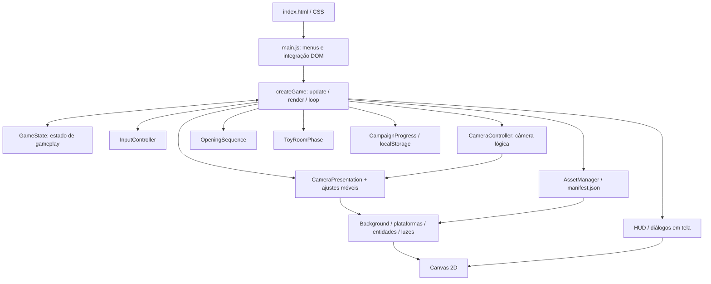

# Manual de desenvolvimento e integração de equipes

Projeto: **legendGirl — O Quarto dos Brinquedos**. Revisão documental: **15/10/2026**. Design inicial de batalha preservado com indicação das diferenças para a arena atual.

Este manual reúne as orientações do repositório e as confronta com a implementação disponível no workspace. Destina-se a desenvolvimento, QA, arte e manutenção da publicação. O código usa JavaScript com módulos ES, HTML, CSS e Canvas 2D; Node.js/Express serve os arquivos. Não há engine externa, compilação para `dist/`, backend de campanha ou contas de jogador.

Repositório de referência: [luciussama/legendGirl no GitHub](https://github.com/luciussama/legendGirl). A fonte desta documentação é o código local. Consulte [ARQUITETURA](ARQUITETURA.md) para todos os módulos/entidades e [COMANDOS](COMANDOS.md) para os aliases e ferramentas. O registro de integração e as evidências ficam no diário; merge local não equivale a publicação.

## Índice

1. [Primeiro dia e preparação](#primeiro-dia-e-preparação)
2. [Fontes e convenções](#fontes-e-convenções)
3. [Arquitetura e fluxo de execução](#arquitetura-e-fluxo-de-execução)
4. [Estado, física e persistência](#estado-física-e-persistência)
5. [Controllers](#controllers)
6. [Environment e pipeline visual](#environment-e-pipeline-visual)
7. [Entidades, efeitos e interface](#entidades-efeitos-e-interface)
8. [Assets e direção de arte](#assets-e-direção-de-arte)
9. [Sala de brinquedos](#sala-de-brinquedos)
10. [Receitas de manutenção](#receitas-de-manutenção)
11. [Testes e diagnóstico](#testes-e-diagnóstico)
12. [Publicação e integração de mudanças](#publicação-e-integração-de-mudanças)
13. [Roteiro de integração e glossário](#roteiro-de-integração-e-glossário)
14. [Referência detalhada de métodos](REFERENCIA-METODOS.md)
15. [Dicionário de bibliotecas e dependências](DEPENDENCIAS.md)
16. [Implementações atuais e fronteiras](#implementações-atuais-e-fronteiras)
17. [Modo de batalha da Toy Room — design oficial](#modo-de-batalha-da-toy-room--design-oficial)
18. [Inimigos da Toy Room — design oficial](#inimigos-da-toy-room--design-oficial)
19. [Urso, chefe final — design oficial](#urso-chefe-final--design-oficial)

## Primeiro dia e preparação

Use **Node.js 24** e npm, conforme [workflow de publicação](../.github/workflows/deploy-pages.yml). Chrome/DevTools atende a inspeção local; Android e iPhone reais são necessários para confirmar comportamento nativo. Git é necessário para versões, comparação de alterações e histórico de evidências.

```sh
git clone https://github.com/luciussama/legendGirl.git
cd legendGirl
npm ci
npm run dev
```

Abra `http://localhost:3000`. Não abra `index.html` por `file://`: módulos ES e manifesto dependem de HTTP. `npm start` executa o mesmo servidor. Para outra porta em shell compatível: `PORT=3001 npm run dev`.

`npm ci` instala o lockfile sem escolher versões novas. Mudanças de dependências devem versionar `package.json` e `package-lock.json` juntos.

Para estabelecer uma referência local antes da primeira alteração:

```sh
npm test
npm run check-assets
npm run lint
npm run build
```

Esses comandos não cobrem todas as ferramentas extras de QA. Confira os testes específicos na seção de validação. Registre falhas anteriores à sua alteração, sem modificar referências para fazê-las desaparecer.

Jogue a sequência abertura → castelo → fuga → porta falsa → plot twist → subida final → portal → sala de brinquedos. Nas fases de plataforma, o jogo conduz o deslocamento horizontal: toque/clique, Espaço ou seta para cima controlam salto/avanço de diálogo. O botão X do gamepad é o índice 2. Na sala, WASD/setas e joystick virtual controlam movimento; Espaço/E/Enter/F e o botão virtual acionam interação. Na Toy Room, o analógico esquerdo move e X (índice 2) interage; no primeiro salto da Dark Room, a nova pressão de A (índice 0) conclui o tutorial. P pausa; M alterna áudio.

## Fontes e convenções

| Fonte | Uso na integração |
| --- | --- |
| [README](../README.md) | Execução, controles, arquitetura geral, comandos e publicação. |
| [AGENTS.md](../AGENTS.md) | Idioma do projeto e restrições da direção visual. |
| [Verificação de plataformas — acervo de IA](diario-ia/README.md) | Contato, percurso, geometria e limites dos testes. |
| [Personagem oficial](../assets/art/dark-room/OFFICIAL-CHARACTER.md) | Origem imutável, recortes e regras de animação. |
| [Arte complementar](../assets/art/dark-room/modern/README.md) | Recursos ilustrados e calibração de apoios. |
| [Abertura](../assets/art/dark-room/opening/README.md) | Atlas narrativo, tempo e persistência da sequência. |
| [Arena atual](arena/GUIA-ARENA.md) / [design inicial](battle-mode/battle-mode-rules.md) | Implementação vigente e diferenças explícitas para o projeto original/combate legado. |

Comentários, documentação, interface e diagnósticos novos são escritos em português do Brasil. Preserve nomes de APIs, identificadores, comandos e caminhos. Não traduza dependências nem registros históricos externos.

A apresentação normal não deve desenhar réguas de pouso, linhas de hitbox ou realces técnicos sobre ilustrações. Hitboxes pertencem ao modo de depuração, desativado normalmente. A exceção documentada do relógio cuco (19) admite fixação sólida para os pés sem alterar a hitbox. Ajustes de arte não autorizam mudanças de física, layout ou dificuldade.

Relatórios, verificações, fixtures e registros de evidência pertencem ao diário de IA. QA é executado somente em diretório temporário. A documentação humana contém guias e o diário de produto, sem logs ou homologações de máquina.

## Arquitetura e fluxo de execução



| Área | Entrada / contrato | Responsabilidade |
| --- | --- | --- |
| Página | [main.js](../src/js/main.js) | Localiza elementos DOM, cria o jogo, conecta começar/continuar/recomeçar, pausa e som. |
| Coordenação | [game.js](../src/js/game.js), `createGame(canvas, uiFeedback, callbacks)` | Integra todos os subsistemas e escolhe o modo ativo. |
| Configuração | [config.js](../src/js/config.js) | Chão, layout, portas, entidades iniciais e atributos progressivos. |
| Estado | `state/` | Flags narrativas, transições, derrota e captura/restauração da campanha. |
| Controle | `controllers/` | Entrada, áudio, câmera e ajustes móveis. |
| Desenho | `environment/`, `entities/`, `effects/`, `ui/` | Materiais, sprites, luzes, transições e texto. |
| Exploração | `toy-room/` | Sala com câmera, entradas, móveis, colisões e coleta próprios. |
| Recursos | `assets/` em `src/js/` | Manifesto, imagens, caches, atlas e personagem oficial. |
| Diagnóstico | `debug/`, `scripts/` e acervo de IA | Overlay de atlas e executor de QA; fixtures/tests só são recuperados temporariamente. |

`index.js` de cada pasta reexporta implementações; não contém um loop adicional. `input.js` e `toyRoom.js` preservam pontos de importação existentes. Prefira os pontos de entrada já usados pela área e evite introduzir dependências circulares.

### Ciclo do jogo e API pública

`createGame` cria estado, assets, áudio, câmera, partículas, abertura e entrada. `assetsReady` é a promessa de carregamento do manifesto/pré-carregamento. O primeiro desenho acontece antes do início da campanha. `start()` tenta restaurar progresso, inicia a abertura ou o modo salvo e agenda `requestAnimationFrame(loop)`.

`loop(currentTime)` calcula tempo relativo a 60 Hz e limita `dt` a **0,5..1,2**. É passo variável limitado, não um acumulador fixo. Quando pausado, continua desenhando, sem avançar `update`. Na sala de brinquedos, delega `update(dt)` e `render()` à instância própria. No quarto, chama `update(dt)`, publicação da orientação do viewport e `render()`.

| API retornada por `createGame` | Uso e efeito |
| --- | --- |
| `start`, `newCampaign`, `hasProgress`, `saveProgress` | Início/restauração, limpeza da campanha, consulta e gravação. `newCampaign` é destrutivo para o progresso local; a UI já pede confirmação ao jogador. |
| `doJump(inputSource)`, `isGrounded`, `isCutsceneActive`, `setLastInputDevice` | Entrada contextual: salto ou interação narrativa respeitando bloqueios. |
| `togglePause`, `setPaused`, `isPaused` | Pausa da atualização; desenho permanece disponível. |
| `retry`, `resetToStart`, `restartToTitle`, `isGameOver` | Recuperação/derrota e retorno ao menu. |
| `startToyRoomPhase`, `startToyRoomIntroduction`, `isToyRoomMode` | Transição, introdução e delegação à sala. |
| `startDebugPhase`, `getDifficulty` | Seletor de fases sem autosave de campanha e consulta de dificuldade normalizada. |
| `setMuted`, `toggleMute`, `isMuted`, `setMasterVolume`, `getMasterVolume`, `pauseMusic`, `resumeMusic` | Controle de áudio usado pela página. |
| `state`, `toyRoomIntroduction`, `camera`, `lighting`, `particles`, `transitions`, `background`, `platforms`, `hud`, `dialogue`, `assets`, `assetsReady`, `darkRoomAtlas`, `atlasDebugger`, `input`, `audio` | Referências expostas para integração/inspeção; não significam autorização para escrever arbitrariamente no estado. |
| `destroy` | Salva e remove listeners específicos de campanha/entrada/áudio. Não assuma que encerra todo RAF ou todo listener de resize: audite o ciclo de vida ao criar múltiplas instâncias. |

Os métodos internos `update`, `render`, `loop`, `syncViewportFromState` e `syncViewportToState` não são APIs públicas normais. Fixtures recuperadas do diário em `tests/` temporários expõem controles adicionais por instrumentação de código; não leve esses controles ao jogo distribuído.

## Estado, física e persistência

[StateVariables](../src/js/state/StateVariables.js) define `baby`, `fairy`, modo, câmera, prontidão, narrativa, relógios e buffers. [GameState](../src/js/state/GameState.js) implementa transições. `game.js` ainda contém movimento, impulso, pousos e coordenação narrativa; as seis sequências do quarto estão em `DarkRoomNarrative.js`. Não existe uma classe independente que concentre toda a física.

Os campos de gameplay de `game.js` são lidos e escritos diretamente em `GameState`: câmera lógica, narrativa, progressão, fase ativa, indicadores de início/fim e temporizadores de entrada. Não há `Proxy` narrativo nem cópias locais desses campos. A orientação `isPortrait` conserva a publicação/restauração nos pontos originais por `syncViewportToState` e `syncViewportFromState`; trata-se de uma fronteira de apresentação cuja ordem influencia o enquadramento móvel. Pausa, relógio do autosave e objetos de apresentação conservam o ciclo de vida existente. A revisão de um campo novo deve identificar seu proprietário, leitores, escritores e persistência; não acrescentar outro espelho de gameplay.

### Métodos de estado por fluxo

| Métodos de `GameState` | Contrato |
| --- | --- |
| `setLastInputDevice`, `getActivePromptDevice` | Seleção das mensagens de entrada. |
| `startStandbyPreparation`, `confirmStandby` | Prontidão e confirmação para começar a ação. |
| `resetBabyPhysicsBody` | Reconfigura o corpo e flags transitórias; altera gameplay. |
| `triggerGameOver`, `showFailMessage`, `retryGame`, `restartToTitle`, `resetToStart` | Derrota, avisos e recuperação; recebimento de áudio quando aplicável. |
| `startCastleCutscene`, `advanceCutscene`, `finishCutscene` | Castelo e desbloqueio do percurso de fuga. |
| `startPlotTwistCutscene`, `advancePlotTwist`, `finishPlotTwistAndStartTutorial` | Porta falsa, reviravolta e entrada na terceira parte. |
| `startTruePortalTransition` | Preparação da passagem para a sala. |
| `spawnFairySparkles`, `spawnFairyFlightDust`, `updateFairyParticles` | Buffers visuais da guia; não confundí-los com seu controlador de movimento. |

`config.js` exporta `createBabyState`, `createFairyState`, `getEscapeStats(level)`, `getPhase3Stats(level, fromFloor = false)` e `getApproachJumpSpeed(platformIndex)`. `platforms` contém 22 apoios e `phase3Platforms` contém 16. `standRegion` e `surfaceTopY` podem definir a região real de chegada; a extensão da ilustração não equivale automaticamente à colisão.

### Save

[CampaignProgress](../src/js/state/CampaignProgress.js) usa `legendGirl.campaign.v1` em `localStorage`. `captureState` seleciona chaves dos defaults excluindo referências de runtime, relógios da página, instâncias e entrada transitória. `restoreState` preserva referências de arrays/objetos quando aplicável. `createCampaignProgress(storage)` retorna `read`, `write`, `clear`, valida versão/forma e mantém alternativa em memória quando o armazenamento falha.

O pacote salvo também contém `OpeningSequence.snapshot()`, estado de ativação das plataformas e `ToyRoomPhase.snapshot()` quando relevante. `ToyRoomPhase.restore` religa o objeto carregado por ID; não basta desserializar uma cópia desconectada do brinquedo.

Ao adicionar campo persistente: defina default serializável, revise captura/restauração/validação, teste saves anteriores incompletos, continuidade de narrativa e alternativa sem storage. A versão não tem migração genérica pronta. DOM, nós de áudio, timers e controllers não devem ser serializados como estado da campanha.

## Tutorial do primeiro salto

O fluxo é `CUTSCENE → FIRST_JUMP_TUTORIAL → GAMEPLAY_NORMAL`. A espera suspende a atualização, mantendo renderização e entrada ativas. Um salto aceito conclui o tutorial uma vez por save, usando `firstJumpTutorialCompleted`. Consulte o [guia técnico completo](TUTORIAL-PRIMEIRO-SALTO.md) para métodos, campos, eventos, migração, coordenadas, testes e evolução. Este sistema é independente do tutorial após o plot twist.

## Controllers

| Controller / funções | Métodos centrais | Contrato e cuidados |
| --- | --- | --- |
| [InputController](../src/js/controllers/InputController.js) | `init`, `triggerJump`, `handlePointerDown`, `handleKeyDown`, `pollGamepad`, `gamepadLoop`, `startGamepadPollingLoop`, `handleGamepadDisconnected`, `destroy`; fábrica `bindInput` | Debounce padrão 140 ms, ponteiro primário, borda de subida de A no primeiro tutorial e X no gameplay normal, bloqueios de UI/solo/narrativa. A fábrica retorna `controller`, `pollGamepad`, `destroy`. |
| [AudioController](../src/js/controllers/AudioController.js) | `init`, handlers de foco/visibilidade, `onBackground`, `onForeground`, volume/mudo, delegações `play*`/`start*`/`stop*`, `destroy` | Integra `createAudioSystem` e respeita silenciamento do usuário. Inicialização de áudio depende das políticas do navegador e interação. |
| [CameraController](../src/js/controllers/CameraController.js) | `reset`, `setZoom`, `setPosition`, `update`, `syncFromState`, `syncToState`, `applyTransform` | Câmera lógica: rolagem, limites, derrota por atraso e clamp que escreve em `baby.y`/`baby.vy`. Não é somente estética. `setPosition(..., false)` ajusta o alvo vertical, não um follow horizontal genérico. |
| [CameraPresentation](../src/js/controllers/CameraPresentation.js) | `reset`, `snapshot`, `restore`, `frame`, `mobileFrame` | Histórico visual independente; estabilização após pouso, limites de deslocamento e interpolação de transições. Não escreve na simulação. |
| [AndroidFraming](../src/js/controllers/AndroidFraming.js) | `androidFrameOffset`, `createAndroidFraming().offset` | Reserva inferior e insets; limita elevação para preservar o topo. Saída é um deslocamento de apresentação. |
| [MobileZoom](../src/js/controllers/MobileZoom.js) | `isMobileDevice`, `getMobileZoomFrame` | Retorna `{zoom,x,y}`. Modo normal aproxima até 1,18; modo estável da reviravolta/subida usa 0,8. Portanto “zoom móvel até 18%” não descreve sozinho todos os trechos atuais. |
| [EscapeFairyGuide](../src/js/controllers/EscapeFairyGuide.js) | `getEscapeGuideTarget`, `updateEscapeFairyGuide` | Próximo apoio/porta e amortecimento crítico na fuga entre castelo e plot twist. **Atualiza movimento da fada**; mudanças aqui não são simples renderização. |

### Referenciais de câmera

Mantenha separados mundo, desenho relativo à câmera, bitmap do canvas e pixels CSS. `cameraX`/`cameraY` lógicos não descrevem sozinhos a imagem final: há pose visual, zoom, foco e offsets adicionais. Renderizadores de objetos normalmente recebem `camX` e desenham `worldX - camX`; o contexto já contém a transformação restante. Não subtraia a câmera outra vez dentro de uma camada já preparada.

`CameraController.applyTransform` aceita `presentationY`, `presentationX` e `sourceX` para conciliar o desenho relativo à câmera original com a pose visual. `getTransform()` é a referência da composição real. A iluminação deve copiar essa matriz; o HUD deve ser desenhado após restaurar a transformação da cena.

Um viewport CSS 390 × 844 não implica bitmap 390 × 844. `handleResize` delega a `createViewportController().resize()`, que usa largura interna 540 em retrato, altura 540 em paisagem e ajusta o outro eixo por proporção. Converta métricas de jitter para pixels visuais antes de comparar resultados.

## Environment e pipeline visual

| Módulo | Métodos / dados | Responsabilidade |
| --- | --- | --- |
| [BackgroundRenderer](../src/js/environment/BackgroundRenderer.js) | `setAssets`, `drawAtlasSceneryItem`, `renderWall`, `renderScenery`, `render`; helper `getBackgroundViewport` | Parede, parallax, janelas, desenhos, guirlandas, piso e objetos decorativos. O helper inverte a matriz para calcular a cobertura visível real. |
| [PlatformRenderer](../src/js/environment/PlatformRenderer.js) | `setAssets`, `drawAtlasPlatformSprite`, `renderPlatforms`, `renderExitDoor`, `renderTrueExitDoor`, `renderTutorialArrow`; `PLATFORM_SURFACES` | Desenho de apoios/portas e calibração dos recortes. `cameraVisibility` permite descarte considerando a matriz real. Física não deve ser recalibrada para compensar um sprite. |
| [StorybookPlatforms](../src/js/environment/StorybookPlatforms.js) | `drawStorybookPlatform`, `drawContactEdge` e helpers internos | Desenhos de materiais/objetos; apoios integrados ao objeto. `drawContactEdge` não autoriza linhas auxiliares sobre arte fora das regras de `AGENTS.md`. |
| [LightingSystem](../src/js/environment/LightingSystem.js) | `resize`, `apply`; fábrica `createLightingSystem` | Canvas auxiliar de escuridão, recortes de luz, feixes, brilho e vinheta. |
| [nightWindows](../src/js/environment/nightWindows.js) | `NIGHT_WINDOWS` | Posições compartilhadas das janelas entre background e luz. Evita divergência visual de fontes. |
| [environment/index.js](../src/js/environment/index.js) | Reexportações | Entrada dos renderizadores e fábrica de iluminação. |

### Ordem de desenho no quarto

1. Limpa o canvas; abertura não revelada usa o caminho próprio de `OpeningSequence`.
2. Calcula pose visual, limites da cena, offset Android e enquadramento móvel.
3. Salva o contexto e aplica translação/escala móvel, offset vertical e transformação da câmera.
4. Desenha parede, decoração, plataformas, porta falsa/verdadeira e seta do tutorial.
5. Desenha rastros, poeira, fadinha e menina.
6. Aplica a atmosfera: máscara de escuridão, luzes e vinheta.
7. Obtém a matriz da cena, restaura o contexto e aplica `ArtFinish`.
8. Desenha HUD, tutorial do primeiro salto em coordenadas de tela, diálogos, fade da abertura e transição do portal; telas finais conforme estado.

`LightingSystem.apply` limpa/reconstrói a máscara com `source-over`, recorta com `destination-out` na matriz real, compõe `multiply` em tela, aplica brilhos com `screen` e vinheta em tela. Um `globalCompositeOperation` não restaurado pode contaminar frames futuros. Use pares equilibrados de `save`/`restore`.

### Diagnóstico de faixa clara ou camada deslocada

Não atribua o defeito à câmera apenas pela proximidade de uma alteração. Capture uma pose reproduzível, a matriz aplicada, dimensões CSS/internas e alpha de cada estágio. Desative uma camada por vez na fixture. Diferencie parallax intencional de erro de referencial.

Limitar o fundo a `0..canvas.width` sob zoom/offset pode expor transparência; a máscara composta sobre essa área mostra sua própria cor. A cobertura pertence a BackgroundRenderer. Testes/fixtures relacionados são recuperados do diário por seus nomes históricos; diagnósticos e evidências de execuções ficam no acervo.

## Entidades, efeitos e interface

| Módulo | Métodos principais | Uso |
| --- | --- | --- |
| [BabyRenderer](../src/js/entities/BabyRenderer.js) | `setAssets`, `resolveAnimationState`, `renderPose`, `render` | Escolhe poses oficiais e desenha a partir do centro/pés; escala visual não altera hitbox. |
| [FairyRenderer](../src/js/entities/FairyRenderer.js) | `render` | Desenha fadinha e partículas a partir do estado recebido; movimento pertence à atualização. |
| [ParticleSystem](../src/js/effects/ParticleSystem.js) | `clear`, `spawnBabyJumpDust`, `spawnBabyJumpPuff`, `spawnBabyLandingPuff`, `spawnPhase3Ribbons`, `spawnEscapeRibbons`, `update`, `updateBabyJumpDust`, `updateSpeedRibbons`, `renderSpeedRibbons`, `renderBabyJumpDust`, `render` | Buffers de partículas atualizados por `dt` e desenhados na cena. |
| [TransitionEffects](../src/js/effects/TransitionEffects.js) | `renderPortalWipe` | Envelope de luz do portal; pode receber `presentationTransform` para coordenadas móveis. |
| [ArtFinish](../src/js/effects/ArtFinish.js) | `applyArtFinish` | Dessaturação de 12% por composição `saturation`, em tela. |
| [OpeningSequence](../src/js/cinematics/OpeningSequence.js) | `hasCompleted`, `start`, `cancel`, `reset`, `snapshot`, `restore`, `update`, `renderFade`, `render` | Relógio e cues da abertura; callbacks `onReveal`, `onComplete`, `onCue`. A cena dura 37,5 s de jogo. |
| [HudRenderer](../src/js/ui/HudRenderer.js) | `renderEscapeBanner` | Mensagens/nível da fuga e subida. |
| [DialogueRenderer](../src/js/ui/DialogueRenderer.js) | `drawPortrait`, `wrapText`, `renderCutsceneDialogue` | Retratos, quebra de linhas, texto e prompts. |
| [DialogueSafeArea](../src/js/ui/DialogueSafeArea.js) | `intersectCanvasSafeArea`, `getDialogueSafeArea`, `getDialogueBoxY` | Interseção do canvas com viewport/insets; converte para bitmap. |
| [MobileDialogueRegion](../src/js/ui/MobileDialogueRegion.js) | `getMobileDialogueRegions`, `renderMobileDialogueRegion` | Área superior de cena e painel inferior de fala. |

A abertura tem estado e persistência próprios, além do pacote de campanha. Alterar cues exige testar pausa, recarga incompleta, retorno de foco e término da abertura. Áudio de foco não deve reativar som explicitamente silenciado pelo jogador.

## Assets e direção de arte

[AssetManager](../src/js/assets/AssetManager.js) lê [manifest.json](../assets/manifest.json), mantém `images`, `statuses`, `regionCache` e `manifestStatus`. As entradas de `images` são pré-carregadas; os recortes são solicitados sob demanda.

| Método | Entrada / saída e cuidado |
| --- | --- |
| `loadManifest(url)` | Promessa do manifesto; falha rejeita e define status `error`. |
| `preload()` | Promessa do mapa de imagens. Uma imagem ausente pode resolver `null` sem rejeitar toda a operação. |
| `loadImage(key, source)` | Carrega/cacheia imagem e aplica tratamentos somente às chaves específicas existentes. |
| `get`, `has`, `getStatus`, `isReady` | Consulta disponibilidade. `isReady()` sem chave verifica manifesto, não a integridade de todos os assets. |
| `getRegion(key, {x,y,width,height})` | Retorna canvas de recorte ou `null`; rejeita limites inválidos e usa cache. |
| `removeSolidBackground`, `normalizeCharacterPalette` | Processamento de imagens específicas; não aplique genericamente à personagem oficial. |
| `clearRegionCache` | Invalida recortes; revise quando mudar atlas durante a sessão. |

`darkRoomAtlas.js` define regiões e `officialCharacter.js` contém frames e SHA-256 da fonte oficial. Não suponha o formato pelo sufixo: a fonte `official-sprites.png` é JPEG conforme guia. `generate-dream-girl-sprites.js` recorta a fonte preservando os pixels autorizados. O carregamento ausente não deve introduzir personagem substituta.

`AtlasDebugger.setAssets`, `validateAllRegions`, `initDOM`, `toggle`, `render` ajudam a inspecionar recortes, dimensões e sobreposição. Utilize modo técnico para depuração; o overlay não deve ficar ligado na apresentação normal.

## Sala de brinquedos

[ToyRoomPhase](../src/js/toy-room/ToyRoomPhase.js) mantém dados de sala, câmera, jogador, fada, móveis, brinquedos, objeto carregado, contagem organizada, entradas e efeitos. Esses dados não são o mesmo objeto `baby` da fase lateral.

| Grupo de métodos | Responsabilidade |
| --- | --- |
| `setupListeners`, `handleKeyDown`, `handleKeyUp`, `onPointerDown`, `onPointerMove`, `onPointerUp` | Delega os controles ao `ToyRoomInputController`. `destroy` remove seus listeners pelo mesmo controlador. |
| `getCanvasCoordinates`, `isActionButtonHit` | Converte ponteiro e testa área da ação; não usar coordenadas CSS diretamente em física do mundo. |
| `triggerAction` | Delega decisões e feedback à interação, preservando distâncias e bloqueios. |
| `resolveCollisions` | Delega a resolução geométrica ao `ToyRoomMovement`, mantendo a interface usada pela narrativa. |
| `spawnSparkles`, `spawnConfetti` | Delega emissão de efeitos ao `ToyRoomEffects`. |
| `update`, `render` | Avança o modo e compõe a cena. |
| `snapshot`, `restore` | Delega captura e restauração à persistência, inclusive reconexão por ID. |

A fábrica `createToyRoom` retorna `update`, `render`, `triggerAction`, `destroy` e `instance`. `RoomEnvironmentRenderer` implementa `renderBackground`, `renderPerspectiveFloor`, janelas, portal, tapetes, trilhos e `renderFurniture`; `ToyRenderer.renderToy` desenha os itens; `ToyRoomEntities.renderPlayer/renderFairy` desenha os atores; `ToyRoomUI.renderUI` desenha a interface.

[ToyRoomInputController](../src/js/toy-room/ToyRoomInputController.js) processa teclado, gamepad e ponteiros, converte coordenadas CSS para Canvas, testa os controles móveis e instala/remove os listeners. O contrato [ToyRoomInputContext](../src/js/toy-room/ToyRoomInputContext.js) fornece somente estado de entrada, acessos atuais a Canvas/jogador e callbacks de bloqueio, dispositivo, áudio e ações. Os campos de entrada da fase continuam sendo a fonte dos dados usados pelo HUD e pelo combate, sem cópias no controlador. Os getters acompanham substituições feitas por `restore` e `clearInput`. A fase conserva os métodos públicos e os handlers vinculados; o controlador é criado no primeiro uso. Preservar a prioridade das entradas, as bordas de pressão dos botões, a captura dos ponteiros e a limpeza em blur, pausa, restauração e saída.

[ToyRoomMovement](../src/js/toy-room/ToyRoomMovement.js) calcula o movimento da exploração e resolve colisões com móveis e limites da sala. A fase passa jogador, entradas e partículas atuais em cada atualização; o módulo não retém referências entre quadros. `resolveCollisions` permanece público na fase e também atende as consultas narrativas de piso livre. Preservar a prioridade teclado → gamepad → toque, peso do brinquedo, orientação, cadência dos passos, ordem dos móveis e desempate das penetrações. A história recebe `updateAfterMovement` após a resolução; a posição do brinquedo carregado continua sendo atualizada em seguida pela fase.

A sala distribui as demais responsabilidades entre módulos específicos:

| Módulo | Contrato e cuidados |
| --- | --- |
| [ToyRoomInteraction](../src/js/toy-room/ToyRoomInteraction.js) / [contexto](../src/js/toy-room/ToyRoomInteractionContext.js) | Decide proximidade, coleta, soltura e armazenamento; mantém debounce, prioridade arena/combate, ordem dos efeitos, notificação à história e contagem. Getters acessam objetos atuais após restore. |
| [ToyRoomEffects](../src/js/toy-room/ToyRoomEffects.js) | Inicializa poeira e emite/atualiza brilhos, confetes, passos e animação do baú nas coleções recebidas. Preservar a ordem das chamadas aleatórias e sua posição no update. |
| [ToyRoomCompanion](../src/js/toy-room/ToyRoomCompanion.js) | Atualiza tutorial, seleção de brinquedo, voo e rastro da fada. Recebe os atores do quadro e devolve a guia escolhida. Não define o alvo da câmera. |
| [ToyRoomCamera](../src/js/toy-room/ToyRoomCamera.js) | Calcula câmera e enquadramento com alvo explícito selecionado pela história. A fase publica as coordenadas calculadas; fórmulas, limites e área segura permanecem compartilhados com a apresentação. |
| [ToyRoomSceneRenderer](../src/js/toy-room/ToyRoomSceneRenderer.js) / [dados do quadro](../src/js/toy-room/ToyRoomSceneFrame.js) | Compõe cenário, entidades ordenadas por Y, espada, fada, partículas, HUD e falas. Recebe somente as referências e callbacks do quadro. Preserva panorama de retorno e registro do viewport. |
| [ToyRoomInitialEntities](../src/js/toy-room/ToyRoomInitialEntities.js) | Cria jogador, fada, móveis e oito brinquedos com objetos próprios por sala. Conserva catálogo, pesos e geometria; não compartilha objetos mutáveis entre instâncias. |
| [ToyRoomPersistence](../src/js/toy-room/ToyRoomPersistence.js) / [contexto](../src/js/toy-room/ToyRoomPersistenceContext.js) | Captura e restaura o formato de save existente, religa o item carregado por ID, migra facing antigo e retoma história/combate/arena na mesma ordem. Preserva includeArena/preserveArena e limpeza de controles. |

`ToyRoomPhase` conserva a criação e o ciclo de vida dos subsistemas, a seleção do modo, as transições e as delegações públicas. A sequência é: proximidade, movimento/colisão, história após movimento, posição do item carregado, fada/tutorial, efeitos e câmera. Retornos antecipados da história ou dos modos de combate mantêm sua posição. A redução de responsabilidades da fase não implica que o combate legado e a arena já tenham contratos restritos para todos os acessos à sala.

[ToyRoomTutorial](../src/js/toy-room/ToyRoomTutorial.js) recebe [ToyRoomTutorialContext](../src/js/toy-room/ToyRoomTutorialContext.js), criado pela fase: jogador, fada, brinquedos, câmera, apresentação móvel e dois campos de progresso. Os getters consultam objetos atuais após restauração; os setters expõem somente conclusão e modo. O tutorial conserva seleção do brinquedo, cooldown, mensagens por dispositivo e conclusão ao carregar. [ToyRoomTutorialRenderer](../src/js/toy-room/ToyRoomTutorialRenderer.js) recebe somente os dados do quadro e desenha a orientação com o layout seguro compartilhado. [ToyRoomInputBindings](../src/js/toy-room/ToyRoomInputBindings.js) fornece os mapeamentos para entrada e mensagens; `TOY_ROOM_INPUT` continua reexportado pelo módulo do tutorial para os chamadores existentes. A regressão de contrato e restauração integra `npm test` e pode ser recuperada isoladamente por `npm run journal:qa -- test:refact:tutorial`.

[ToyRoomWorldQueries](../src/js/toy-room/ToyRoomWorldQueries.js) reúne as consultas de piso livre, piso alcançável e viewport usadas pela narrativa. Recebe funções de acesso a dimensões, jogador, colisões e câmera, sem receber a fase inteira. Esses acessos devem consultar os objetos atuais: `restore` pode substituir o jogador e outros dados da sala. A busca conserva a ordem dos vizinhos e candidatos, que influencia a escolha dos pontos de retorno dos brinquedos e da espada. O módulo consulta o mundo; a narrativa continua responsável por seus estados e decisões.

[ToyRoomToyActions](../src/js/toy-room/ToyRoomToyActions.js) concentra as transições de pegar, guardar no baú, soltar e devolver um brinquedo ao chão. As funções recebem os objetos atuais e preservam sua identidade; não armazenam referências entre chamadas. `ToyRoomPhase` e `ToyRoomStory` continuam escolhendo quando e onde executar cada ação. Alcance, resolução de colisões, contagem organizada, fila de retorno, tutorial, áudio e efeitos mantêm sua coordenação nos chamadores. Preservar a ordem da escolha aleatória no baú, dos efeitos, da notificação à narrativa e do incremento da contagem.

`ToyRoomStory` recebe um contrato explícito, construído na fase por [createToyRoomStoryContext](../src/js/toy-room/ToyRoomStoryContext.js). Seus acessos são `world` (consultas geométricas), `actors` (jogador, fada e dificuldade), `exploration` (brinquedos, móveis e ações narrativas), `flow` (tutorial e introdução), `controls` (limpeza), `audio` (coleta e trilha da espada) e `presentation` (assets e apresentação móvel). A narrativa não recebe nem guarda a fase completa. O adaptador concentra o acesso à sala, consulta referências atuais após restauração e mantém os efeitos nos mesmos pontos. Não capturar jogador, fada ou arrays ao construir o contrato; seus getters devem continuar consultando os objetos atuais. O snapshot narrativo contém somente o estado da história. [ToyRoomStoryRenderer](../src/js/toy-room/ToyRoomStoryRenderer.js) resolve os recortes e desenha a espada, o ataque e as falas a partir dos dados do quadro. Não recebe a história inteira nem altera o estado narrativo. `ToyRoomStory.narrativeBeat()` seleciona o conteúdo segundo os mesmos tempos; seus métodos `render*` delegam a apresentação. O export `drawToySword` no módulo anterior e a propriedade `attackFrames` foram preservados para os consumidores do combate.

Móveis e brinquedos iniciais estão no construtor da fase; não procure todo o layout da sala em `config.js`. Adicionar item exige revisar inicialização, interação, contagem de vitória e snapshot/restauração, além do desenho.

### Modo de batalha da Toy Room — design oficial

O design inicial está preservado em [battle-mode-rules](battle-mode/battle-mode-rules.md) e nas três especificações JSON dessa pasta. Ele não é a configuração carregada pelo runtime: descreve câmera fixa, 2 HP por inimigo comum e 4 para o Urso, além de decisões pendentes na época. Não converter esses `null` em defaults ou interpretar seu antigo escopo “design apenas” como proibição vigente de código já autorizado.

A [arena implementada](arena/GUIA-ARENA.md) usa `ToyRoomArenaPhase`, `ARENA_TUNING`, `ARENA_ENEMIES`, `ArenaCombatRules`, IA, contato, câmera e apresentação próprios. A menina começa com 3 HP; Trem/Robô/Dinossauro/Urso têm 3/4/4/8. `ToyRoomBattle` conserva um perfil legado com 2/2/2/4 e tuning próprio; não confundir os perfis. Roubo de 1 coração por acerto válido e descarte de cura excedente continuam compartilhados. Bloqueio não transfere vida.

### Inimigos da Toy Room — design oficial

Trem: `Steam Blast`/`Front Charge`; Robô: `Laser Beam`/`Rocket Punch`; Dinossauro: `Bite`/`Rush`. O [catálogo inicial](battle-mode/toy-enemy-design.md) conserva a origem do repertório. A implementação define alcance, preparação, recuperação, corpos sólidos, evasão, memória curta e escolha determinística em módulos de combate; esses parâmetros não estão pendentes no runtime. O Trem mantém sequência introdutória; os seguintes reagem à antecipação da espada e oferecem janelas de contra-ataque.

### Urso, chefe final — design oficial

O [design inicial](battle-mode/bear-final-boss-design.md) define o repertório exclusivo: `Bear Hug`, `Belly Charge`, `Toy Leap`. A arena atual tem 8 HP, introdução própria e fúria a partir de metade da vida, mantida após cura; o perfil legado conserva gatilho de último coração e máximo 4. `ArenaBoss`, `ToyRoomBattle` e `ArenaEnemyAI` definem a evolução atual. Nenhum desses documentos autoriza criar golpes novos ou alterar o balanceamento por uma revisão documental.

## Implementações atuais e fronteiras

A implementação usa composição de instâncias e funções por domínio. Os nomes de arquivo abaixo não implicam que todos sejam classes: ViewportController, CameraQaObserver e RuntimeContext são fábricas; DarkRoomNarrative e DarkRoomRenderPipeline exportam funções. As classes dos demais domínios continuam descritas nas tabelas deste manual; suas assinaturas estão na [referência completa](REFERENCIA-METODOS.md).

| Módulo / forma | Responsabilidade e dependências | Funções e contratos centrais |
| --- | --- | --- |
| [RuntimeContext](../src/js/runtime/RuntimeContext.js), fábrica | Agrega `state`, `audio`, `camera`, `assets`, `input`, `effects`, `campaign` com as mesmas referências existentes. Não gerencia lifecycle nem resolve dependências. | `createRuntimeContext({...})` devolve objeto simples. No jogo atual `input` é o adaptador `inputHandler` e `effects` é `particles`; não é um registro de todos os efeitos. Não é responsável pela migração de estado nem injeta contexto universalmente; os espelhos de gameplay já foram removidos do coordenador. |
| [ViewportController](../src/js/controllers/ViewportController.js), fábrica | Mede rect CSS (fallback `host.innerWidth/innerHeight`), calcula aspecto, redimensiona Canvas principal/auxiliar e iluminação. | `createViewportController({...})` devolve `resize()`. Chama `onOrientation(aspect < 1.15)` antes de redimensionar. O callback mantém `isPortrait` local em game.js; publicação posterior permanece necessária. Listeners continuam no coordenador. Não calcula safe area nem política de zoom mobile. |
| [CameraQaObserver](../src/js/debug/CameraQaObserver.js), fábrica | Instrumentação optativa; depende de `host.location`, callback `host.cameraQaRecord` e função `snapshot`. | `createCameraQaObserver({...}).record(transform = null)` chama snapshot/callback somente com parâmetro `cameraQa` presente e callback válido. Não armazena nova câmera. |
| [DarkRoomRenderPipeline](../src/js/rendering/DarkRoomRenderPipeline.js), função | Composição da cena: branches de introdução/abertura, apresentação, camadas, iluminação, HUD e diálogos. Recebe objetos, escalares e callbacks de desenho. | `renderDarkRoom(context)` aplica MobileZoom → offset Android → CameraController.applyTransform; preserva save/restore do Canvas e emissão QA. Não executa update de simulação. Alguns callbacks de desenho ainda publicam a orientação do viewport em GameState: o render completo não é puro. |
| [DarkRoomNarrative](../src/js/narrative/DarkRoomNarrative.js), funções | Seis sequências do quarto: atores, foco/zoom, partículas, diálogo, bloqueios e gatilhos; recebe contexto específico e dt. | `updateStandbyNarrative`, `updateTransicaoStandbyNarrative`, `updateCasteloNarrative`, `updateReviravoltaNarrative`, `updateTutorialRetornoNarrative`, `updatePortalNarrative`. Não possuem armazenamento próprio; game.update seleciona uma e retorna antes do update normal da câmera. |
| [ToyRoomIntroduction](../src/js/cinematics/ToyRoomIntroduction.js), classe | Sequência cinemática antes da sala ativa; usa sala temporária com `bindInputs:false`, imagem de saída e áudio. Não executa a simulação normal da sala. | `start(context)` prepara/inicia; `update(dt)` avança relógio e eventos; `stage`/`dialogue` consultam cena; `cameraFrame(canvas)`/`fairyPosition()` calculam composição; `render`/`drawDialogue` desenham; `cancel()` encerra. `onComplete` abre sala ativa. |
| [ToyCarryPresentation](../src/js/toy-room/ToyCarryPresentation.js), função/dados | Composição visual da pose de transporte e sobreposição de dedos/pernas; não muda a regra de carregar. Depende de assets, jogador e ToyRenderer. | `renderToyCarry(ctx, player, options)` usa `CARRY_PROFILES` por tipo para escala/âncora. Retorna false se faltar pose ou brinquedo, permitindo o caminho alternativo do renderizador. Não serializa perfis ou Canvas no save. |
| [ToyRoomTutorial](../src/js/toy-room/ToyRoomTutorial.js), classe | Orientação de movimento e primeira coleta; mantém alvo visual dinâmico e dispositivo de entrada. Não executa coleta ou movimento do jogador. | `start()` respeita conclusão persistida; `setDevice()` muda instrução; `nearest()` escolhe item elegível; `update(dt)` avança de movement para pickup após deslocamento >2 e conclui quando há carriedItem; `guidePosition()`/`message` orientam; `render()` projeta painel; `finish()` marca conclusão/TOY_ROOM_GAMEPLAY. |

### Catálogo das classes

As classes declaradas em `src/js` estão listadas abaixo. Entidades como baby/fairy/player e fábricas de contexto são dados/funções, não classes adicionais. Métodos internos não constituem APIs estáveis.

| Classe | Implementação | Responsabilidade |
| --- | --- | --- |
| `AssetManager` | [assets/AssetManager.js](../src/js/assets/AssetManager.js) | Manifesto principal, carregamento/cache de imagens e recortes; prontidão e erros por recurso. |
| `OpeningSequence` | [cinematics/OpeningSequence.js](../src/js/cinematics/OpeningSequence.js) | Abertura: relógio, cues, poses, falas, conclusão local e snapshot recuperável. |
| `ToyRoomIntroduction` | [cinematics/ToyRoomIntroduction.js](../src/js/cinematics/ToyRoomIntroduction.js) | Transição para a sala: panorama temporário sem inputs, estágios, eventos e callback de conclusão. |
| `AudioController` | [controllers/AudioController.js](../src/js/controllers/AudioController.js) | Integra áudio, preferências e foco/visibilidade à página; delegações e ciclo de vida. |
| `CameraController` | [controllers/CameraController.js](../src/js/controllers/CameraController.js) | Câmera lógica, rolagem, zoom narrativo e fronteiras usadas pelo gameplay; sincroniza com GameState. |
| `CameraPresentation` | [controllers/CameraPresentation.js](../src/js/controllers/CameraPresentation.js) | Histórico/interpolação da pose visual; estabiliza pousos sem escrever na simulação. |
| `InputController` | [controllers/InputController.js](../src/js/controllers/InputController.js) | Ponteiro/teclado/gamepad do quarto; debounce, bloqueios, dispositivo e confirmação do primeiro salto. |
| `AtlasDebugger` | [debug/AtlasDebugger.js](../src/js/debug/AtlasDebugger.js) | Inspeção técnica das regiões do atlas; validação e overlay optativo. |
| `ParticleSystem` | [effects/ParticleSystem.js](../src/js/effects/ParticleSystem.js) | Buffers e evolução/desenho de poeira, brilho e rastros do quarto. |
| `TransitionEffects` | [effects/TransitionEffects.js](../src/js/effects/TransitionEffects.js) | Íris do portal e efeitos de transição com relógio fornecido pelo coordenador. |
| `BabyRenderer` | [entities/BabyRenderer.js](../src/js/entities/BabyRenderer.js) | Seleção/recorte das poses oficiais da menina no quarto; desenho ancorado aos pés. |
| `FairyRenderer` | [entities/FairyRenderer.js](../src/js/entities/FairyRenderer.js) | Desenho da fada e efeitos visuais associados, sem decidir seu deslocamento. |
| `BackgroundRenderer` | [environment/BackgroundRenderer.js](../src/js/environment/BackgroundRenderer.js) | Parede, piso, janelas, parallax e decoração; cobertura calculada pela matriz real. |
| `LightingSystem` | [environment/LightingSystem.js](../src/js/environment/LightingSystem.js) | Canvas auxiliar, recortes de luz, máscara, brilho e vinheta; acompanha a matriz da cena. |
| `PlatformRenderer` | [environment/PlatformRenderer.js](../src/js/environment/PlatformRenderer.js) | Arte de plataformas/portas, superfícies visuais e descarte; não resolve pousos. |
| `GameState` | [state/GameState.js](../src/js/state/GameState.js) | Defaults e comandos de progresso, prontidão, narrativa, derrota e reinício do quarto. |
| `ArenaAudioProfile` | [toy-room/ArenaAudioProfile.js](../src/js/toy-room/ArenaAudioProfile.js) | Intensidade/percussão da música contínua da espada, sons e retomada do áudio da sala. |
| `ArenaBoss` | [toy-room/ArenaBoss.js](../src/js/toy-room/ArenaBoss.js) | Apresentação/estado persistível do Urso e ativação da fúria na arena. |
| `ArenaCamera` | [toy-room/ArenaCamera.js](../src/js/toy-room/ArenaCamera.js) | Câmera e tremor próprios do combate, enquadrando os atores ampliados. |
| `ArenaPlayerController` | [toy-room/ArenaPlayerController.js](../src/js/toy-room/ArenaPlayerController.js) | Especializa o controlador de combate com parâmetros e movimento da arena. |
| `ArenaPlayerRenderer` | [toy-room/ArenaPlayerRenderer.js](../src/js/toy-room/ArenaPlayerRenderer.js) | Carrega/desenha poses da menina na arena, incluindo mistura, dano e ataque. |
| `ImpactFX` | [toy-room/ImpactFX.js](../src/js/toy-room/ImpactFX.js) | Partículas, arcos, faíscas de bloqueio, flash e tremor da arena; snapshot/restore próprios. |
| `PlayerController` | [toy-room/PlayerController.js](../src/js/toy-room/PlayerController.js) | Movimento horizontal, salto/agachamento, recuperação, recuo e animação física do combate. |
| `RoomEnvironmentRenderer` | [toy-room/RoomEnvironmentRenderer.js](../src/js/toy-room/RoomEnvironmentRenderer.js) | Ilustra arquitetura, piso, detalhes e móveis da exploração. |
| `ToyRenderer` | [toy-room/ToyRenderer.js](../src/js/toy-room/ToyRenderer.js) | Desenha os brinquedos atuais no chão e transportados, preservando seleção e materiais. |
| `ToyRoomArenaBuilder` | [toy-room/ToyRoomArenaBuilder.js](../src/js/toy-room/ToyRoomArenaBuilder.js) | Deriva estruturas/layout heroicos da geometria dos móveis existentes. |
| `ToyRoomArenaPhase` | [toy-room/ToyRoomArenaPhase.js](../src/js/toy-room/ToyRoomArenaPhase.js) | Orquestra transformação, combate, retorno e snapshot da arena; ainda retém a sala completa. |
| `ToyRoomBattle` | [toy-room/ToyRoomBattle.js](../src/js/toy-room/ToyRoomBattle.js) | Simula a luta e transferência de corações; perfis alternam legado/arena; ainda retém a sala completa. |
| `ToyRoomEntities` | [toy-room/ToyRoomEntities.js](../src/js/toy-room/ToyRoomEntities.js) | Desenha menina/fada da exploração com recursos oficiais e pose de transporte. |
| `ToyRoomInputController` | [toy-room/ToyRoomInputController.js](../src/js/toy-room/ToyRoomInputController.js) | Teclado/toque/gamepad, coordenadas, hit testing, captura/liberação de ponteiros e listeners. |
| `ToyRoomInteraction` | [toy-room/ToyRoomInteraction.js](../src/js/toy-room/ToyRoomInteraction.js) | Decide ação/proximidade, debounce e feedback; mantém ordem de efeitos, narrativa e contagem. |
| `ToyRoomPersistence` | [toy-room/ToyRoomPersistence.js](../src/js/toy-room/ToyRoomPersistence.js) | Serializa/restaura sala, religa item por ID e retoma os subsistemas na ordem existente. |
| `ToyRoomPhase` | [toy-room/ToyRoomPhase.js](../src/js/toy-room/ToyRoomPhase.js) | Compõe serviços e entidades, escolhe modo, mantém ciclo de vida/transições e delegações públicas. |
| `ToyRoomStory` | [toy-room/ToyRoomStory.js](../src/js/toy-room/ToyRoomStory.js) | Recorrência, investigação, espada, comandos e relógios narrativos; recebe contexto restrito. |
| `ToyRoomTutorial` | [toy-room/ToyRoomTutorial.js](../src/js/toy-room/ToyRoomTutorial.js) | Etapas movement/pickup, alvo, mensagens e conclusão; recebe contrato restrito de oito campos. |
| `ToyRoomUI` | [toy-room/ToyRoomUI.js](../src/js/toy-room/ToyRoomUI.js) | HUD de exploração, joystick, ação, faixas e contagem; consome estado atual de apresentação. |
| `DialogueRenderer` | [ui/DialogueRenderer.js](../src/js/ui/DialogueRenderer.js) | Caixa/retrato/nome/quebra de texto compartilhados pelas fases e adaptação de falas do quarto. |
| `HudRenderer` | [ui/HudRenderer.js](../src/js/ui/HudRenderer.js) | Faixas/progresso do percurso lateral em coordenadas de tela. |

Para cada classe, a [referência de métodos](REFERENCIA-METODOS.md) contém assinatura, linha e link de implementação. As tabelas de domínio acima explicam os efeitos e as dependências; use ambas para evitar confundir um renderizador com o dono da regra do jogo.

### Sequenciamento, contexto e publicação

`main.js → createGame → update/render` continua sendo a entrada. O contexto narrativo recebe a própria instância de `GameState`; suas escritas não passam por bindings ou outro armazenamento. O contexto de render recebe os valores do quadro explicitamente; RuntimeContext agrega serviços já criados no final de createGame e fornece referências aos contextos narrativo e de render. O próprio objeto runtimeContext não é exposto na API pública.

Comandos e narrativa usam `GameState` diretamente. O controlador de câmera conserva `syncFromState`/`syncToState` e a ordem original de atualização. A fronteira restante de orientação mantém os mesmos pontos de publicação/restauração: comando, câmera, desenho e save. Resize continua atualizando o valor de apresentação, sem antecipar sua publicação na simulação.


### Entrada e tutorial da Toy Room

Portal e botão de ir à segunda fase usam a introdução, antes de liberar os controles. Etapas `TR_002` a `TR_008`: 0,8 / 2,5 / 4 / 4 / 7 / 2 / 3 segundos. O relógio soma dt/60; TR_006 prioriza leitura por sete segundos. Eventos são enviados ao callback `onNarrativeEvent` e por CustomEvent no Canvas; `TOY_ROOM_START` inicia o tutorial da instância ativa. Não confundir o panorama narrativo com cameraX/Y do follow da sala.

`ToyRoomPhase.startTutorial()` e `pollGamepad()` integram ToyRoomTutorial. `TOY_ROOM_INPUT` centraliza teclas de ação, rótulo E, índice 2 e rótulo X. O polling aceita pads padrão (ou sem mapping declarado), usa axes[0]/axes[1], deadzone radial 0,18 e borda de pressão do botão para `triggerAction()`. O vetor segue o mesmo update/colisões dos outros controles. A guia escolhe brinquedos não organizados/não carregados; troca de alvo usa cooldown de 30 passos, distância de 280 e vantagem de 40, para evitar oscilação. A posição sugerida da fada fica 105 acima do alvo.

O save da sala inclui `toyRoomTutorialCompleted`; restore encerra tutorial já concluído ou reinicia orientação quando necessário. `ToyCarryPresentation` continua responsável pela composição visual de transporte (pose e contatos), separada da regra de pegar/guardar. As implementações de arte atuais podem diferir de auditorias históricas; a presença de asset no manifesto não prova uso pelo renderizador.

## Receitas de manutenção

### Acrescentar um asset visual

1. Identifique a fonte e as regras de identidade/material; preserve a origem oficial.
2. Adicione o recurso no caminho de arte adequado e registre a chave em `manifest.json`.
3. Atualize a região no atlas se o recurso for uma prancha; valide bounds reais.
4. Consuma `assets.get`/`getRegion` no renderizador, com comportamento explícito de ausência.
5. Calibre escala/âncora visual usando o plano dos pés ou apoio físico existente. Não altere `standRegion`, hitbox ou distâncias para acomodar a arte.
6. Rode check-assets, testes do personagem/apoios aplicáveis e inspecione capturas nos três formatos.

### Acrescentar uma camada de cenário

Receba o contexto e os dados necessários; mantenha o estado de desenho dentro de `save`/`restore`. Defina se usa mundo, câmera relativa, parallax ou tela. Use a matriz real para máscara/culling/cobertura; não reaplique zoom. Insira a chamada na posição correta do pipeline e faça isolamento da camada em fixture. Verifique alpha, bordas e resize, mantendo a atualização do gameplay idêntica.

### Alterar controlador ou regra

Escreva primeiro o comportamento desejado e os estados afetados. Mudança de entrada deve cobrir repetição, multi-touch, overlays e bloqueios de cena. Mudança de câmera lógica pode alterar derrota/teto e deve ser tratada como mudança de gameplay. Para correções visuais, prefira a apresentação independente e confirme as trajetórias antes/depois. Mudança de guia da fada exige teste específico, pois escreve em suas coordenadas e velocidades.

### Acrescentar cena ou diálogo

Para iniciar uma fase diretamente no debug, use o seletor da barra superior “Debug: escolha uma fase para pular”. As opções são Quarto escuro, Sala de brinquedos e Arena de batalha. Ele permanece disponível durante a partida; a arena começa com a espada equipada. Essas sessões de debug não substituem o progresso salvo da campanha. A opção normal de continuar/iniciar no menu retoma a persistência da campanha.

Revise flags/defaults e seu proprietário em GameState, gatilho/avanço/término em `GameState` e `game.js`, conteúdo e desenho em `DialogueRenderer`, pausa/entrada e callbacks de áudio. Teste recarga no meio da cena, retorno ao menu e safe area móvel. Alterar texto pode aumentar linhas: valide altura e não apenas o conteúdo.

### Acrescentar campo de campanha

Defina default em GameState; use esse campo diretamente; determine se deve persistir; revise `captureState`, `restoreState`, validação de `read` e captura específica da sala/abertura. Teste serialização, referência dos arrays/objetos e dados anteriores. Nunca use o save para guardar contexto Canvas, referências DOM ou nós de áudio.

### Ajustar uma plataforma

Diferencie alteração artística de alteração de design. Arte: modifique renderer/atlas/calibração mantendo configuração física. Design autorizado: revise layout, progressão, alcance, colisões, checkpoints e referência de física como mudança explícita de gameplay. Não atualize `dark-room-physics.json` para acomodar arte ou fazer um teste passar.

## Testes e diagnóstico

O catálogo [COMANDOS](COMANDOS.md) explica a recuperação temporária e as comparações de refatoração. Estas preservam a referência original de imagens/estados/recursos de runtime e reportam separadamente hashes dos READMEs de arte atualizados pela documentação. Não atualize referências gráficas ou metadados de produção para acomodar diferenças.


O harness visual é parcialmente determinístico: performance.now, timers/RAF e storage compartilhado podem gerar diferenças sem mudança de implementação. Seed fixa exige mesma ordem de sorteios; pausa continua desenhando e não congela o pulso. Comparações exigem controlar pré-condições e validar A/B da mesma versão, sem mascarar diferenças. Isso permanece uma limitação, não uma estabilização implementada.


| Comando / ferramenta | Quando usar | Limite |
| --- | --- | --- |
| `npm test` | Regressão geral antes de integrar código. | Não executa todos os scripts específicos nem valida hardware móvel. |
| `npm run verify:dark-room` | Apoios, pés, salto do castelo, personagem, partículas e guia. | Referência física precisa ser preservada em correções visuais. |
| `npm run test:pages`, `npm run build` | Páginas e caminhos de publicação em subpasta. | `build` valida; não transpila nem produz `dist/`. |
| `npm run check-assets` | Manifesto e arquivos. | Disponibilidade de arquivo não garante recorte/arte corretos. |
| `npm run lint` | Sintaxe dos dois arquivos configurados. | Não é ESLint nem análise de todo `src/`. |
| `npm run journal:qa -- script:test-opening-sequence.js` | Abertura/cues/poses e persistência. | Combine com inspeção visual. |
| `npm run journal:qa -- script:test-physics-scenarios.js` | Cenários adicionais de física. | Não substitui percurso completo. |
| `npm run journal:qa -- script:test-lighting.js`, `npm run journal:qa -- script:test-background-viewport.js` | Máscara, matriz, cobertura e invariância visual. | São extras: não estão no `npm test` atual. |
| `npm run journal:qa -- script:test-camera-presentation.js` | Damping visual, estabilização, limites e checkpoints. | Não mede percepção em dispositivo real. |
| `npm run journal:qa -- script:test-mobile-zoom.js`, `npm run journal:qa -- script:test-android-framing.js`, `npm run journal:qa -- script:test-dialogue-safe-area.js`, `npm run journal:qa -- script:test-mobile-dialogue-region.js` | Enquadramento e texto móveis. | Adicione retrato/paisagem/insets em revisão manual. |
| `npm run journal:qa -- script:verify-full-browser.js android` / `iphone` / `desktop` | Sequência completa até organizar os oito objetos. | Busca instantes de salto com snapshots; não representa julgamento humano. |

### Navegador instrumentado

Os aliases de QA recuperam fixtures e iniciam servidor temporário em porta livre; mantenha Chrome dedicado com CDP, normalmente em 9222. Fontes executadas manualmente seguem suas próprias portas. Feche somente a instância dedicada ao terminar. Consulte [todos os comandos e pré-requisitos](COMANDOS.md). Exemplo no macOS:

```sh
"/Applications/Google Chrome.app/Contents/MacOS/Google Chrome" --remote-debugging-port=9222 --user-data-dir=/tmp/legendgirl-qa
npm run journal:qa -- script:verify-full-browser.js android
npm run journal:qa -- script:verify-full-browser.js iphone
npm run journal:qa -- script:verify-full-browser.js desktop
```

Algumas revisões específicas usam porta 3001; confira o cabeçalho do script, em vez de assumir uma porta universal. Fixtures como `dark-room-playthrough.html` podem importar o código real via Blob e expor atualização controlada, preparação e checkpoints. Isso não é uma API de produção e depende de marcadores textuais: refatorações devem revisar a fixture.

Em comparações, fixe a semente, restaure aleatoriedade/checkpoints e descarte tentativas de busca que não pertencem ao percurso aceito. Meça a transformação visual, não apenas `cameraX`. Faça captura no mesmo frame das métricas; resize e composição atrasada podem gerar imagens de outro frame. `qa-visual-layers.js` exporta diretamente o canvas para evitar esse descompasso.

### Enquadramento fixo no retorno pós-clímax

Durante o gameplay após a porta falsa, `getPhase3ScrollFrame` mantém a rolagem horizontal base e usa uma trajetória vertical contínua definida pela extensão do cenário. O enquadramento não consulta altura/velocidade do pulo, contato com o chão, fada ou índice do apoio. O retorno dispensa a recuperação visual após pouso, o deslocamento contextual Android e a recentralização móvel nas bordas; a escala móvel permanece em 0,8 e sua posição é fixa por viewport. Narrativa, tutorial e portal conservam suas transições. A última pose desenhada é guardada para que a entrada da próxima transição parta do enquadramento atual.

A câmera lógica continua com seu contrato de teto, derrota e rolagem. A remoção é exclusivamente de apresentação: não alterar alcance, impulso, geometria ou dificuldade para compensar a perda dessa assistência. Uma eventual ajuda futura exige avaliação própria. Verificação específica: `npm run journal:qa -- test:camera:retorno:browser`.

### Critérios móveis e de câmera

Os critérios de QA-CAMERA-002C incluem jitter parado <=1 px visual em 60 frames, salto de posição <=5% da tela por frame, recuperação do pouso <=300 ms, zoom <=2% sem evento narrativo, região de chegada visível antes do salto e fada visível >=95% do plot twist. Não confunda desvio padrão da câmera em movimento com jitter parado. Relate pousos sem janela suficiente como não medidos, em vez de aprovados.

Emulação de user agent/viewport no Chrome não executa Safari/WebKit nem GPU e frame pacing do aparelho. A matriz mínima de integração é Desktop, Android e iPhone; registre navegador, orientação, viewport, versão, dispositivo, cenas medidas e limites. Declare aprovação nativa apenas quando executada.

### Diagnóstico de problemas frequentes

| Sintoma | Primeiras verificações |
| --- | --- |
| Tela vazia / módulo não carrega | HTTP, aba Network, URL/case do import, tipo de conteúdo e caminhos relativos. O fallback do Express pode devolver HTML para caminho inexistente. |
| Sprite ausente | Manifesto, `getStatus(key)`, bounds de `getRegion`, preload e transparência do atlas. |
| Pés fora do apoio | Compare `surfaceTopY`/`standRegion` com âncora visual e escala; não modifique física automaticamente. |
| Faixa cinza / borda vertical | Cobertura do background pela inversa da matriz, alpha intermediário e composição da máscara. |
| Jitter / zoom oscilante | Targets, troca de próximo apoio, composição dos offsets e zoom, pose lógica versus visual. |
| Progresso não restaura | Origem do localStorage, versão/validação, sincronizações e armazenamento bloqueado. |
| Som não toca / volta indevidamente | Gesto de inicialização, mudo do usuário, foco/visibilidade e faixas ativas. |
| Clique gera ação repetida | Ponteiro primário, debounce, repetição de teclado, múltiplos listeners/instâncias. |
| Erro aparentemente silencioso | `main.js` previne eventos globais `error`/`unhandledrejection`; use DevTools e coleta própria na fixture, sem depender só de overlays. |
| CDP falha | Chrome dedicado realmente aberto em 9222, servidor da fixture na porta esperada e permissões locais. |

## Publicação e integração de mudanças

O [workflow](../.github/workflows/deploy-pages.yml) roda em push para `main` e execução manual. Faz checkout, exige lockfile, configura Node 24, instala com `npm ci`, executa check-assets/lint/test-pages/build, prepara `_site` e publica Pages. **Não roda `npm test` completo atualmente**: execute as regressões relevantes antes de integrar.

GitHub Pages serve arquivos estáticos e não executa Express. Os caminhos devem funcionar na subpasta do repositório.

Fluxo sugerido para equipes novas, sem impor políticas de branch/revisão que o repositório não define:

1. Faça branch de trabalho a partir da base acordada pela equipe e examine `git status` para não sobrescrever trabalho existente.
2. Defina escopo, arquivos e critérios; separe alteração visual de mudança de gameplay.
3. Implemente com métodos pequenos e contratos coerentes com a área existente.
4. Execute testes proporcionais, valide captura/tempo e registre limitações reais.
5. Abra revisão com problema, comportamento resultante, arquivos, testes/evidências e impacto em física/save/assets.
6. Atualize documentação e referência de métodos quando contratos mudarem. A publicação em `main` ocorre pelo workflow existente.

Na revisão, confira listeners/RAF, referências preservadas no save, estado não escrito pelo desenho, restauração do contexto e paths estáticos. A confirmação sobre dificuldade deve distinguir parâmetros mecânicos de percepção humana: igualdade de trajetória não certifica conforto visual.

## Roteiro de integração e glossário

| Etapa sugerida | Atividade | Evidência de conclusão |
| --- | --- | --- |
| Primeiro dia | Executar projeto/testes, ler convenções e jogar os modos. | Ambiente funcional e referência de testes registrada. |
| Arquitetura | Seguir `main → createGame → loop → update/render`, estado e transições. | Explicar onde vivem física, apresentação e persistência. |
| Área de trabalho | Ler a seção correspondente e seus métodos na referência. | Localizar entrada, dependências e testes da tarefa. |
| Primeira contribuição | Mudança pequena e reversível, com escopo acordado. | Revisão com resultado e evidência reproduzível. |
| Integração ampliada | Exercitar percurso completo, save e matriz móvel. | Conhecer limitações de emulação e publicação. |

- **World space:** coordenadas de entidades, colisões e layout.
- **Camera-relative:** valores de desenho após subtrair `camX`; ainda recebem a matriz do contexto.
- **Screen space:** posição após a transformação visual; o HUD usa a tela.
- **Bitmap / CSS:** resolução interna do canvas versus seu tamanho no layout da página.
- **Damping:** interpolação/amortecimento entre pose/alvo; no controller lógico pode participar de regras do jogo.
- **Culling:** descarte de desenho fora da área visível, sem remover objetos do estado.
- **Atlas:** prancha de recursos com regiões de recorte nomeadas.
- **Standby:** preparação/confirmação anterior à retomada da ação.
- **Plot twist:** narrativa da porta falsa antes da subida final.
- **Fixture:** página/ambiente de testes que expõe controles técnicos isolados.
- **CDP:** protocolo usado pelos scripts para controlar o Chrome de QA.

Para localizar uma implementação exata, use a [referência de métodos](REFERENCIA-METODOS.md), organizada por arquivo, com assinatura, tipo da declaração e linha de origem. Funções internas são pontos de leitura, não contratos públicos estáveis. Ao alterar o código, atualize os contratos afetados e as referências de documentação no mesmo trabalho.

## Arte e validação de batalha

Consulte o [guia de designers](sprites/GUIA-DESIGNERS.md), o [guia da arena](arena/GUIA-ARENA.md) e as [orientações de produção de sprites](battle-mode/battle-sprite-production.md). `BattlePresentation.js` concentra a apresentação dos golpes; `BattlePlayerBounds.js` contém limites extraídos das poses. Mudanças visuais precisam continuar compatíveis com a simulação.

Histórico de correções, tentativas, falhas e homologações está exclusivamente no [diário de IA](diario-ia/README.md). Não interpretar uma aprovação antiga como validação da revisão atual. Execute os aliases npm de QA, que recuperam as fontes em ambiente temporário e registram seus resultados no diário.

## Diálogos consistentes entre fases

`DialogueRenderer.renderDialogue(ctx, canvas, dialogue, options)` desenha a caixa compartilhada e o retrato. `renderCutsceneDialogue` escolhe falas e prompts da primeira fase; `ToyRoomStory.renderStoryBeat` fornece as falas temporizadas da Toy Room. A lógica de progressão não pertence ao renderer. `ToyRoomStory.renderStoryBeat` delega a `ToyRoomStoryRenderer.renderStoryBeat`, que adapta dados e usa a caixa compartilhada.

Na Toy Room, `separateScene: false` mantém o enquadramento e as coordenadas dos controles. A opção `bottom` reserva espaço para o botão e joystick nos dispositivos móveis. Falas automáticas não exibem um pedido fictício de avanço. Narração sem interlocutor continua usando `PoeticNarrator`. Use `npm run test:dialogues` e `npm run test:dialogues:browser` para conferir esse contrato no ambiente temporário de QA.

### Progressão das janelas dos saltos

O alcance aéreo da aproximação vem de `getApproachJumpSpeed`, com as velocidades originais: 1,42 por quadro, exceto as saídas das plataformas 4 e 5 (1,8 e 1,95). Não reduzir esse avanço abaixo da corrida para estreitar janelas: isso criou frenagem artificial e dificultou indevidamente o salto da bailarina. Castelo e primeiro salto da fuga mantêm pausa/assistência. Após a porta falsa, `getPhase3Stats` usa uma tabela de alcances fixos; `fromFloor` distingue a entrada no percurso invertido. A geometria, gravidade, impulso vertical e velocidades de corrida permanecem independentes desse ajuste. Não calcular o alcance com a posição do comando para facilitar a mira.

`npm run test:saltos:progressao` mede saídas usando os trechos reais de produção, em NORMAL/EASY e dt 0,5/1/1,2. Integra `npm test`, junto com `test:saltos:bailarina`, que verifica saídas normais com os pés apoiados. A progressão decrescente é exigida no retorno pós-clímax; a aproximação conserva os alcances originais. Comparações históricas de salto aceitam somente as mudanças autorizadas de alcance; colisão, gravidade e bloqueios continuam cobertos.
