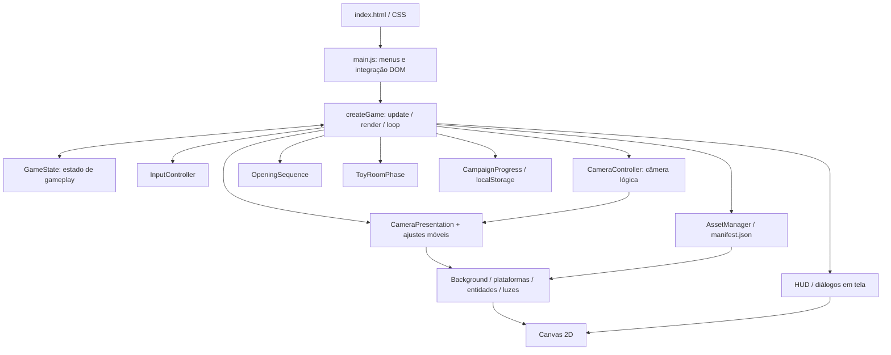

# Manual de desenvolvimento e integração de equipes

Projeto: **legendGirl — O Quarto dos Brinquedos**. Revisão documental: **29/10/2026**. Design inicial de batalha preservado com indicação das diferenças para a arena atual.

Este manual reúne as orientações do repositório e as confronta com a implementação disponível no workspace. Destina-se a desenvolvimento, QA, arte e manutenção da publicação. O código usa JavaScript com módulos ES, HTML, CSS, Canvas 2D e Three.js/WebGL 2 na perseguição; Node.js/Express serve os arquivos. Three.js atende à renderização 3D, com importação tardia. Não há compilação para `dist/`, backend de campanha ou contas de jogador.

Repositório de referência: [luciussama/legendGirl no GitHub](https://github.com/luciussama/legendGirl). A fonte desta documentação é o código local. Consulte [ARQUITETURA](ARQUITETURA.md) para todos os módulos/entidades e [COMANDOS](COMANDOS.md) para os aliases e ferramentas. O registro de integração e as evidências ficam no diário; merge local não equivale a publicação.

## Índice

1. [Primeiro dia e preparação](#primeiro-dia-e-preparação)
2. [Fontes e convenções](#fontes-e-convenções)
3. [Arquitetura e fluxo de execução](#arquitetura-e-fluxo-de-execução)
4. [Estado, física e persistência](#estado-física-e-persistência)
5. [Controllers](#controllers)
6. [Environment e pipeline visual](#environment-e-pipeline-visual)
7. [Entidades, efeitos e interface](#entidades-efeitos-e-interface)
8. [Assets e direção de arte](#assets-e-direção-de-arte)
9. [Sala de brinquedos](#sala-de-brinquedos)
10. [Receitas de manutenção](#receitas-de-manutenção)
11. [Testes e diagnóstico](#testes-e-diagnóstico)
12. [Publicação e integração de mudanças](#publicação-e-integração-de-mudanças)
13. [Roteiro de integração e glossário](#roteiro-de-integração-e-glossário)
14. [Tela inicial e fuga de campanha](#tela-inicial-e-fuga-de-campanha)
15. [Referência detalhada de métodos](REFERENCIA-METODOS.md)
16. [Dicionário de bibliotecas e dependências](DEPENDENCIAS.md)
17. [Implementações atuais e fronteiras](#implementações-atuais-e-fronteiras)
18. [Modo de batalha da Toy Room — design oficial](#modo-de-batalha-da-toy-room--design-oficial)
19. [Inimigos da Toy Room — design oficial](#inimigos-da-toy-room--design-oficial)
20. [Urso, chefe final — design oficial](#urso-chefe-final--design-oficial)
21. [Desenvolver o jardim](#desenvolver-o-jardim)
22. [Padrão de diálogos](#padrão-de-diálogos)

## Funcionalidades e integração vigentes

A campanha atual percorre abertura e capítulo 1 → quarto escuro/retorno → introdução e exploração da sala → arena → perseguição 3D → epílogo do quarto arrumado e capítulo 2 → jardim lateral → piquenique e sono. A bandeira oferece entradas isoladas para revisão; a origem de prévia acompanha as transições sem substituir a campanha salva.

| Área | Implementação atual | Documentação de manutenção |
| --- | --- | --- |
| Tela inicial e progresso | Menina lendo, novo/carregar, confirmação de reinício, dificuldade, opções e preferências locais. | `TitleScreen`, `TitleScene` e contrato de `CampaignProgress` neste manual. |
| Quarto escuro e retorno | Tutorial de primeiro salto, alcances por dificuldade, contato por superfície e câmera de gameplay somente lateral. | [Primeiro salto](TUTORIAL-PRIMEIRO-SALTO.md) e seções de câmera/estado. |
| Exploração da sala | Oito brinquedos, transporte até o baú, recorrência, investigação e espada; movimento em teclado/toque/gamepad. | Contextos e proprietários em [arquitetura](ARQUITETURA.md). |
| Atuação 2D e sombras | Pernas por distância, reação de tronco/cabeça/vestido, perfil lateral coerente e brinquedo acompanhando as mãos; sombras assentadas no piso. | Seções de articulação/sombras e [guia de designers](sprites/GUIA-DESIGNERS.md). |
| Arena | Trem, robô, dinossauro e urso, defesa, esquiva, espada, especial único e efeitos de áudio por personagem. | [Guia da arena](arena/GUIA-ARENA.md) e configuração derivada. |
| Perseguição | Corrida automática e desvios, abertura obrigatória, vida por dificuldade, piso validado na GPU e protagonista articulada. | [Guia da perseguição](bear-chase/GUIA-PREVIA.md). |
| Capítulos | Música ao levantar, duas gravuras, epílogo com facepalm, pausa e retomada da cena; entrada também pela bandeira. | [Roteiro](capitulos/ROTEIRO.md) e contratos abaixo. |
| Jardim e piquenique | Terrenos, rios, seção aérea, rodas/nuvens, encontros, resgate EASY e domínio v11; Yuna e Nanda adormecem ao final. | [Guia do jardim](garden/GUIA-JARDIM.md). |
| Leitura e derrotas | Avanço automático, gesto consumido por fala, Enter modal, skip separado de cenas vistas e oferta EASY após três derrotas completas. | [Padrão de diálogos](diario-ia/padroes/DIALOGOS-E-CENAS.md) e fluxo de derrotas. |

O sonho foi implementado como floresta lateral2D, conforme revisão de direção de30/10. Publicação ocorre pelo workflow da principal e deve ser distinguida da disponibilidade local da branch.

## Primeiro dia e preparação

Use **Node.js 24** e npm, conforme [workflow de publicação](../.github/workflows/deploy-pages.yml). Chrome/DevTools atende a inspeção local; Android e iPhone reais são necessários para confirmar comportamento nativo. Git é necessário para versões, comparação de alterações e histórico de evidências.

```sh
git clone https://github.com/luciussama/legendGirl.git
cd legendGirl
npm ci
npm run dev
```

Abra `http://localhost:3000`. Não abra `index.html` por `file://`: módulos ES e manifesto dependem de HTTP. `npm start` executa o mesmo servidor. Para outra porta em shell compatível: `PORT=3001 npm run dev`.

`npm ci` instala o lockfile sem escolher versões novas. Mudanças de dependências devem versionar `package.json` e `package-lock.json` juntos.

Para estabelecer uma referência local antes da primeira alteração:

```sh
npm test
npm run check-assets
npm run lint
npm run build
```

Esses comandos não cobrem todas as ferramentas extras de QA. Confira os testes específicos na seção de validação. Registre falhas anteriores à sua alteração, sem modificar referências para fazê-las desaparecer.

Jogue a sequência abertura → castelo → fuga do quarto → porta falsa → retorno → portal → sala de brinquedos → investigação/espada → arena → perseguição 3D → jardim → piquenique. Nos percursos do quarto, o jogo conduz o deslocamento horizontal: toque/clique, Espaço ou seta para cima controlam salto/avanço de diálogo. O botão X do gamepad é o índice 2. Na sala, WASD/setas e joystick virtual controlam movimento; Espaço/E/Enter/F e o botão virtual pegam ou entregam ao baú. Na Toy Room, o analógico esquerdo move e X (índice 2) interage; no primeiro salto da Dark Room, a nova pressão de A (índice 0) conclui o tutorial. No jardim, A/D/setas controlam direção e Espaço/W/cima controlam salto; durante o besouro, somente o pulo é manual. P pausa; M alterna áudio. Falas avançam automaticamente; clique/toque adianta um quadro sem acionar gameplay.

## Fontes e convenções

| Fonte | Uso na integração |
| --- | --- |
| [README](../README.md) | Execução, controles, arquitetura geral, comandos e publicação. |
| [AGENTS.md](../AGENTS.md) | Idioma do projeto e restrições da direção visual. |
| [Verificação de plataformas — acervo de IA](diario-ia/README.md) | Contato, percurso, geometria e limites dos testes. |
| [Personagem oficial](../assets/art/dark-room/OFFICIAL-CHARACTER.md) | Origem imutável, recortes e regras de animação. |
| [Arte complementar](../assets/art/dark-room/modern/README.md) | Recursos ilustrados e calibração de apoios. |
| [Abertura](../assets/art/dark-room/opening/README.md) | Atlas narrativo, tempo e persistência da sequência. |
| [Arena atual](arena/GUIA-ARENA.md) / [design inicial no diário](diario-ia/README.md) | Implementação vigente e diferenças explícitas para o projeto original/combate legado. |

Comentários, documentação, interface e diagnósticos novos são escritos em português do Brasil. Preserve nomes de APIs, identificadores, comandos e caminhos. Não traduza dependências nem registros históricos externos.

A apresentação normal não deve desenhar réguas de pouso, linhas de hitbox ou realces técnicos sobre ilustrações. Hitboxes pertencem ao modo de depuração, desativado normalmente. A exceção documentada do relógio cuco (19) admite fixação sólida para os pés sem alterar a hitbox. Ajustes de arte não autorizam mudanças de física, layout ou dificuldade.

Relatórios, verificações, fixtures e registros de evidência pertencem ao diário de IA. QA é executado somente em diretório temporário. A documentação humana contém guias e o diário de produto, sem logs ou homologações de máquina.

## Arquitetura e fluxo de execução



| Área | Entrada / contrato | Responsabilidade |
| --- | --- | --- |
| Página | [main.js](../src/js/main.js) | Localiza elementos DOM, cria o jogo, conecta começar/continuar/recomeçar, pausa e som. |
| Coordenação | [game.js](../src/js/game.js), `createGame(canvas, uiFeedback, callbacks)` | Integra todos os subsistemas e escolhe o modo ativo. |
| Configuração | [config.js](../src/js/config.js) | Chão, layout, portas, entidades iniciais e atributos progressivos. |
| Estado | `state/` | Flags narrativas, transições, derrota e captura/restauração da campanha. |
| Controle | `controllers/` | Entrada, áudio, câmera e ajustes móveis. |
| Desenho | `environment/`, `entities/`, `effects/`, `ui/` | Materiais, sprites, luzes, transições e texto. |
| Exploração e arena | `toy-room/` | Sala, coleta, combate, persistência e coordenação dos modos posteriores. |
| Perseguição | `bear-chase/` | Domínio de corrida, Three.js sob demanda, recursos GPU e abertura ilustrada. |
| Jardim | `garden/` | Plataforma lateral 2D, terrenos, insetos, resgate, cenas e áudio próprios. |
| Capítulos | `chapters/` | Gravuras, recortes de atuação e epílogo persistível entre perseguição e jardim. |
| Narrativa compartilhada | `narrative/` | Sequências do quarto, quadros de fala, limites de leitura e consumo do gesto. |
| Recursos | `assets/` em `src/js/` | Manifesto, imagens, caches, atlas e personagem oficial. |
| Diagnóstico | `debug/`, `scripts/` e acervo de IA | Overlay de atlas e executor de QA; fixtures/tests só são recuperados temporariamente. |

`index.js` de cada pasta reexporta implementações; não contém um loop adicional. `input.js` e `toyRoom.js` preservam pontos de importação existentes. Prefira os pontos de entrada já usados pela área e evite introduzir dependências circulares.

### Ciclo do jogo e API pública

`createGame` cria estado, assets, áudio, câmera, partículas, abertura e entrada. `assetsReady` é a promessa de carregamento do manifesto/pré-carregamento. O primeiro desenho acontece antes do início da campanha. `start()` tenta restaurar progresso, inicia a abertura ou o modo salvo e agenda `requestAnimationFrame(loop)`.

`loop(currentTime)` calcula tempo relativo a 60 Hz e limita `dt` a **0,5..1,2**. É passo variável limitado, não um acumulador fixo. Quando pausado, continua desenhando, sem avançar `update`. Na sala de brinquedos, delega `update(dt)` e `render()` à instância própria. No quarto, chama `update(dt)`, publicação da orientação do viewport e `render()`.

| API retornada por `createGame` | Uso e efeito |
| --- | --- |
| `start`, `newCampaign`, `hasProgress`, `saveProgress` | Início/restauração, limpeza da campanha, consulta e gravação. `newCampaign` é destrutivo para o progresso local; a UI já pede confirmação ao jogador. |
| `doJump(inputSource)`, `isGrounded`, `isCutsceneActive`, `setLastInputDevice` | Entrada contextual: salto ou interação narrativa respeitando bloqueios. |
| `advanceDialogue(event)` | Encaminha uma fala ao dono atual: abertura, introdução, história, quarto, epílogo ou jardim. Retorna se houve avanço; não executa salto, coleta ou ataque. |
| `togglePause`, `setPaused`, `isPaused` | Pausa da atualização; desenho permanece disponível. |
| `retry`, `resetToStart`, `restartToTitle`, `isGameOver` | Recuperação/derrota e retorno ao menu. |
| `startToyRoomPhase`, `startToyRoomIntroduction`, `isToyRoomMode` | Transição, introdução e delegação à sala. |
| `startDebugPhase`, `getDifficulty` | Seletor de fases sem autosave de campanha e consulta de dificuldade normalizada. |
| `hasSavedCampaign`, `continueOnEasy`, `declineEasyOffer` | Consulta save efetivo e responde à ajuda após derrotas; preserva o progresso da seção ativa. |
| `setMuted`, `toggleMute`, `isMuted`, `setMasterVolume`, `getMasterVolume`, `pauseMusic`, `resumeMusic` | Controle de áudio usado pela página. |
| `state`, `toyRoomIntroduction`, `camera`, `lighting`, `particles`, `transitions`, `background`, `platforms`, `hud`, `dialogue`, `assets`, `assetsReady`, `platformContact`, `darkRoomAtlas`, `atlasDebugger`, `input`, `audio` | Referências expostas para integração/inspeção; não significam autorização para escrever arbitrariamente no estado. |
| `destroy` | Salva e remove listeners específicos de campanha/entrada/áudio. Não assuma que encerra todo RAF ou todo listener de resize: audite o ciclo de vida ao criar múltiplas instâncias. |

Os métodos internos `update`, `render`, `loop`, `syncViewportFromState` e `syncViewportToState` não são APIs públicas normais. Fixtures recuperadas do diário em `tests/` temporários expõem controles adicionais por instrumentação de código; não leve esses controles ao jogo distribuído.

## Estado, física e persistência

[StateVariables](../src/js/state/StateVariables.js) define `baby`, `fairy`, modo, câmera, prontidão, narrativa, relógios e buffers. [GameState](../src/js/state/GameState.js) implementa transições. `game.js` ainda contém movimento, impulso, pousos e coordenação narrativa; as seis sequências do quarto estão em `DarkRoomNarrative.js`. Não existe uma classe independente que concentre toda a física.

Os campos de gameplay de `game.js` são lidos e escritos diretamente em `GameState`: câmera lógica, narrativa, progressão, fase ativa, indicadores de início/fim e temporizadores de entrada. Não há `Proxy` narrativo nem cópias locais desses campos. A orientação `isPortrait` conserva a publicação/restauração nos pontos originais por `syncViewportToState` e `syncViewportFromState`; trata-se de uma fronteira de apresentação cuja ordem influencia o enquadramento móvel. Pausa, relógio do autosave e objetos de apresentação conservam o ciclo de vida existente. A revisão de um campo novo deve identificar seu proprietário, leitores, escritores e persistência; não acrescentar outro espelho de gameplay.

### Métodos de estado por fluxo

| Métodos de `GameState` | Contrato |
| --- | --- |
| `setLastInputDevice`, `getActivePromptDevice` | Seleção das mensagens de entrada. |
| `startStandbyPreparation`, `confirmStandby` | Prontidão e confirmação para começar a ação. |
| `resetBabyPhysicsBody` | Reconfigura o corpo e flags transitórias; altera gameplay. |
| `triggerGameOver`, `showFailMessage`, `retryGame`, `restartToTitle`, `resetToStart` | Derrota, avisos e recuperação; recebimento de áudio quando aplicável. |
| `startCastleCutscene`, `advanceCutscene`, `finishCutscene` | Castelo e desbloqueio do percurso de fuga. |
| `startPlotTwistCutscene`, `advancePlotTwist`, `finishPlotTwistAndStartTutorial` | Porta falsa, reviravolta e entrada na terceira parte. |
| `startTruePortalTransition` | Preparação da passagem para a sala. |
| `spawnFairySparkles`, `spawnFairyFlightDust`, `updateFairyParticles` | Buffers visuais da guia; não confundí-los com seu controlador de movimento. |

`config.js` exporta `createBabyState`, `createFairyState`, `getEscapeStats(level, difficulty)`, `getPhase3Stats(level, fromFloor = false, difficulty)` e `getApproachJumpSpeed(platformIndex, difficulty)`. `platforms` contém 22 apoios e `phase3Platforms` contém 16. `standRegion` e `surfaceTopY` podem definir a região real de chegada; a extensão da ilustração não equivale automaticamente à colisão.

### Save

[CampaignProgress](../src/js/state/CampaignProgress.js) usa `legendGirl.campaign.v1` em `localStorage`. `captureState` seleciona chaves dos defaults excluindo referências de runtime, relógios da página, instâncias e entrada transitória. `restoreState` preserva referências de arrays/objetos quando aplicável. `createCampaignProgress(storage)` retorna `read`, `write`, `clear`, valida versão/forma e mantém alternativa em memória quando o armazenamento falha.

O pacote salvo também contém `OpeningSequence.snapshot()`, estado de ativação das plataformas e `ToyRoomPhase.snapshot()` quando relevante. `ToyRoomPhase.restore` religa o objeto carregado por ID; não basta desserializar uma cópia desconectada do brinquedo. Na sala, `toyRoomGarden` tem prioridade sobre `toyRoomChaseCampaign`. O envelope de `GardenPhase.snapshot()` tem versão 1 e contém o domínio do jardim em `state.version:10`; nenhuma dessas versões altera a versão 1 do pacote geral da campanha. Recursos, listeners e áudio são reconstruídos pelo dono da fase.

Ao adicionar campo persistente: defina default serializável, revise captura/restauração/validação, teste saves anteriores incompletos, continuidade de narrativa e alternativa sem storage. A versão não tem migração genérica pronta. DOM, nós de áudio, timers e controllers não devem ser serializados como estado da campanha.

## Tutorial do primeiro salto

O fluxo é `CUTSCENE → FIRST_JUMP_TUTORIAL → GAMEPLAY_NORMAL`. A espera suspende a atualização, mantendo renderização e entrada ativas. Um salto aceito conclui o tutorial uma vez por save, usando `firstJumpTutorialCompleted`. Consulte o [guia técnico completo](TUTORIAL-PRIMEIRO-SALTO.md) para métodos, campos, eventos, migração, coordenadas, testes e evolução. Este sistema é independente do tutorial após o plot twist.

## Controllers

| Controller / funções | Métodos centrais | Contrato e cuidados |
| --- | --- | --- |
| [InputController](../src/js/controllers/InputController.js) | `init`, `triggerJump`, `handlePointerDown`, `handleKeyDown`, `pollGamepad`, `gamepadLoop`, `startGamepadPollingLoop`, `handleGamepadDisconnected`, `destroy`; fábrica `bindInput` | Debounce padrão 140 ms, ponteiro primário, borda de subida de A no primeiro tutorial e X no gameplay normal, bloqueios de UI/solo/narrativa. A fábrica retorna `controller`, `pollGamepad`, `destroy`. |
| [AudioController](../src/js/controllers/AudioController.js) | `init`, handlers de foco/visibilidade, `onBackground`, `onForeground`, volume/mudo, delegações `play*`/`start*`/`stop*`, `destroy` | Integra `createAudioSystem` e respeita silenciamento do usuário. Inicialização de áudio depende das políticas do navegador e interação. |
| [CameraController](../src/js/controllers/CameraController.js) | `reset`, `setZoom`, `setPosition`, `update`, `syncFromState`, `syncToState`, `applyTransform` | Câmera lógica: rolagem, limites, derrota por atraso e clamp que escreve em `baby.y`/`baby.vy`. Não é somente estética. `setPosition(..., false)` ajusta o alvo vertical, não um follow horizontal genérico. |
| [CameraPresentation](../src/js/controllers/CameraPresentation.js) | `reset`, `snapshot`, `restore`, `frame`, `mobileFrame` | Quadro fixo no gameplay; `getDarkRoomScrollFrame`/`getPhase3ScrollFrame` definem altura por viewport. Interpola somente transições narrativas. |
| [AndroidFraming](../src/js/controllers/AndroidFraming.js) | `androidFrameOffset`, `createAndroidFraming().offset` | Reserva inferior e insets exclusivamente nas cenas; não atua durante os saltos. |
| [MobileZoom](../src/js/controllers/MobileZoom.js) | `isMobileDevice`, `getMobileZoomFrame`, `getDarkRoomMobileFrame` | Retorna `{zoom,x,y}`. Gameplay usa composição fixa por viewport, até 0,8, com rodapé livre; aproximação até 1,18 por limites é exclusiva das cenas. Portanto “zoom móvel até 18%” não descreve sozinho todos os trechos atuais. |
| [EscapeFairyGuide](../src/js/controllers/EscapeFairyGuide.js) | `getEscapeGuideTarget`, `updateEscapeFairyGuide` | Próximo apoio/porta e amortecimento crítico na fuga entre castelo e plot twist. **Atualiza movimento da fada**; mudanças aqui não são simples renderização. |

### Referenciais de câmera

Mantenha separados mundo, desenho relativo à câmera, bitmap do canvas e pixels CSS. `cameraX`/`cameraY` lógicos não descrevem sozinhos a imagem final: há pose visual, zoom, foco e offsets adicionais. Renderizadores de objetos normalmente recebem `camX` e desenham `worldX - camX`; o contexto já contém a transformação restante. Não subtraia a câmera outra vez dentro de uma camada já preparada.

`CameraController.applyTransform` aceita `presentationY`, `presentationX` e `sourceX` para conciliar o desenho relativo à câmera original com a pose visual. `getTransform()` é a referência da composição real. A iluminação deve copiar essa matriz; o HUD deve ser desenhado após restaurar a transformação da cena.

Um viewport CSS 390 × 844 não implica bitmap 390 × 844. `handleResize` delega a `createViewportController().resize()`, que usa largura interna 540 em retrato, altura 540 em paisagem e ajusta o outro eixo por proporção. Converta métricas de jitter para pixels visuais antes de comparar resultados.

## Environment e pipeline visual

| Módulo | Métodos / dados | Responsabilidade |
| --- | --- | --- |
| [BackgroundRenderer](../src/js/environment/BackgroundRenderer.js) | `setAssets`, `drawAtlasSceneryItem`, `renderWall`, `renderScenery`, `render`; helper `getBackgroundViewport` | Parede, parallax, janelas, desenhos, guirlandas, piso e objetos decorativos. O helper inverte a matriz para calcular a cobertura visível real. |
| [PlatformRenderer](../src/js/environment/PlatformRenderer.js) | `setAssets`, `drawAtlasPlatformSprite`, `renderPlatforms`, `renderExitDoor`, `renderTrueExitDoor`, `renderTutorialArrow`; `PLATFORM_SURFACES` | Desenho de apoios/portas e calibração dos recortes. `cameraVisibility` permite descarte considerando a matriz real. Física não deve ser recalibrada para compensar um sprite. |
| [StorybookPlatforms](../src/js/environment/StorybookPlatforms.js) | `drawStorybookPlatform`, `drawContactEdge` e helpers internos | Desenhos de materiais/objetos; apoios integrados ao objeto. `drawContactEdge` não autoriza linhas auxiliares sobre arte fora das regras de `AGENTS.md`. |
| [LightingSystem](../src/js/environment/LightingSystem.js) | `resize`, `apply`; fábrica `createLightingSystem` | Canvas auxiliar de escuridão, recortes de luz, feixes, brilho e vinheta. |
| [nightWindows](../src/js/environment/nightWindows.js) | `NIGHT_WINDOWS` | Posições compartilhadas das janelas entre background e luz. Evita divergência visual de fontes. |
| [environment/index.js](../src/js/environment/index.js) | Reexportações | Entrada dos renderizadores e fábrica de iluminação. |

### Ordem de desenho no quarto

1. Limpa o canvas; abertura não revelada usa o caminho próprio de `OpeningSequence`.
2. Calcula pose visual, limites da cena, offset Android e enquadramento móvel.
3. Salva o contexto e aplica translação/escala móvel, offset vertical e transformação da câmera.
4. Desenha parede, decoração, plataformas, porta falsa/verdadeira e seta do tutorial.
5. Desenha rastros, poeira, fadinha e menina.
6. Aplica a atmosfera: máscara de escuridão, luzes e vinheta.
7. Obtém a matriz da cena, restaura o contexto e aplica `ArtFinish`.
8. Desenha HUD, tutorial do primeiro salto em coordenadas de tela, diálogos, fade da abertura e transição do portal; telas finais conforme estado.

`LightingSystem.apply` limpa/reconstrói a máscara com `source-over`, recorta com `destination-out` na matriz real, compõe `multiply` em tela, aplica brilhos com `screen` e vinheta em tela. Um `globalCompositeOperation` não restaurado pode contaminar frames futuros. Use pares equilibrados de `save`/`restore`.

### Diagnóstico de faixa clara ou camada deslocada

Não atribua o defeito à câmera apenas pela proximidade de uma alteração. Capture uma pose reproduzível, a matriz aplicada, dimensões CSS/internas e alpha de cada estágio. Desative uma camada por vez na fixture. Diferencie parallax intencional de erro de referencial.

Limitar o fundo a `0..canvas.width` sob zoom/offset pode expor transparência; a máscara composta sobre essa área mostra sua própria cor. A cobertura pertence a BackgroundRenderer. Testes/fixtures relacionados são recuperados do diário por seus nomes históricos; diagnósticos e evidências de execuções ficam no acervo.

## Entidades, efeitos e interface

| Módulo | Métodos principais | Uso |
| --- | --- | --- |
| [BabyRenderer](../src/js/entities/BabyRenderer.js) | `setAssets`, `resolveAnimationState`, `renderPose`, `render` | Escolhe poses oficiais e desenha a partir do centro/pés; escala visual não altera hitbox. |
| [FairyRenderer](../src/js/entities/FairyRenderer.js) | `render` | Desenha fadinha e partículas a partir do estado recebido; movimento pertence à atualização. |
| [ParticleSystem](../src/js/effects/ParticleSystem.js) | `clear`, `spawnBabyJumpDust`, `spawnBabyJumpPuff`, `spawnBabyLandingPuff`, `spawnPhase3Ribbons`, `spawnEscapeRibbons`, `update`, `updateBabyJumpDust`, `updateSpeedRibbons`, `renderSpeedRibbons`, `renderBabyJumpDust`, `render` | Buffers de partículas atualizados por `dt` e desenhados na cena. |
| [TransitionEffects](../src/js/effects/TransitionEffects.js) | `renderPortalWipe` | Envelope de luz do portal; pode receber `presentationTransform` para coordenadas móveis. |
| [ArtFinish](../src/js/effects/ArtFinish.js) | `applyArtFinish` | Dessaturação de 12% por composição `saturation`, em tela. |
| [OpeningSequence](../src/js/cinematics/OpeningSequence.js) | `hasCompleted`, `start`, `cancel`, `reset`, `snapshot`, `restore`, `update`, `renderFade`, `render` | Relógio e cues da abertura; callbacks `onReveal`, `onComplete`, `onCue`. A cena dura 42,5 s de jogo, incluindo a gravura do capítulo 1 de 36 a 41 s; a música entra após levantar, em 33,5 s. |
| [HudRenderer](../src/js/ui/HudRenderer.js) | `renderEscapeBanner` | Mensagens/nível da fuga e subida. |
| [DialogueRenderer](../src/js/ui/DialogueRenderer.js) | `drawPortrait`, `wrapText`, `renderCutsceneDialogue` | Retratos, quebra de linhas, texto e prompts. |
| [DialogueSafeArea](../src/js/ui/DialogueSafeArea.js) | `intersectCanvasSafeArea`, `getDialogueSafeArea`, `getDialogueBoxY` | Interseção do canvas com viewport/insets; converte para bitmap. |
| [MobileDialogueRegion](../src/js/ui/MobileDialogueRegion.js) | `getMobileDialogueRegions`, `renderMobileDialogueRegion` | Cena e painel sem interseção; `placement: top` reserva narração acima, padrão `bottom` conserva as falas existentes. |

A abertura tem estado e persistência próprios, além do pacote de campanha. Alterar cues exige testar pausa, recarga incompleta, retorno de foco e término da abertura. Áudio de foco não deve reativar som explicitamente silenciado pelo jogador.

## Assets e direção de arte

[AssetManager](../src/js/assets/AssetManager.js) lê [manifest.json](../assets/manifest.json), mantém `images`, `statuses`, `regionCache` e `manifestStatus`. As entradas de `images` são pré-carregadas; os recortes são solicitados sob demanda.

| Método | Entrada / saída e cuidado |
| --- | --- |
| `loadManifest(url)` | Promessa do manifesto; falha rejeita e define status `error`. |
| `preload()` | Promessa do mapa de imagens. Uma imagem ausente pode resolver `null` sem rejeitar toda a operação. |
| `loadImage(key, source)` | Carrega/cacheia imagem e aplica tratamentos somente às chaves específicas existentes. |
| `get`, `has`, `getStatus`, `isReady` | Consulta disponibilidade. `isReady()` sem chave verifica manifesto, não a integridade de todos os assets. |
| `getRegion(key, {x,y,width,height})` | Retorna canvas de recorte ou `null`; rejeita limites inválidos e usa cache. |
| `removeSolidBackground`, `normalizeCharacterPalette` | Processamento de imagens específicas; não aplique genericamente à personagem oficial. |
| `clearRegionCache` | Invalida recortes; revise quando mudar atlas durante a sessão. |

`darkRoomAtlas.js` define regiões e `officialCharacter.js` contém frames e SHA-256 da fonte oficial. Não suponha o formato pelo sufixo: a fonte `official-sprites.png` é JPEG conforme guia. `generate-dream-girl-sprites.js` recorta a fonte preservando os pixels autorizados. O carregamento ausente não deve introduzir personagem substituta.

`AtlasDebugger.setAssets`, `validateAllRegions`, `initDOM`, `toggle`, `render` ajudam a inspecionar recortes, dimensões e sobreposição. Utilize modo técnico para depuração; o overlay não deve ficar ligado na apresentação normal.

## Sala de brinquedos

[ToyRoomPhase](../src/js/toy-room/ToyRoomPhase.js) mantém dados de sala, câmera, jogador, fada, móveis, brinquedos, objeto carregado, contagem organizada, entradas e efeitos. Esses dados não são o mesmo objeto `baby` da fase lateral.

| Grupo de métodos | Responsabilidade |
| --- | --- |
| `setupListeners`, `handleKeyDown`, `handleKeyUp`, `onPointerDown`, `onPointerMove`, `onPointerUp` | Delega os controles ao `ToyRoomInputController`. `destroy` remove seus listeners pelo mesmo controlador. |
| `getCanvasCoordinates`, `isActionButtonHit` | Converte ponteiro e testa área da ação; não usar coordenadas CSS diretamente em física do mundo. |
| `triggerAction` | Delega decisões e feedback à interação, preservando distâncias e bloqueios. |
| `resolveCollisions` | Delega a resolução geométrica ao `ToyRoomMovement`, mantendo a interface usada pela narrativa. |
| `spawnSparkles`, `spawnConfetti` | Delega emissão de efeitos ao `ToyRoomEffects`. |
| `update`, `render` | Avança o modo e compõe a cena. |
| `snapshot`, `restore` | Delega captura e restauração à persistência, inclusive reconexão por ID. |

A fábrica `createToyRoom` retorna `update`, `render`, `triggerAction`, `destroy` e `instance`. `RoomEnvironmentRenderer` implementa `renderBackground`, `renderPerspectiveFloor`, janelas, portal, tapetes, trilhos e `renderFurniture`; `ToyRenderer.renderToy` desenha os itens; `ToyRoomEntities.renderPlayer/renderFairy` desenha os atores; `ToyRoomUI.renderUI` desenha a interface.

[ToyRoomInputController](../src/js/toy-room/ToyRoomInputController.js) processa teclado, gamepad e ponteiros, converte coordenadas CSS para Canvas, testa os controles móveis e instala/remove os listeners. O contrato [ToyRoomInputContext](../src/js/toy-room/ToyRoomInputContext.js) fornece somente estado de entrada, acessos atuais a Canvas/jogador e callbacks de bloqueio, dispositivo, áudio e ações. Os campos de entrada da fase continuam sendo a fonte dos dados usados pelo HUD e pelo combate, sem cópias no controlador. Os getters acompanham substituições feitas por `restore` e `clearInput`. A fase conserva os métodos públicos e os handlers vinculados; o controlador é criado no primeiro uso. Preservar a prioridade das entradas, as bordas de pressão dos botões, a captura dos ponteiros e a limpeza em blur, pausa, restauração e saída.

[ToyRoomMovement](../src/js/toy-room/ToyRoomMovement.js) calcula o movimento da exploração e resolve colisões com móveis e limites da sala. A fase passa jogador, entradas e partículas atuais em cada atualização; o módulo não retém referências entre quadros. `resolveCollisions` permanece público na fase e também atende as consultas narrativas de piso livre. Preservar a prioridade teclado → gamepad → toque, peso do brinquedo, orientação, cadência dos passos, ordem dos móveis e desempate das penetrações. A animação e a poeira dos passos avançam pela distância efetivamente resolvida, com referência de 3,8 px por tick: peso, analógico e deslizamento reduzem a cadência proporcionalmente. Contra um obstáculo, `isMoving` fica falso e não há passos; `dt <= 0` não altera o jogador. O resíduo de `stepTimer` é preservado entre pausas e saves, e a poeira nasce na altura dos pés (`y + 28`). A história recebe `updateAfterMovement` após a resolução; a posição do brinquedo carregado continua sendo atualizada em seguida pela fase.

A sala distribui as demais responsabilidades entre módulos específicos:

| Módulo | Contrato e cuidados |
| --- | --- |
| [ToyRoomInteraction](../src/js/toy-room/ToyRoomInteraction.js) / [contexto](../src/js/toy-room/ToyRoomInteractionContext.js) | Decide proximidade, coleta e entrega obrigatória ao baú; bloqueia coleta comum durante investigação/espada. Mantém debounce, prioridade arena/combate, ordem dos efeitos, notificação à história e contagem. Getters acessam objetos atuais após restore. |
| [ToyRoomEffects](../src/js/toy-room/ToyRoomEffects.js) | Inicializa poeira e emite/atualiza brilhos, confetes, passos e animação do baú nas coleções recebidas. Preservar a ordem das chamadas aleatórias e sua posição no update. |
| [ToyRoomCompanion](../src/js/toy-room/ToyRoomCompanion.js) | Atualiza tutorial, seleção de brinquedo, voo e rastro da fada. Recebe os atores do quadro e devolve a guia escolhida. Não define o alvo da câmera. |
| [ToyRoomCamera](../src/js/toy-room/ToyRoomCamera.js) | Calcula câmera e enquadramento com alvo explícito selecionado pela história. A fase publica as coordenadas calculadas; fórmulas, limites e área segura permanecem compartilhados com a apresentação. |
| [ToyRoomSceneRenderer](../src/js/toy-room/ToyRoomSceneRenderer.js) / [dados do quadro](../src/js/toy-room/ToyRoomSceneFrame.js) | Compõe cenário, entidades ordenadas por Y, espada, fada, partículas, HUD e falas. Recebe somente as referências e callbacks do quadro. Preserva panorama de retorno e registro do viewport. |
| [ToyRoomInitialEntities](../src/js/toy-room/ToyRoomInitialEntities.js) | Cria jogador, fada, móveis e oito brinquedos com objetos próprios por sala. Conserva catálogo, pesos e geometria; não compartilha objetos mutáveis entre instâncias. |
| [ToyRoomPersistence](../src/js/toy-room/ToyRoomPersistence.js) / [contexto](../src/js/toy-room/ToyRoomPersistenceContext.js) | Captura e restaura o formato de save existente, religa o item carregado por ID, migra facing antigo e retoma história/combate/arena na mesma ordem. Preserva includeArena/preserveArena e limpeza de controles. |

`ToyRoomPhase` conserva a criação e o ciclo de vida dos subsistemas, a seleção do modo, as transições e as delegações públicas. A sequência é: proximidade, movimento/colisão, história após movimento, posição do item carregado, fada/tutorial, efeitos e câmera. Retornos antecipados da história ou dos modos de combate mantêm sua posição. A redução de responsabilidades da fase não implica que o combate legado e a arena já tenham contratos restritos para todos os acessos à sala.

[ToyRoomTutorial](../src/js/toy-room/ToyRoomTutorial.js) recebe [ToyRoomTutorialContext](../src/js/toy-room/ToyRoomTutorialContext.js), criado pela fase: jogador, fada, brinquedos, câmera, apresentação móvel e dois campos de progresso. Os getters consultam objetos atuais após restauração; os setters expõem somente conclusão e modo. O tutorial conserva seleção do brinquedo, cooldown, mensagens por dispositivo e conclusão ao carregar. [ToyRoomTutorialRenderer](../src/js/toy-room/ToyRoomTutorialRenderer.js) recebe somente os dados do quadro e desenha a orientação com o layout seguro compartilhado. [ToyRoomInputBindings](../src/js/toy-room/ToyRoomInputBindings.js) fornece os mapeamentos para entrada e mensagens; `TOY_ROOM_INPUT` continua reexportado pelo módulo do tutorial para os chamadores existentes. A regressão de contrato e restauração integra `npm test` e pode ser recuperada isoladamente por `npm run journal:qa -- test:refact:tutorial`.

[ToyRoomWorldQueries](../src/js/toy-room/ToyRoomWorldQueries.js) reúne as consultas de piso livre, piso alcançável e viewport usadas pela narrativa. Recebe funções de acesso a dimensões, jogador, colisões e câmera, sem receber a fase inteira. Esses acessos devem consultar os objetos atuais: `restore` pode substituir o jogador e outros dados da sala. A busca conserva a ordem dos vizinhos e candidatos, que influencia a escolha dos pontos de retorno dos brinquedos e da espada. O módulo consulta o mundo; a narrativa continua responsável por seus estados e decisões.

[ToyRoomToyActions](../src/js/toy-room/ToyRoomToyActions.js) concentra as transições de pegar, guardar no baú, soltar e devolver um brinquedo ao chão. As funções recebem os objetos atuais e preservam sua identidade; não armazenam referências entre chamadas. A ação normal só permite pegar e guardar; a primitiva de soltura permanece legada e não é exposta pelo controle da fase. `ToyRoomPhase` e `ToyRoomStory` coordenam as transições. Alcance, resolução de colisões, contagem organizada, fila de retorno, tutorial, áudio e efeitos mantêm sua coordenação nos chamadores. Preservar a ordem da escolha aleatória no baú, dos efeitos, da notificação à narrativa e do incremento da contagem.

`ToyRoomStory` recebe um contrato explícito, construído na fase por [createToyRoomStoryContext](../src/js/toy-room/ToyRoomStoryContext.js). Seus acessos são `world` (consultas geométricas), `actors` (jogador, fada e dificuldade), `exploration` (brinquedos, móveis e ações narrativas), `flow` (tutorial e introdução), `controls` (limpeza), `audio` (coleta e trilha da espada) e `presentation` (assets e apresentação móvel). A narrativa não recebe nem guarda a fase completa. O adaptador concentra o acesso à sala, consulta referências atuais após restauração e mantém os efeitos nos mesmos pontos. Não capturar jogador, fada ou arrays ao construir o contrato; seus getters devem continuar consultando os objetos atuais. O snapshot narrativo contém somente o estado da história. [ToyRoomStoryRenderer](../src/js/toy-room/ToyRoomStoryRenderer.js) resolve os recortes e desenha a espada, o ataque e as falas a partir dos dados do quadro. Não recebe a história inteira nem altera o estado narrativo. `ToyRoomStory.narrativeBeat()` seleciona o conteúdo segundo os mesmos tempos; seus métodos `render*` delegam a apresentação. O export `drawToySword` no módulo anterior e a propriedade `attackFrames` foram preservados para os consumidores do combate.

Móveis e brinquedos iniciais são criados por `ToyRoomInitialEntities`, chamado pelo construtor da fase; não procure todo o layout da sala em `config.js`. Adicionar item exige revisar inicialização, interação, contagem de vitória e snapshot/restauração, além do desenho.

### Modo de batalha da Toy Room — design oficial

`ArenaCamera.update(dt, player, enemy, jump, impact, battle)` recebe o estado da batalha somente para antecipar enquadramento de golpes e transporte. `frame` consulta viewport/área segura, contém os envelopes de pintura e aplica o corte existente do especial sem escrever na simulação. A aproximação é mais lenta que a abertura; largura mínima760, ampliada conforme atores e ameaças. Retrato reserva o topo do direcional e paisagem reserva suas laterais. Câmera, física e alcance têm responsabilidades distintas: editar envelopes não altera hitboxes. Os cinco campos de snapshot existentes são preservados; `dt=0` não avança a câmera. Consulte o [guia da arena](arena/GUIA-ARENA.md).

O design inicial está preservado em `battle-mode-rules.md` no [diário de IA](diario-ia/README.md) e nas três especificações JSON arquivadas no mesmo acervo. Ele não é a configuração carregada pelo runtime: descreve câmera fixa, 2 HP por inimigo comum e 4 para o Urso, além de decisões pendentes na época. Não converter esses `null` em defaults ou interpretar seu antigo escopo “design apenas” como proibição vigente de código já autorizado.

A [arena implementada](arena/GUIA-ARENA.md) usa `ToyRoomArenaPhase`, `ARENA_TUNING`, `ARENA_ENEMIES`, `ArenaCombatRules`, IA, contato, câmera e apresentação próprios. A menina começa com 3 HP; Trem/Robô/Dinossauro/Urso têm 3/4/4/8. `ToyRoomBattle` conserva um perfil legado com 2/2/2/4 e tuning próprio; não confundir os perfis. Roubo de 1 coração por acerto válido e descarte de cura excedente continuam compartilhados. Bloqueio não transfere vida.

### Inimigos da Toy Room — design oficial

Trem: `Steam Blast`/`Front Charge`; Robô: `Laser Beam`/`Rocket Punch`; Dinossauro: `Bite`/`Rush`. O catálogo inicial `toy-enemy-design.md` no diário conserva a origem do repertório. A implementação define alcance, preparação, recuperação, corpos sólidos, evasão, memória curta e escolha determinística em módulos de combate; esses parâmetros não estão pendentes no runtime. O Trem mantém sequência introdutória; os seguintes reagem à antecipação da espada e oferecem janelas de contra-ataque.

### Urso, chefe final — design oficial

O design inicial `bear-final-boss-design.md` no diário define o repertório exclusivo: `Bear Hug`, `Belly Charge`, `Toy Leap`. A arena atual tem 8 HP, introdução própria e fúria a partir de metade da vida, mantida após cura; o perfil legado conserva gatilho de último coração e máximo 4. `ArenaBoss`, `ToyRoomBattle` e `ArenaEnemyAI` definem a evolução atual. Nenhum desses documentos autoriza criar golpes novos ou alterar o balanceamento por uma revisão documental.

## Implementações atuais e fronteiras

A implementação usa composição de instâncias e funções por domínio. Os nomes de arquivo abaixo não implicam que todos sejam classes: ViewportController, CameraQaObserver e RuntimeContext são fábricas; DarkRoomNarrative e DarkRoomRenderPipeline exportam funções. As classes dos demais domínios continuam descritas nas tabelas deste manual; suas assinaturas estão na [referência completa](REFERENCIA-METODOS.md).

| Módulo / forma | Responsabilidade e dependências | Funções e contratos centrais |
| --- | --- | --- |
| [RuntimeContext](../src/js/runtime/RuntimeContext.js), fábrica | Agrega `state`, `audio`, `camera`, `assets`, `input`, `effects`, `campaign` com as mesmas referências existentes. Não gerencia lifecycle nem resolve dependências. | `createRuntimeContext({...})` devolve objeto simples. No jogo atual `input` é o adaptador `inputHandler` e `effects` é `particles`; não é um registro de todos os efeitos. Não é responsável pela migração de estado nem injeta contexto universalmente; os espelhos de gameplay já foram removidos do coordenador. |
| [ViewportController](../src/js/controllers/ViewportController.js), fábrica | Mede rect CSS (fallback `host.innerWidth/innerHeight`), calcula aspecto, redimensiona Canvas principal/auxiliar e iluminação. | `createViewportController({...})` devolve `resize()`. Chama `onOrientation(aspect < 1.15)` antes de redimensionar. O callback mantém `isPortrait` local em game.js; publicação posterior permanece necessária. Listeners continuam no coordenador. Não calcula safe area nem política de zoom mobile. |
| [CameraQaObserver](../src/js/debug/CameraQaObserver.js), fábrica | Instrumentação optativa; depende de `host.location`, callback `host.cameraQaRecord` e função `snapshot`. | `createCameraQaObserver({...}).record(transform = null)` chama snapshot/callback somente com parâmetro `cameraQa` presente e callback válido. Não armazena nova câmera. |
| [DarkRoomRenderPipeline](../src/js/rendering/DarkRoomRenderPipeline.js), função | Composição da cena: branches de introdução/abertura, apresentação, camadas, iluminação, HUD e diálogos. Recebe objetos, escalares e callbacks de desenho. | `renderDarkRoom(context)` aplica MobileZoom → offset Android → CameraController.applyTransform; preserva save/restore do Canvas e emissão QA. Não executa update de simulação. Alguns callbacks de desenho ainda publicam a orientação do viewport em GameState: o render completo não é puro. |
| [DarkRoomNarrative](../src/js/narrative/DarkRoomNarrative.js), funções | Seis sequências do quarto: atores, foco/zoom, partículas, diálogo, bloqueios e gatilhos; recebe contexto específico e dt. | `updateStandbyNarrative`, `updateTransicaoStandbyNarrative`, `updateCasteloNarrative`, `updateReviravoltaNarrative`, `updateTutorialRetornoNarrative`, `updatePortalNarrative`. Não possuem armazenamento próprio; game.update seleciona uma e retorna antes do update normal da câmera. |
| [ToyRoomIntroduction](../src/js/cinematics/ToyRoomIntroduction.js), classe | Sequência ilustrada antes da sala ativa; recebe assets, imagem de saída e áudio. Não instancia nem desenha a sala de exploração. | `start(context)` prepara/inicia; `update(dt)` avança relógio e eventos; `stage`/`dialogue` consultam cena; `cameraFrame(canvas)`/`fairyPosition()` calculam composição; `drawGirl`/`drawFairy` apresentam a atuação; `render`/`drawDialogue` desenham; `cancel()` encerra. `onComplete` abre sala ativa. |
| [ToyCarryPresentation](../src/js/toy-room/ToyCarryPresentation.js), função/dados | Composição visual da pose de transporte e sobreposição de dedos/pernas; não muda a regra de carregar. Depende de assets, jogador e ToyRenderer. | `renderToyCarry(ctx, player, options)` usa `CARRY_PROFILES` por tipo para escala/âncora. Retorna false se faltar pose ou brinquedo, permitindo o caminho alternativo do renderizador. Não serializa perfis ou Canvas no save. |
| [ToyRoomTutorial](../src/js/toy-room/ToyRoomTutorial.js), classe | Orientação de movimento e primeira coleta; mantém alvo visual dinâmico e dispositivo de entrada. Não executa coleta ou movimento do jogador. | `start()` respeita conclusão persistida; `setDevice()` muda instrução; `nearest()` escolhe item elegível; `update(dt)` avança de movement para pickup após deslocamento >2 e conclui quando há carriedItem; `guidePosition()`/`message` orientam; `render()` projeta painel; `finish()` marca conclusão/TOY_ROOM_GAMEPLAY. |

### Catálogo das classes

As classes declaradas em `src/js` estão listadas abaixo. Entidades como baby/fairy/player e fábricas de contexto são dados/funções, não classes adicionais. Métodos internos não constituem APIs estáveis.

| Classe | Implementação | Responsabilidade |
| --- | --- | --- |
| `AssetManager` | [assets/AssetManager.js](../src/js/assets/AssetManager.js) | Manifesto principal, carregamento/cache de imagens e recortes; prontidão e erros por recurso. |
| `OpeningSequence` | [cinematics/OpeningSequence.js](../src/js/cinematics/OpeningSequence.js) | Abertura: relógio, cues, poses, falas, conclusão local e snapshot recuperável. |
| `ToyRoomIntroduction` | [cinematics/ToyRoomIntroduction.js](../src/js/cinematics/ToyRoomIntroduction.js) | Transição ilustrada para a sala: atuação própria, planos na altura dos olhos, estágios, eventos e callback de conclusão. |
| `AudioController` | [controllers/AudioController.js](../src/js/controllers/AudioController.js) | Integra áudio, preferências e foco/visibilidade à página; delegações e ciclo de vida. |
| `CameraController` | [controllers/CameraController.js](../src/js/controllers/CameraController.js) | Rolagem lateral e pressão de atraso, quadro fixo no gameplay e zoom somente narrativo; nunca corrige o corpo. |
| `CameraPresentation` | [controllers/CameraPresentation.js](../src/js/controllers/CameraPresentation.js) | Quadro fixo de gameplay e interpolação exclusivamente narrativa; não consulta saltos ou pousos. |
| `InputController` | [controllers/InputController.js](../src/js/controllers/InputController.js) | Ponteiro/teclado/gamepad do quarto; debounce, bloqueios, dispositivo e confirmação do primeiro salto. |
| `AtlasDebugger` | [debug/AtlasDebugger.js](../src/js/debug/AtlasDebugger.js) | Inspeção técnica das regiões do atlas; validação e overlay optativo. |
| `ParticleSystem` | [effects/ParticleSystem.js](../src/js/effects/ParticleSystem.js) | Buffers e evolução/desenho de poeira, brilho e rastros do quarto. |
| `TransitionEffects` | [effects/TransitionEffects.js](../src/js/effects/TransitionEffects.js) | Íris do portal e efeitos de transição com relógio fornecido pelo coordenador. |
| `BabyRenderer` | [entities/BabyRenderer.js](../src/js/entities/BabyRenderer.js) | Seleção/recorte das poses oficiais da menina no quarto; desenho ancorado aos pés. |
| `FairyRenderer` | [entities/FairyRenderer.js](../src/js/entities/FairyRenderer.js) | Desenho da fada e efeitos visuais associados, sem decidir seu deslocamento. |
| `BackgroundRenderer` | [environment/BackgroundRenderer.js](../src/js/environment/BackgroundRenderer.js) | Parede, piso, janelas, parallax e decoração; cobertura calculada pela matriz real. |
| `LightingSystem` | [environment/LightingSystem.js](../src/js/environment/LightingSystem.js) | Canvas auxiliar, recortes de luz, máscara, brilho e vinheta; acompanha a matriz da cena. |
| `PlatformRenderer` | [environment/PlatformRenderer.js](../src/js/environment/PlatformRenderer.js) | Arte de plataformas/portas, superfícies visuais e descarte; não resolve pousos. |
| `GameState` | [state/GameState.js](../src/js/state/GameState.js) | Defaults e comandos de progresso, prontidão, narrativa, derrota e reinício do quarto. |
| `ArenaAudioProfile` | [toy-room/ArenaAudioProfile.js](../src/js/toy-room/ArenaAudioProfile.js) | Intensidade/percussão da música contínua da espada, sons e retomada do áudio da sala. |
| `ArenaBoss` | [toy-room/ArenaBoss.js](../src/js/toy-room/ArenaBoss.js) | Apresentação/estado persistível do Urso e ativação da fúria na arena. |
| `ArenaSpecialAttack` | [toy-room/ArenaSpecialAttack.js](../src/js/toy-room/ArenaSpecialAttack.js) | Coordena o especial único, o dano e a apresentação; estado no snapshot da batalha. |
| `ArenaCamera` | [toy-room/ArenaCamera.js](../src/js/toy-room/ArenaCamera.js) | Aproximação e abertura suaves do combate, com folgas para pinturas, golpes, HUD e controles. |
| `ArenaPlayerController` | [toy-room/ArenaPlayerController.js](../src/js/toy-room/ArenaPlayerController.js) | Especializa o controlador de combate com parâmetros e movimento da arena. |
| `ArenaPlayerRenderer` | [toy-room/ArenaPlayerRenderer.js](../src/js/toy-room/ArenaPlayerRenderer.js) | Carrega/desenha poses da menina na arena, incluindo mistura, dano e ataque. |
| `ImpactFX` | [toy-room/ImpactFX.js](../src/js/toy-room/ImpactFX.js) | Partículas, arcos, faíscas de bloqueio, flash e tremor da arena; snapshot/restore próprios. |
| `PlayerController` | [toy-room/PlayerController.js](../src/js/toy-room/PlayerController.js) | Movimento horizontal, salto/agachamento, recuperação, recuo e animação física do combate. |
| `RoomEnvironmentRenderer` | [toy-room/RoomEnvironmentRenderer.js](../src/js/toy-room/RoomEnvironmentRenderer.js) | Ilustra arquitetura, piso, detalhes e móveis da exploração. |
| `ToyRenderer` | [toy-room/ToyRenderer.js](../src/js/toy-room/ToyRenderer.js) | Desenha os brinquedos atuais no chão e transportados, preservando seleção e materiais. |
| `ToyRoomArenaBuilder` | [toy-room/ToyRoomArenaBuilder.js](../src/js/toy-room/ToyRoomArenaBuilder.js) | Deriva estruturas/layout heroicos da geometria dos móveis existentes. |
| `ToyRoomArenaPhase` | [toy-room/ToyRoomArenaPhase.js](../src/js/toy-room/ToyRoomArenaPhase.js) | Orquestra transformação, combate, retorno e snapshot da arena; ainda retém a sala completa. |
| `ToyRoomBattle` | [toy-room/ToyRoomBattle.js](../src/js/toy-room/ToyRoomBattle.js) | Simula a luta e transferência de corações; perfis alternam legado/arena; ainda retém a sala completa. |
| `ToyRoomEntities` | [toy-room/ToyRoomEntities.js](../src/js/toy-room/ToyRoomEntities.js) | Desenha menina/fada da exploração com recursos oficiais e pose de transporte. |
| `ToyRoomInputController` | [toy-room/ToyRoomInputController.js](../src/js/toy-room/ToyRoomInputController.js) | Teclado/toque/gamepad, coordenadas, hit testing, captura/liberação de ponteiros e listeners. |
| `ToyRoomInteraction` | [toy-room/ToyRoomInteraction.js](../src/js/toy-room/ToyRoomInteraction.js) | Decide ação/proximidade, debounce e feedback; mantém ordem de efeitos, narrativa e contagem. |
| `ToyRoomPersistence` | [toy-room/ToyRoomPersistence.js](../src/js/toy-room/ToyRoomPersistence.js) | Serializa/restaura sala, religa item por ID e retoma os subsistemas na ordem existente. |
| `ToyRoomPhase` | [toy-room/ToyRoomPhase.js](../src/js/toy-room/ToyRoomPhase.js) | Compõe serviços e entidades, escolhe modo, mantém ciclo de vida/transições e delegações públicas. |
| `ToyRoomStory` | [toy-room/ToyRoomStory.js](../src/js/toy-room/ToyRoomStory.js) | Recorrência, investigação, espada, comandos e relógios narrativos; recebe contexto restrito. |
| `ToyRoomTutorial` | [toy-room/ToyRoomTutorial.js](../src/js/toy-room/ToyRoomTutorial.js) | Etapas movement/pickup, alvo, mensagens e conclusão; recebe contrato restrito de oito campos. |
| `ToyRoomUI` | [toy-room/ToyRoomUI.js](../src/js/toy-room/ToyRoomUI.js) | HUD de exploração, joystick, ação, faixas e contagem; consome estado atual de apresentação. |
| `DialogueRenderer` | [ui/DialogueRenderer.js](../src/js/ui/DialogueRenderer.js) | Caixa/retrato/nome/quebra de texto compartilhados pelas fases e adaptação de falas do quarto. |
| `HudRenderer` | [ui/HudRenderer.js](../src/js/ui/HudRenderer.js) | Faixas/progresso do percurso lateral em coordenadas de tela. |
| `BearChasePhase` | [bear-chase/BearChasePhase.js](../src/js/bear-chase/BearChasePhase.js) | Compõe a fuga, adapta o tempo do loop, revela a abertura ilustrada enquanto prepara/verifica o 3D e controla pausa, entradas, snapshot e descarte. |
| `ChaseAudio` | [bear-chase/ChaseAudio.js](../src/js/bear-chase/ChaseAudio.js) | Controla trilha, passos, ganho, pausa e restauração da posição musical. |
| `ChaseBearAnimation` | [bear-chase/ChaseBearAnimation.js](../src/js/bear-chase/ChaseBearAnimation.js) | Calcula poses e articulações do urso sem modificar o domínio. |
| `ChaseBearModel` | [bear-chase/ChaseBearModel.js](../src/js/bear-chase/ChaseBearModel.js) | Constrói o urso volumétrico com materiais e hierarquia próprios. |
| `ChaseFairyModel` | [bear-chase/ChaseFairyModel.js](../src/js/bear-chase/ChaseFairyModel.js) | Modela núcleo de luz e asas em volume, com órbita ao redor da menina e rastro instanciado. |
| `ChaseGirlAnimation` | [bear-chase/ChaseGirlAnimation.js](../src/js/bear-chase/ChaseGirlAnimation.js) | Resolve apoios no espaço do quadril com os comprimentos do modelo; anima espada, cabelo, saia e tropeço. |
| `ChaseGirlModel` | [bear-chase/ChaseGirlModel.js](../src/js/bear-chase/ChaseGirlModel.js) | Constrói malhas, materiais e articulações da menina; compartilha comprimentos e altura da sola em `proportions`. |
| `ChaseInput` | [bear-chase/ChaseInput.js](../src/js/bear-chase/ChaseInput.js) | Converte teclado, ponteiro e gamepad em intenção lateral; libera listeners. |
| `ChaseIntroRenderer` | [bear-chase/ChaseIntroRenderer.js](../src/js/bear-chase/ChaseIntroRenderer.js) | Apresenta a introdução ilustrada e o corte de largada em Canvas 2D. |
| `ChaseLighting` | [bear-chase/ChaseLighting.js](../src/js/bear-chase/ChaseLighting.js) | Compõe luzes de sala e da fada; duas fontes de sombra, com recursos próprios e acompanhamento no percurso. |
| `ChaseRenderer3D` | [bear-chase/ChaseRenderer3D.js](../src/js/bear-chase/ChaseRenderer3D.js) | Compõe cena WebGL; valida o piso na GPU com alternativa linear, envia mapas, compila materiais, monta modelos e descarta recursos. |
| `ChaseRoom` | [bear-chase/ChaseRoom.js](../src/js/bear-chase/ChaseRoom.js) | Constrói superfícies e decoração fixa ao longo do traçado. |
| `ChaseToyModels` | [bear-chase/ChaseToyModels.js](../src/js/bear-chase/ChaseToyModels.js) | Adaptador de compatibilidade para o trem do catálogo. |
| `BlockCastleProp` | [bear-chase/props/BlockCastleProp.js](../src/js/bear-chase/props/BlockCastleProp.js) | Constrói o castelo de blocos decorativo. |
| `BlocksProp` | [bear-chase/props/BlocksProp.js](../src/js/bear-chase/props/BlocksProp.js) | Constrói o grupo de blocos arremessável. |
| `BookshelfProp` | [bear-chase/props/BookshelfProp.js](../src/js/bear-chase/props/BookshelfProp.js) | Constrói a estante decorativa. |
| `BunnyProp` | [bear-chase/props/BunnyProp.js](../src/js/bear-chase/props/BunnyProp.js) | Constrói o coelho arremessável. |
| `ChasePropCatalog` | [bear-chase/props/ChasePropCatalog.js](../src/js/bear-chase/props/ChasePropCatalog.js) | Catálogo, instâncias, limites e liberação dos objetos do percurso. |
| `ChasePropResources` | [bear-chase/props/ChasePropResources.js](../src/js/bear-chase/props/ChasePropResources.js) | Compartilha e controla materiais, texturas e geometrias dos objetos. |
| `PropParts` | [bear-chase/props/ChasePropResources.js](../src/js/bear-chase/props/ChasePropResources.js) | Compartilha e controla materiais, texturas e geometrias dos objetos. |
| `OakCabinetProp` | [bear-chase/props/OakCabinetProp.js](../src/js/bear-chase/props/OakCabinetProp.js) | Constrói o armário baixo ilustrado. |
| `ToyChestProp` | [bear-chase/props/ToyChestProp.js](../src/js/bear-chase/props/ToyChestProp.js) | Constrói o baú articulado usado no encerramento. |
| `TrainProp` | [bear-chase/props/TrainProp.js](../src/js/bear-chase/props/TrainProp.js) | Constrói o trem volumétrico do catálogo. |
| `ToyRoomEpilogue` | [chapters/ToyRoomEpilogue.js](../src/js/chapters/ToyRoomEpilogue.js) | Cena do quarto arrumado, leitura, facepalm e passagem ao capítulo2; snapshot próprio. |
| `DarkRoomContact` | [environment/DarkRoomContact.js](../src/js/environment/DarkRoomContact.js) | Extrai contornos de apoio da arte carregada; resolve sapatos completos, descida varrida e união urso/livros. |
| `GardenAudio` | [garden/GardenAudio.js](../src/js/garden/GardenAudio.js) | MP3 Blues Shuffle Loop em repetição e sinais curtos do jardim, com volume, pausa e descarte. |
| `GardenInput` | [garden/GardenInput.js](../src/js/garden/GardenInput.js) | Combina teclado, toque e gamepad; instala e remove controles próprios da fase. |
| `GardenPhase` | [garden/GardenPhase.js](../src/js/garden/GardenPhase.js) | Compõe domínio, arte, controles e áudio; coordena prontidão, pausa, retry, snapshot e descarte. |
| `GardenRenderer` | [garden/GardenRenderer.js](../src/js/garden/GardenRenderer.js) | Carrega o manifesto dedicado e desenha pinturas, HUD e controles com câmera somente lateral. |
| `ArenaSoundEffects` | [toy-room/ArenaSoundEffects.js](../src/js/toy-room/ArenaSoundEffects.js) | MP3s por evento/personagem, pré-carga, trechos, ganho por voz e interrupção no mixer mestre; não serializa recursos. |
| `GameSoundEffects` | [audio/GameSoundEffects.js](../src/js/audio/GameSoundEffects.js) | Pulo/lama gravados e asas em loop, cache por contexto, panorâmica e interrupção das vozes. |
| `TitleScene` | [ui/TitleScene.js](../src/js/ui/TitleScene.js) | Compõe o quarto e a menina lendo com pernas articuladas; observa visibilidade, tamanho e movimento reduzido para controlar seu RAF; câmera comum mantém a poltrona no tapete. |
| `TitleScreen` | [ui/TitleScreen.js](../src/js/ui/TitleScreen.js) | Coordena novo jogo, carregamento, modo fácil, opções e confirmação de reinício por callbacks do coordenador principal. |
| `DreamInput` | [dream-forest/DreamInput.js](../src/js/dream-forest/DreamInput.js) | Controles verticais e salto separado, mantendo liberação e simultaneidade. |
| `DreamRenderer` | [dream-forest/DreamRenderer.js](../src/js/dream-forest/DreamRenderer.js) | Fundo e apoios pintados em Canvas2D, sem pipeline3D. |
| `DreamAudio` | [dream-forest/DreamAudio.js](../src/js/dream-forest/DreamAudio.js) | Especializa GardenAudio para Bug attack desde o início da cinemática até a captura, grito sintetizado e trilha do despertar; respeita pausa/mudo/volume. |
| `DreamNightmareLighting` | [dream-forest/DreamNightmareLighting.js](../src/js/dream-forest/DreamNightmareLighting.js) | Volume suave, resposta dos abrigos e reflexos superficiais em buffer reutilizado. |
| `DreamNightmareRenderer` | [dream-forest/DreamNightmareRenderer.js](../src/js/dream-forest/DreamNightmareRenderer.js) | Carga tardia, câmera próxima fixa, barata monumental, sombras compartilhadas e atuação no piquenique. |
| `DreamPhase` | [dream-forest/DreamPhase.js](../src/js/dream-forest/DreamPhase.js) | Carga, áudio Misty Blues, pausa, retomada e descarte. |

Para cada classe, a [referência de métodos](REFERENCIA-METODOS.md) contém assinatura, linha e link de implementação. As tabelas de domínio acima explicam os efeitos e as dependências; use ambas para evitar confundir um renderizador com o dono da regra do jogo.

### Sequenciamento, contexto e publicação

`main.js → createGame → update/render` continua sendo a entrada. O contexto narrativo recebe a própria instância de `GameState`; suas escritas não passam por bindings ou outro armazenamento. O contexto de render recebe os valores do quadro explicitamente; RuntimeContext agrega serviços já criados no final de createGame e fornece referências aos contextos narrativo e de render. O próprio objeto runtimeContext não é exposto na API pública.

Comandos e narrativa usam `GameState` diretamente. O controlador de câmera conserva `syncFromState`/`syncToState` e a ordem original de atualização. A fronteira restante de orientação mantém os mesmos pontos de publicação/restauração: comando, câmera, desenho e save. Resize continua atualizando o valor de apresentação, sem antecipar sua publicação na simulação.


### Entrada e tutorial da Toy Room

Portal e botão de ir à segunda fase usam a introdução, antes de liberar os controles. Etapas `TR_002` a `TR_008`: 0,8 / 2,5 / 4 / 4 / 7 / 2 / 3 segundos. O relógio soma dt/60; TR_006 prioriza leitura por sete segundos. Eventos são enviados ao callback `onNarrativeEvent` e por CustomEvent no Canvas; `TOY_ROOM_START` inicia o tutorial da instância ativa. Não confundir a câmera cinematográfica com cameraX/Y do follow da sala. A sequência usa `introduction/room-v1.png` e `girl-acting-v1.png`, pré-carregados no manifesto, com quatro poses ancoradas pelos sapatos, respiração discreta e voo/asas de Nanda. Planos abrem em paisagem baixa para conservar a fada. O último fade creme se encontra com `introAlpha:1` da sala ativa, sem repetir banner. Nenhuma sala temporária é construída.

`ToyRoomPhase.startTutorial()` e `pollGamepad()` integram ToyRoomTutorial. `TOY_ROOM_INPUT` centraliza teclas de ação, rótulo E, índice 2 e rótulo X. O polling aceita pads padrão (ou sem mapping declarado), usa axes[0]/axes[1], deadzone radial 0,18 e borda de pressão do botão para `triggerAction()`. O vetor segue o mesmo update/colisões dos outros controles. A guia escolhe brinquedos não organizados/não carregados; troca de alvo usa cooldown de 30 passos, distância de 280 e vantagem de 40, para evitar oscilação. A posição sugerida da fada fica 105 acima do alvo.

O save da sala inclui `toyRoomTutorialCompleted`; restore encerra tutorial já concluído ou reinicia orientação quando necessário. `ToyCarryPresentation` continua responsável pela composição visual de transporte (pose e contatos), separada da regra de pegar/guardar. As implementações de arte atuais podem diferir de auditorias históricas; a presença de asset no manifesto não prova uso pelo renderizador.

## Receitas de manutenção

### Acrescentar um asset visual

1. Identifique a fonte e as regras de identidade/material; preserve a origem oficial.
2. Adicione o recurso no caminho de arte adequado e registre a chave em `manifest.json`.
3. Atualize a região no atlas se o recurso for uma prancha; valide bounds reais.
4. Consuma `assets.get`/`getRegion` no renderizador, com comportamento explícito de ausência.
5. Calibre escala/âncora visual usando o plano dos pés ou apoio físico existente. Não altere `standRegion`, hitbox ou distâncias para acomodar a arte.
6. Rode check-assets, testes do personagem/apoios aplicáveis e inspecione capturas nos três formatos.

### Acrescentar uma camada de cenário

Receba o contexto e os dados necessários; mantenha o estado de desenho dentro de `save`/`restore`. Defina se usa mundo, câmera relativa, parallax ou tela. Use a matriz real para máscara/culling/cobertura; não reaplique zoom. Insira a chamada na posição correta do pipeline e faça isolamento da camada em fixture. Verifique alpha, bordas e resize, mantendo a atualização do gameplay idêntica.

### Alterar controlador ou regra

Escreva primeiro o comportamento desejado e os estados afetados. Mudança de entrada deve cobrir repetição, multi-touch, overlays e bloqueios de cena. Mudança de câmera lógica pode alterar a pressão lateral/derrota e deve ser tratada como mudança de gameplay. A câmera não pode impor teto ao salto nem modificar o corpo. Para correções visuais, prefira a apresentação independente e confirme as trajetórias antes/depois. Mudança de guia da fada exige teste específico, pois escreve em suas coordenadas e velocidades.

### Acrescentar cena ou diálogo

Para revisar uma fase, use o seletor da barra superior “Revisar fase desde a cena inicial”. As opções são Quarto escuro (despertar, mesmo se já assistido), Sala de brinquedos (chegada ilustrada), Arena de batalha (transformação com espada equipada) e Perseguição 3D (urso caído). O seletor aguarda os assets principais e permanece disponível durante a partida, inclusive para repetir a mesma fase. Ao entrar no debug, salva uma última vez a campanha normal; a revisão e suas trocas posteriores não substituem esse progresso. `OpeningSequence.start({replay:true})` ignora a marca de conclusão sem alterá-la ao terminar. A opção normal de continuar/iniciar no menu retoma a persistência da campanha.

Revise flags/defaults e seu proprietário em GameState, gatilho/avanço/término em `GameState` e `game.js`, conteúdo e desenho em `DialogueRenderer`, pausa/entrada e callbacks de áudio. Teste recarga no meio da cena, retorno ao menu e safe area móvel. Alterar texto pode aumentar linhas: valide altura e não apenas o conteúdo.

### Acrescentar campo de campanha

Defina default em GameState; use esse campo diretamente; determine se deve persistir; revise `captureState`, `restoreState`, validação de `read` e captura específica da sala/abertura. Teste serialização, referência dos arrays/objetos e dados anteriores. Nunca use o save para guardar contexto Canvas, referências DOM ou nós de áudio.

### Ajustar uma plataforma

Diferencie alteração artística de alteração de design. Arte: modifique renderer/atlas/calibração mantendo configuração física. Design autorizado: revise layout, progressão, alcance, colisões, checkpoints e referência de física como mudança explícita de gameplay. Não atualize `dark-room-physics.json` para acomodar arte ou fazer um teste passar.

## Testes e diagnóstico

O catálogo [COMANDOS](COMANDOS.md) explica a recuperação temporária e as comparações de refatoração. Estas preservam a referência original de imagens/estados/recursos de runtime e reportam separadamente hashes dos READMEs de arte atualizados pela documentação. Não atualize referências gráficas ou metadados de produção para acomodar diferenças.


O harness visual é parcialmente determinístico: performance.now, timers/RAF e storage compartilhado podem gerar diferenças sem mudança de implementação. Seed fixa exige mesma ordem de sorteios; pausa continua desenhando e não congela o pulso. Comparações exigem controlar pré-condições e validar A/B da mesma versão, sem mascarar diferenças. Isso permanece uma limitação, não uma estabilização implementada.


| Comando / ferramenta | Quando usar | Limite |
| --- | --- | --- |
| `npm test` | Regressão geral antes de integrar código. | Não executa todos os scripts específicos nem valida hardware móvel. |
| `npm run verify:dark-room` | Apoios, pés, salto do castelo, personagem, partículas e guia. | Referência física precisa ser preservada em correções visuais. |
| `npm run test:pages`, `npm run build` | Páginas e caminhos de publicação em subpasta. | `build` valida; não transpila nem produz `dist/`. |
| `npm run check-assets` | Manifesto e arquivos. | Disponibilidade de arquivo não garante recorte/arte corretos. |
| `npm run lint` | Sintaxe dos dois arquivos configurados. | Não é ESLint nem análise de todo `src/`. |
| `npm run journal:qa -- script:test-opening-sequence.js` | Abertura/cues/poses e persistência. | Combine com inspeção visual. |
| `npm run journal:qa -- script:test-physics-scenarios.js` | Cenários adicionais de física. | Não substitui percurso completo. |
| `npm run journal:qa -- script:test-lighting.js`, `npm run journal:qa -- script:test-background-viewport.js` | Máscara, matriz, cobertura e invariância visual. | São extras: não estão no `npm test` atual. |
| `npm run journal:qa -- script:test-camera-presentation.js` | Damping visual, estabilização, limites e checkpoints. | Não mede percepção em dispositivo real. |
| `npm run journal:qa -- script:test-mobile-zoom.js`, `npm run journal:qa -- script:test-android-framing.js`, `npm run journal:qa -- script:test-dialogue-safe-area.js`, `npm run journal:qa -- script:test-mobile-dialogue-region.js` | Enquadramento e texto móveis. | Adicione retrato/paisagem/insets em revisão manual. |
| `npm run journal:qa -- script:verify-full-browser.js android` / `iphone` / `desktop` | Sequência completa até organizar os oito objetos. | Busca instantes de salto com snapshots; não representa julgamento humano. |

### Navegador instrumentado

Os aliases de QA recuperam fixtures e iniciam servidor temporário em porta livre; mantenha Chrome dedicado com CDP, normalmente em 9222. Fontes executadas manualmente seguem suas próprias portas. Feche somente a instância dedicada ao terminar. Consulte [todos os comandos e pré-requisitos](COMANDOS.md). Exemplo no macOS:

```sh
"/Applications/Google Chrome.app/Contents/MacOS/Google Chrome" --remote-debugging-port=9222 --user-data-dir=/tmp/legendgirl-qa
npm run journal:qa -- script:verify-full-browser.js android
npm run journal:qa -- script:verify-full-browser.js iphone
npm run journal:qa -- script:verify-full-browser.js desktop
```

Algumas revisões específicas usam porta 3001; confira o cabeçalho do script, em vez de assumir uma porta universal. Fixtures como `dark-room-playthrough.html` podem importar o código real via Blob e expor atualização controlada, preparação e checkpoints. Isso não é uma API de produção e depende de marcadores textuais: refatorações devem revisar a fixture.

Em comparações, fixe a semente, restaure aleatoriedade/checkpoints e descarte tentativas de busca que não pertencem ao percurso aceito. Meça a transformação visual, não apenas `cameraX`. Faça captura no mesmo frame das métricas; resize e composição atrasada podem gerar imagens de outro frame. `qa-visual-layers.js` exporta diretamente o canvas para evitar esse descompasso.

### Enquadramento exclusivamente lateral no quarto escuro

Regra vigente do usuário, registrada em `AGENTS.md`: durante a jogabilidade a câmera faz apenas rolagem lateral. É proibido alterar altura, escala, âncora ou posição a partir do arco, aterrissagem, estado aéreo ou troca de plataforma. Correções de salto pertencem à distância do salto, à superfície dos pés ou à superfície do objeto.

`getDarkRoomScrollFrame` define uma altura constante por viewport nas três seções; `getPhase3ScrollFrame` é um alias compatível. Não existe trajetória vertical pelo percurso. `DarkRoomRenderPipeline` usa essa pose diretamente, com escala móvel fixa por viewport, até 0,8, e deslocamento constante por seção. `getDarkRoomMobileFrame` reserva o rodapé: chão até 70% da área segura em retrato e 75% em paisagem, limitado também por uma folga de oito pixels CSS entre os pés e um modelo de dedo de raio 36 CSS sobre a indicação de toque. O envelope autorado até y=−64 cabe abaixo da faixa superior de 64 CSS em paisagem e 178 CSS em retrato; a escala não depende do corpo ou do apoio. Em telas baixas, isso abre mais o enquadramento e reduz o tamanho desenhado dos atores. Não calcula limites de atores/apoios, deslocamento Android nem recuperação de pouso no ramo de gameplay. `CameraPresentation.mobileFrame({fixed:true})` guarda a última pose sem interpolar, para as transições narrativas partirem do quadro atual. Cortes narrativos e resize/orientação têm seus próprios limites. O indicador TOQUE PARA PULAR ocupa o rodapé e não restringe a entrada: a tela inteira continua aceitando pulo. O tutorial inicial conserva seu prompt próprio. Em paisagem, o badge de nível fica no topo central e se estreita em telas menores para não disputar os três botões HTML. Nessa orientação, o aviso temporário de nível fica restrito à mesma largura, com até três linhas, sem cruzar toda a ação. As referências horizontais preservam a leitura das bordas de pressão ao abrir o quadro.

`CameraController` também usa altura fixa e zoom 1 no gameplay, sem ler `baby.y`, `vy`, `onGround` ou índice de apoio. Não impõe teto nem modifica a personagem. A rolagem lateral conserva sua pressão de atraso; `escapeEndPlatformX` encerra a pressão na região horizontal do pedestal final. Entrar nessa região é um teste espacial, independente de pouso/índice. Parâmetros de salto e superfícies não foram recalibrados para disfarçar o movimento da câmera.

Verificação: `npm run journal:qa -- test:camera:lateral:browser`, com matriz real nos saltos e pousos, testes de visibilidade, câmera sem escrita no corpo e percursos reais. A fonte anterior de `test:camera:retorno:browser` permanece histórica; a nova regressão abrange também a aproximação e a fuga.

### Critérios móveis e de câmera

Os critérios de QA-CAMERA-002C incluem jitter parado <=1 px visual em 60 frames, salto de posição <=5% da tela por frame, nenhuma recuperação de câmera após pouso e nenhuma variação de zoom/altura durante saltos, região de chegada visível antes do salto e fada visível >=95% do plot twist. Não confunda desvio padrão da câmera em movimento com jitter parado. Relate pousos sem janela suficiente como não medidos, em vez de aprovados.

Emulação de user agent/viewport no Chrome não executa Safari/WebKit nem GPU e frame pacing do aparelho. A matriz mínima de integração é Desktop, Android e iPhone; registre navegador, orientação, viewport, versão, dispositivo, cenas medidas e limites. Declare aprovação nativa apenas quando executada.

### Diagnóstico de problemas frequentes

| Sintoma | Primeiras verificações |
| --- | --- |
| Tela vazia / módulo não carrega | HTTP, aba Network, URL/case do import, tipo de conteúdo e caminhos relativos. O fallback do Express pode devolver HTML para caminho inexistente. |
| Sprite ausente | Manifesto, `getStatus(key)`, bounds de `getRegion`, preload e transparência do atlas. |
| Pés fora do apoio | Compare o perfil de `DarkRoomContact` com a arte, o envelope dos sapatos e a altura nominal; `standRegion` calibra o desenho. |
| Faixa cinza / borda vertical | Cobertura do background pela inversa da matriz, alpha intermediário e composição da máscara. |
| Jitter / zoom oscilante | Targets, troca de próximo apoio, composição dos offsets e zoom, pose lógica versus visual. |
| Progresso não restaura | Origem do localStorage, versão/validação, sincronizações e armazenamento bloqueado. |
| Som não toca / volta indevidamente | Gesto de inicialização, mudo do usuário, foco/visibilidade e faixas ativas. |
| Clique gera ação repetida | Ponteiro primário, debounce, repetição de teclado, múltiplos listeners/instâncias. |
| Erro aparentemente silencioso | `main.js` previne eventos globais `error`/`unhandledrejection`; use DevTools e coleta própria na fixture, sem depender só de overlays. |
| CDP falha | Chrome dedicado realmente aberto em 9222, servidor da fixture na porta esperada e permissões locais. |

## Publicação e integração de mudanças

O [workflow](../.github/workflows/deploy-pages.yml) roda em push para `main` e execução manual. Faz checkout, exige lockfile, configura Node 24, instala com `npm ci`, executa check-assets/lint/build, prepara `_site` e publica Pages. **Não roda `npm test` nem o alias `test:pages` atualmente**: execute as regressões relevantes antes de integrar.

GitHub Pages serve arquivos estáticos e não executa Express. Os caminhos devem funcionar na subpasta do repositório.

Fluxo sugerido para equipes novas, sem impor políticas de branch/revisão que o repositório não define:

1. Faça branch de trabalho a partir da base acordada pela equipe e examine `git status` para não sobrescrever trabalho existente.
2. Defina escopo, arquivos e critérios; separe alteração visual de mudança de gameplay.
3. Implemente com métodos pequenos e contratos coerentes com a área existente.
4. Execute testes proporcionais, valide captura/tempo e registre limitações reais.
5. Abra revisão com problema, comportamento resultante, arquivos, testes/evidências e impacto em física/save/assets.
6. Atualize documentação e referência de métodos quando contratos mudarem. A publicação em `main` ocorre pelo workflow existente.

Na revisão, confira listeners/RAF, referências preservadas no save, estado não escrito pelo desenho, restauração do contexto e paths estáticos. A confirmação sobre dificuldade deve distinguir parâmetros mecânicos de percepção humana: igualdade de trajetória não certifica conforto visual.

## Roteiro de integração e glossário

| Etapa sugerida | Atividade | Evidência de conclusão |
| --- | --- | --- |
| Primeiro dia | Executar projeto/testes, ler convenções e jogar os modos. | Ambiente funcional e referência de testes registrada. |
| Arquitetura | Seguir `main → createGame → loop → update/render`, estado e transições. | Explicar onde vivem física, apresentação e persistência. |
| Área de trabalho | Ler a seção correspondente e seus métodos na referência. | Localizar entrada, dependências e testes da tarefa. |
| Primeira contribuição | Mudança pequena e reversível, com escopo acordado. | Revisão com resultado e evidência reproduzível. |
| Integração ampliada | Exercitar percurso completo, save e matriz móvel. | Conhecer limitações de emulação e publicação. |

- **World space:** coordenadas de entidades, colisões e layout.
- **Camera-relative:** valores de desenho após subtrair `camX`; ainda recebem a matriz do contexto.
- **Screen space:** posição após a transformação visual; o HUD usa a tela.
- **Bitmap / CSS:** resolução interna do canvas versus seu tamanho no layout da página.
- **Damping:** interpolação/amortecimento entre pose/alvo; no controller lógico pode participar de regras do jogo.
- **Culling:** descarte de desenho fora da área visível, sem remover objetos do estado.
- **Atlas:** prancha de recursos com regiões de recorte nomeadas.
- **Standby:** preparação/confirmação anterior à retomada da ação.
- **Plot twist:** narrativa da porta falsa antes da subida final.
- **Fixture:** página/ambiente de testes que expõe controles técnicos isolados.
- **CDP:** protocolo usado pelos scripts para controlar o Chrome de QA.

Para localizar uma implementação exata, use a [referência de métodos](REFERENCIA-METODOS.md), organizada por arquivo, com assinatura, tipo da declaração e linha de origem. Funções internas são pontos de leitura, não contratos públicos estáveis. Ao alterar o código, atualize os contratos afetados e as referências de documentação no mesmo trabalho.

## Arte e validação de batalha

Consulte o [guia de designers](sprites/GUIA-DESIGNERS.md), o [guia da arena](arena/GUIA-ARENA.md) e as [orientações de produção de sprites](battle-mode/battle-sprite-production.md). `BattlePresentation.js` concentra a apresentação dos golpes; `BattlePlayerBounds.js` contém limites extraídos das poses. Mudanças visuais precisam continuar compatíveis com a simulação.

Histórico de correções, tentativas, falhas e homologações está exclusivamente no [diário de IA](diario-ia/README.md). Não interpretar uma aprovação antiga como validação da revisão atual. Execute os aliases npm de QA, que recuperam as fontes em ambiente temporário e registram seus resultados no diário.

## Diálogos consistentes entre fases

`DialogueRenderer.renderDialogue(ctx, canvas, dialogue, options)` desenha a caixa compartilhada e o retrato. `renderCutsceneDialogue` escolhe falas e prompts da primeira fase; `ToyRoomStory.renderStoryBeat` fornece as falas temporizadas da Toy Room. A lógica de progressão não pertence ao renderer. `ToyRoomStory.renderStoryBeat` delega a `ToyRoomStoryRenderer.renderStoryBeat`, que adapta dados e usa a caixa compartilhada.

Na Toy Room, `separateScene: false` mantém o enquadramento e as coordenadas dos controles. A opção `bottom` reserva espaço para o botão e joystick nos dispositivos móveis. Falas automáticas não exibem um pedido fictício de avanço. Narração sem interlocutor continua usando `PoeticNarrator`. Use `npm run test:dialogues` e `npm run test:dialogues:browser` para conferir esse contrato no ambiente temporário de QA.

### Progressão das janelas dos saltos

Os três percursos de plataformas usam `getApproachJumpSpeed`, `getEscapeStats` e `getPhase3Stats` com a dificuldade persistida da campanha. As velocidades e os impulsos continuam fixos por nível. `DarkRoomContact` calcula o apoio dos 38 objetos a partir da arte já carregada, em coordenadas do mundo: rasteriza uma vez cada objeto e guarda o primeiro pixel opaco de cada coluna a partir da altura nominal de apoio. Transparência e decoração acima dessa altura não viram chão. `standRegion` e `PLATFORM_SURFACES` continuam calibrando o desenho; ampliá-los para corrigir colisão esticaria a arte.

O contato considera um envelope estável dos sapatos completos, nas duas direções, incluindo a pose de dash. Qualquer sobreposição efetiva com a superfície permite apoio; o centro do corpo não precisa estar dentro dela. EASY conserva também sua margem lateral assistida. A descida usa varredura horizontal/vertical no dt real para não atravessar apoios; subida e entrada por baixo não pousam. Caminhada acompanha pequenos desníveis do contorno. Urso e livros têm o mesmo `contactGroup`, permitindo cruzar a emenda sem saltar; seus índices continuam distintos para preservar narrativa e saves. Castelo e primeiro salto da fuga mantêm pausa/assistência.

Não reduzir o avanço aéreo da aproximação abaixo da corrida: isso já criou frenagem artificial na bailarina. `fromFloor` distingue a entrada no percurso invertido. A dificuldade acompanha o save; mudar a opção no menu vale para uma partida nova.

`npm run verify:dark-room` valida contato parcial dos sapatos, subida/entrada por baixo e os pixels das poses oficiais. `npm run test:saltos:progressao` usa os trechos de produção para verificar travessias em NORMAL/EASY e dt 0,5/1/1,2; `test:saltos:bailarina` protege o alcance dessa travessia. `npm run journal:qa -- test:contato:browser` carrega as artes reais, verifica os 38 contornos, a caminhada urso/livros e entradas de teclado/toque. Os contratos antigos que exigiam centro/insets ou igualdade de colisão EASY estão preservados no diário e foram substituídos por essa solicitação.

## Tela inicial e fuga de campanha

`TitleScreen` recebe callbacks de `main.js`: Novo jogo confirma a substituição quando há campanha; Carregar depende da existência de progresso; Modo fácil define somente a nova aventura. Carregar respeita a dificuldade salva. A opção de qualidade automática está desabilitada. `TitleScene` mantém canvas e RAF próprios, interrompidos quando menu/aba ficam ocultos, com resize e preferência de movimento reduzido. Fontes e resolução nativa estão em `assets/art/title-screen/prompts.json`. `TITLE_SCENE_LAYOUT` mantém poltrona e quarto nas mesmas coordenadas 1920×1080; `titleSceneFrame` aplica uma câmera única e aproxima o foco da menina no retrato. Não redimensionar a poltrona separadamente do tapete.

O último golpe que zera os corações do Urso inicia imediatamente o destino `CHASE` de `ToyRoomArenaPhase`. O fade de 30 quadros oculta `restoreReality({resumeAudio:false})`, que registra `arenaCompleted` e organiza os brinquedos nos dados. A cena da sala não é apresentada entre arena e fuga. A ida visual do urso ao baú pertence ao final de `ChaseSimulation`. Retornos legados para `ROOM` mantêm seu caminho anterior. Consulte o [contrato da transição](bear-chase/MANUAL-TRANSICAO-VITORIA-ARENA-FUGA.md).

`ToyRoomPhase.startChaseCampaign()` prepara `BearChasePhase` e remove entradas da sala; o caminho `startChasePreview()` permanece exclusivo do debug. Falha de preparação descarta a fase parcial, devolve a sala e apresenta `chase-error-dialog`, com ação “Voltar à sala”. As artes ilustradas prontas permitem revelar a abertura em 0,4 s, ainda com entradas/simulação bloqueadas nesse intervalo. O 3D carrega durante a atuação obrigatória. `introReady` permite a introdução; `ready` exige decodificação, validação do piso na GPU, envio das texturas e compilação dos materiais. A menina aguarda junto ao urso caído se faltar recurso; só depois ele levanta e começa a corrida. Saves já na corrida aguardam a mesma prontidão, sem avançar o domínio.

A simulação da fuga usa segundos e passo fixo de 1/60 s, adaptados do dt legado por acumulador. Renderer, áudio, HUD e entrada consomem estado e eventos; não decidem dano. O [guia da fuga](bear-chase/GUIA-PREVIA.md) documenta sequência, vidas, ritmo, materiais, WebGL 2 e descarte. O catálogo completo dos módulos está na arquitetura.

`ToyRoomPersistence` salva `toyRoomChaseCampaign` somente no modo campanha e fora da captura interna da arena. Restore exige sala com arena concluída e sem arena ativa; saves antigos sem esse campo continuam válidos. Retoma a etapa salva, com estado e posição musical, sob fade. O debug não grava essa fuga na campanha. Pausa, foco, erro de contexto e saída precisam respeitar os recursos e listeners do proprietário.

Em campanha ou prévia, COMPLETE mantém o resultado por 150 ticks (2,5 s na base de 60 Hz), e `ToyRoomPhase` chama `startEpilogue`. O epílogo mostra o encerramento e a gravura do capítulo 2 antes de `startGarden`, mantendo a origem campanha/prévia. GAME_OVER oferece nova tentativa pela tela de derrota; o retry reinicia a abertura da perseguição sem retornar ao título.

A preparação RGBA do piso mantém recorte, repetição, luz e geometria existentes. `prepareFloor` confere uma amostragem 8×8 na GPU e tenta a mesma arte com filtro linear sem mipmaps se necessário; falha definitiva impede arrancada. `prepareVisualResources` envia os mapas e aguarda compilação dos materiais. A confirmação no Safari permanece pendente; a validação no Chrome não confirma o resultado no aparelho do usuário. Alterações exclusivamente documentais não exigem regenerar artes ou executar exportadores que sobrescrevem recursos.

### Derrotas e mudança assistida de dificuldade

A contagem persistente da campanha soma derrotas completas do quarto, arena e perseguição. `CampaignDefeats.recordCampaignDefeat` usa `defeatPending` para não duplicar por quadro ou recarga. No NORMAL, cada terceira derrota define `easyOfferPending`; o coordenador publica `onGameOver({phase,offerEasy})` e main abre `easy-mode-dialog`, com a pergunta “deseja tentar no fácil?”. Não/sair com Escape conserva NORMAL e a tentativa encerrada. Sim chama `continueOnEasy`, aplica o perfil às instâncias atuais, recupera a tentativa e salva. Não oferecer ajuda novamente no EASY. Nova campanha reinicializa o contador; novas perdas após uma recusa acumulam até a próxima terceira derrota.

A ajuda mantém a seção: checkpoint existente nas plataformas, adversário/HP inimigo atual na arena e distância/posição na perseguição. Recupera HP/vidas e imunidade de retomada; não reinicia a campanha. Um retry comum mantém a dificuldade e os pontos de reinício anteriores; na fuga, reinicia sua abertura. Novos campos ausentes em saves antigos recebem defaults; valores inválidos continuam rejeitados. O domínio e o fluxo real de interface são verificados por `test:campaign:defeats` e `journal:qa -- test:campaign:defeats:browser`.

### Efeitos gravados e defesa da arena

`ArenaSoundEffects` carrega os dez MP3s de `assets/audio/arena/` no desbloqueio de áudio, decodifica uma vez e encaminha as amostras ao ganho mestre de `audio.js`. Os eventos existentes selecionam ataque/bloqueio da menina, mecanismos e ofensivas por inimigo; `player_special` é emitido uma vez no lançamento do raio, no quadro 94. Pontos de início compensam silêncio e trechos com fade limitam caudas. Reação/troca de inimigo, pausa, mudo, limpeza e saída encerram fontes; o mecanismo do Robô não reinicia enquanto toca. Enquanto uma amostra não estiver disponível, a síntese existente cobre o evento sem reprodução atrasada. Não serializar buffers ou fontes. Iniciar a música de uma fase libera a pausa da fase anterior.

Na arena, `player_attack` sempre agenda `SwordAudio`, somando o MP3 quando disponível: o primeiro corte e os seguintes compartilham o mesmo início sintetizado. `sword_impact` continua no contato válido e `sword_block` no bloqueio. O lançamento do especial preserva a cauda da espada. Confirmações de coração têm ganho reduzido a 25% e as reações dos brinquedos usam fator 0,85, priorizando o contato; dano da menina mantém o fator anterior. `BattleRenderer` inclina/comprime a pintura dos quatro adversários durante HIT/DEATH, sem mudar posição física ou recuperação. O espaço disponível limita a inclinação e o deslocamento de desenho. Renderização não avança estado, e save/load usa os campos existentes. Parâmetros e integração estão no [guia da arena](arena/GUIA-ARENA.md).

`ToyRoomBattle.beginEnemyAttack` adia somente o som de `Rocket Punch` no perfil da arena: o ramo ATTACK o emite ao cruzar `windup - 4`, sem timer nem campo persistente. O áudio acompanha a luva, evitando um punch solto durante a preparação logo após a reação à espadada. Em `ArenaSoundEffects`, a voz conserva o evento que a originou; `sword_block` encerra apenas a cauda de `robot_punch`, preservando os demais canais. Essa identificação existe somente em memória e não entra no save. Outros ataques e perfil legado permanecem iguais.

`PlayerController` mantém a menina voltada para o inimigo enquanto recua com caminhada animada. Na preparação e janela ofensiva inimiga, manter a direção para trás no chão ativa guarda e firma a base. `arenaEnemyImpactEnd` determina a liberação; a caminhada retoma imediatamente na recuperação do inimigo. `ArenaPlayerAnimation` remove a pose residual ao andar. A separação dos corpos detém a investida na superfície do corpo defendendo quando cabe nos limites; não altera dimensões das hitboxes. Saltar, agachar, atacar ou sofrer dano conserva prioridade. O guia da arena mapeia arquivos e regras; os novos comandos de QA estão em COMANDOS.


### Quadro da narração

`PoeticNarrator.renderPoeticNarration` apresenta todas as passagens narradas no topo da área segura, sobre papel creme, dupla moldura rosa/sálvia e pequenas flores. A fonte manuscrita Caveat, peso 600, é servida de `assets/fonts/Caveat-Variable.ttf`, com licença OFL no mesmo diretório; o HTML antecipa seu download e o módulo solicita seu carregamento. Texto castanho e quebra por largura preservam leitura e acentos. O quadro não usa retrato. A opção `topInset`, em unidades do canvas a partir do topo seguro, reserva espaço para controles do host; sem ela, mantém o posicionamento anterior. No sonho em retrato móvel, o recuo acompanha a borda inferior real da barra global. `DialogueControls` acrescenta dentro da moldura o aviso “Avança sozinho” e a indicação de como adiantar uma fala, com espaço reservado para evitar sobreposição ao texto. A introdução da sala usa a mesma moldura para suas falas, identificando Menina/Nanda.

No celular, `separateScene:true` usa a região superior do painel e apresenta a atuação abaixo. A abertura evita aplicar a divisão duas vezes. As outras conversas conservam seu layout próprio. Opções antigas `center`/`panel` não deslocam mais a narração para centro/rodapé. Validar em `npm run journal:qa -- test:toy-room:intro:browser`; cobre artes, planos, fonte local, quadro seguro e conclusão/cancelamento.


### Fadinha volumétrica da perseguição

`ChaseFairyModel` pertence ao renderer e registra malhas/materiais em `own()`. O núcleo branco/ciano e a aura são esferas; as quatro asas peroladas têm espessura e pivôs de batimento. O rastro usa seis instâncias de uma geometria compartilhada. `flightOffset(time, target)` resolve uma órbita elíptica com oscilação de altura; `apply` ancora seu centro na menina e converte para o referencial curvo do percurso. Não escreve na simulação ou no save. A nova direção visual substitui o modelo humanoide inicial.

`ChaseLighting.fairy` é um projetor amplo junto ao núcleo, com luz branca/ciano, intensidade 1,8 e alcance 7,5. Seu mapa tem 1024² em paisagem/512² em retrato. Ocupa o passe de sombra antes usado pela janela dominante: principal e fada são as duas fontes com sombra, enquanto as janelas conservam a máscara. Evite trocar essa luz por PointLight com sombras sem reavaliar o custo das seis faces do mapa. Núcleo/asas não ocluem a própria fonte; menina e objetos continuam como emissores/receptores de sombras. Recursos são descartados pelo compositor; mapas, pelo controlador de iluminação.

## Atualizar a menina ilustrada

Leia `assets/art/characters/girl-v2/README.md` e o guia de designers. Preserve fontes e prompts; regenere com `node scripts/prepare-illustrated-girl.js`. A referência comum impede crescer/encolher a cabeça entre poses. Na corrida, regenere a paleta com `node scripts/prepare-chase-palette.js` e o intercâmbio com `node scripts/export-chase-girl.js`. A execução constrói as malhas locais, sem carregar o GLB. Verifique pegada, expressão da arena, saída dos quatro adversários do baú e luz/sombras da corrida pelos aliases do diário.

### Entrega dos brinquedos e exclusividade da espada

A ação de exploração não solta brinquedos no chão: conserva `carriedItem` até a entrega ao baú. A liberação torna a coleta disponível e o guia escolhe o brinquedo mais próximo da menina. `ToyRoomStory.canCollectToys` centraliza o bloqueio de brinquedos comuns desde a investigação até a espada equipada. A investigação aguarda mãos vazias; nunca força a soltura. A espada aparece em piso livre à direita do baú e abaixo da janela direita; Nanda permanece sobre ela desde a revelação. O botão precisa refletir entrega ou espada, sem anunciar soltura. A função legada `releaseCarriedToy` permanece disponível como primitiva, sem ação manual de soltura na fase.

`npm run journal:qa -- test:toy-room:entrega:browser` cobre os oito itens, proibição de soltar/trocar, entrega/nova coleta, guia para baú/próximo brinquedo, revelação/acessibilidade/exclusividade da espada e save/restore em NORMAL/EASY e três formatos.

## Desenvolver o jardim

Use a bandeira → Um dia no jardim. Leia [GUIA-JARDIM](garden/GUIA-JARDIM.md) e o [README das artes](../assets/art/garden/README.md). Reconstrua recortes com `node scripts/prepare-garden-art.js`. O manifesto dedicado é carregado pela fase, sem aumentar o preload de todas as cenas. Física/apoios ficam em `GardenLevel`/`GardenSimulation`; pintura não altera essas medidas. Preservar controle simultâneo por toque, origem dos pés, câmera lateral, transporte pela roda, snapshot e descarte ao trocar de fase.

O domínio atual é v11. Preserve grama a 100 px/s, chão/madeira/pedra/nuvem a 220 px/s e pedrinhas a 410 px/s, sem derrapagem; saltos de pedrinhas variam deterministicamente. O NORMAL tem queda fatal e checkpoints, enquanto o EASY tem resgate/desorientação sem morte. `clouds`, `fairy`, `trail`, `safeGround`, `recovery`, `encounters`, `story` e `presentation` são serializáveis. Não restaure apoio em nuvem ausente. O mapa tem consultas espaciais e subpassos de até 1/120 s; evite varrer todas as plataformas a cada subpasso.

`GardenContact` compartilha seleção de pose e perfil dos sapatos com o renderer; `GardenContactData` deriva das pinturas originais. A atuação completa de medo usa recortes próprios de `GardenFearArt`, sem substituir a referência física. Morros têm superfícies físicas curvas e pinturas cacheadas na carga; grama alta ocupa pequenas faixas e a vegetação baixa continua até as bordas. Pilares, peixes e plantas não criam apoios. Não usar câmera, zoom ou linhas auxiliares para corrigir saltos.

`GardenEncounters` mantém cinco abelhas com repouso fixo e arcos alternados A/B, quatro minhocas por proximidade e três besouros inofensivos: dois até a chegada segura à margem oposta do rio e um de seis segundos nas nuvens finais. Aviso/arco/intervalo da abelha duram 0,5/1,25/1,8 s; lateral/baixo causam um ponto e pisão derrota. O besouro entra visualmente de fora da esquerda em 0,85 s, sem mudar velocidades. O fim da fuga nos rios exige apoio em chão firme e os pés inteiros além da margem de destino; expirar o contador de seis segundos não encerra esse encontro. `resetGardenPanic` rearma encontros à frente na retomada. A fala de Nanda e a orientação inicial não bloqueiam PULAR.

`GardenNarrative` guarda falas e durações; `GardenCinematic` separa atuação da leitura. O domínio avança os balões automaticamente ou por pulso, e `GardenPhase` trata clique/toque e cenas vistas. O final retira o quadro e conserva Yuna e Nanda adormecidas na toalha. O save v8 acrescentou leitura/cenas vistas; o v9 acrescenta o trajeto alternado das abelhas e migra voos antigos a partir da posição atual. A versão de configuração `GARDEN.version:7` não é a versão do domínio. O v10 permite `remaining:0` com fuga de rio ainda ativa e conserva `elapsed` real até o pouso seguro; saves v9 retomam sem mudar posição. O v11 acrescenta o sono ao piquenique; conclusões v8–v10 retomam no primeiro quadro novo, sem repetir o percurso. Consulte as migrações no guia da fase.

Para reconstruir artes, siga a ordem no [README de produção](../assets/art/garden/README.md) e o catálogo em [COMANDOS](COMANDOS.md#jardim). Os preparadores sobrescrevem derivados e alguns manifestos; não são testes. O diário usa SQLite incremental e segmentos imutáveis; mudanças em guias/contratos devem terminar com registro e `journal:sync`.

## Padrão de diálogos

Ao criar ou alterar cenas, consultar [padrões de diálogos e cenas](diario-ia/padroes/DIALOGOS-E-CENAS.md): manter avanço automático e duração autorada, oferecer clique/toque para adiantar um balão e consumir a entrada sem ações de gameplay. O diário registra a decisão geral do usuário e substitui a antiga espera manual do jardim. O registro comum consome o ciclo de pressionar/soltar, inclusive fora do canvas, e o clique sintético posterior. Nas cenas modais, Enter é outra entrada de avanço por borda; segurar/repetir não atravessa balões nem leva a entrada à ação seguinte. Fora delas, Enter e os controles de jogo mantêm seu comportamento. Não duplicar listeners de leitura por fase. Confirmações de prontidão e tutoriais mantêm seus prompts próprios. O jardim recebe o botão separado “Pular cena / já vista · S” apenas quando permitido pelo domínio; a área de44CSS não é reduzida pelo ajuste de fonte em paisagem. A medição do espaço dos atores inclui o rodapé e a presença desse botão.

## Articulação contínua da exploração 2D

`GirlLocomotion.js` compõe a locomoção normal da exploração, inclusive dash e transporte, com pinturas originais. `GirlGait.js` amostra um ciclo de300px da referência256: contato, absorção, impulso e retorno. Segmentos laterais de34/34px mantêm a continuidade; a vista em profundidade encurta a projeção do joelho. A orientação visual conserva a passada lateral aprovada em todas as direções da sala. O espelhamento escolhe esquerda/direita; subida, descida e diagonais não reorientam só as pernas enquanto o torso permanece de perfil. O relógio acompanha a distância total percorrida. Não reduzir o relógio isoladamente nem alterar velocidades físicas para calibrar a atuação. A carga reduz a elevação e o balanço; o peso existente determina a velocidade e a cadência.

`runBlend` aproxima/afasta a atuação em oito ticks; o campo opcional do ator é restaurado pelo save existente. Renderizar não avança esse relógio. Pausa e dt zero continuam sem avançá-lo. A cabeça é única durante a mistura de braços/roupa. `ToyCarryPresentation` ancora brinquedo e dedos ao pequeno balanço do tronco. Saltos, contato dos pés, velocidades, peso, câmeras e poses da arena conservam seus contratos.

`GirlLocomotion` prepara em memória a textura original da pele e um recorte completo da meia/bota original. Uma tabela do contorno da sola mantém o apoio durante a passagem de calcanhar para ponta. `GirlBodyLayers.js` separa braços, torso, saia, cabeça e cabelo sem repintar as fontes. O tronco comprime/inclina a partir do quadril; ombros/braços reagem em oposição às pernas; cabeça estabiliza parte do movimento e cabelo/saia acompanham com atraso discreto. Mãos, brinquedo e dedos compartilham a transformação do torso. Recortes e leituras de pixels ocorrem na preparação das camadas, nunca no desenho aquecido. O assentamento retorna à camada original das pernas e o repouso usa a pintura integral. A variante `pernas-articuladas-v1.png` continua somente como histórico artístico fora do manifesto. Conferir dois sentidos, oito direções, cargas, partida/parada e cenas narrativas. Física e câmera permanecem independentes da atuação; avaliação visual do usuário continua necessária.

## Sombras da exploração da sala 2D

`ToyRoomLighting` define as duas janelas em520/1280 e a inclinação−190/480 já usada pelos feixes. `getToyRoomFloorLight(x,y)` calcula intensidade/comprimento sem alterar o mundo; as projeções seguem para baixo e para a esquerda nos dois sentidos de Yuna.

`prepareToyRoomShadows(assets)` prepara as silhuetas de móveis, brinquedos e Yuna com/sem cada carga na entrada da sala. A rasterização usa os renderizadores existentes em canvases isolados, com as elipses genéricas desativadas e sem auras de interação. Alfa>=200 define a silhueta sólida; a penumbra translúcida já pintada não é esticada como corpo. Apoios são medidos na faixa inferior opaca, com altura própria por grupo. O contato adicional é atenuado quando há penumbra pintada abaixo da base; as imagens originais são preservadas.

`renderToyRoomShadows` desenha somente dentro do piso, entre x54 e largura−54, de y240 até altura−54. Vem depois dos tapetes/trilhos e antes das entidades, que o ocultam. Usa somente imagens/gradientes preparados; não lê pixels nem aplica filtros no loop. A seleção atual exclui brinquedos carregados/organizados: a carga participa da sombra de Yuna, e retornos ao chão usam a posição nova, sem cache de coordenadas antigas. A renderização conserva o estado e a matriz recebida.

`groundShadows:false` em `ToyRenderer`/`RoomEnvironmentRenderer` suprime apenas as elipses antigas quando o compositor da sala assume esse passe. O valor padrão mantém os consumidores independentes. `renderToyRoomScene(...,{groundShadows:false})` conserva o caminho anterior para comparação interna; `arenaBackdrop` também mantém o plano de fundo anterior, sem mudar as sombras da arena. Não acrescentar configuração técnica à interface do jogador. As máscaras não definem hitboxes, peso, apoios físicos, percurso, velocidade ou câmera.


### Proporções e apoio da menina3D

`ChaseGirlModel.proportions` fornece os comprimentos dos membros e a altura da sola. O modelo e `ChaseGirlAnimation` devem consumir os mesmos valores. Alvos dos pés são definidos no piso, compensando a altura da raiz antes da conversão para o espaço do quadril. O tornozelo compensa a orientação completa da cadeia para conservar o sapato paralelo ao plano local da pista. Ao mudar proporções, revisar também mão/espada, franja em perfil, vista traseira, repouso, tropeço e queda; regenerar `assets/models/bear-chase/menina.glb` com o exportador local. A câmera, o traçado e a simulação não devem ser usados para corrigir a anatomia. A aprovação artística do modelo é específica, além da validação técnica.


### Capítulos e encerramento da organização

`ChapterCard` apresenta gravuras e títulos com avanço automático ou um gesto por quadro. `ToyRoomEpilogue` guarda somente índice/idade/tempo, desenha a sala arrumada e o facepalm, e abre o capítulo 2 antes de `startGarden`. O plano silencioso mantém 4,5 s, separado da leitura. `toyRoomEpilogue` é restaurado entre `toyRoomGarden` e `toyRoomChaseCampaign`; a campanha conserva seus dados anteriores. O seletor de capítulos não foi criado: este trabalho é a separação narrativa, conforme [roteiro](capitulos/ROTEIRO.md).


### Encerramento da perseguição pelo seletor

O encerramento visual usa o mesmo epílogo na campanha e na prévia da bandeira. O sinal `campaign` é transmitido de `BearChasePhase` para `ToyRoomEpilogue` e, depois, `GardenPhase`. O sinal decide a persistência, não a apresentação da cena. Uma prévia conserva `campaign:false`; seus campos de epílogo/jardim não entram no snapshot de campanha. Reiniciar a perseguição limpa o temporizador da transição anterior.


## Contratos de manutenção dos capítulos

| Ponto | Contrato atual |
| --- | --- |
| `renderChapterCard(ctx, canvas, options)` | Apresentação sem relógio próprio: recebe idade/duração do dono, desenha imagem/título e registra callback de avanço na área segura. |
| `ToyRoomEpilogue` | Recebe assets, áudio, callback, save opcional e origem campaign. Valida índice/relógios; `beat` consulta o quadro, `advanceDialogue` respeita o plano silencioso, `update` recebe dt legado e `snapshot` devolve versão 1. |
| `ToyRoomPhase.startEpilogue` | Descarta a perseguição e suas entradas, inicia a cena e entrega sua conclusão a `startGarden` com a mesma origem. `updateActiveMode` conserva a prioridade modal da cena. |
| `ToyRoomPersistence` | Captura epílogo ativo apenas na campanha; restaura jardim antes de epílogo e perseguição. A origem de debug nunca se torna campanha por atravessar um corte narrativo. |
| `GardenSimulation` / `GardenCinematic` | Domínio v11 controla falas/sono e migra conclusões antigas; o renderer apresenta as poses. DreamPhase recebe esse ponto final após quatro segundos, sem reaproveitar o combate do jardim2D. |

Ao substituir as pinturas, manter `CHAPTER_ART` coerente com as fontes e as âncoras. `prepare-chapter-art.js` encontra separações transparentes, inclusive quando a pose cruza a divisão nominal da prancha; não recortar por grade presumida. A atuação e as aproximações são narrativas e não corrigem física ou câmera de gameplay.

A [entrada obrigatória do diário](diario-ia/README.md#regras-obrigatórias-de-documentação-e-commit) exige atualização documental em cada implementação autorizada e limpeza de relatórios/evidências dispensáveis antes de cada commit solicitado, com preservação verificada no acervo.


## Desenvolver a floresta dos sonhos

O [guia do sonho](dream-forest/GUIA-SONHO.md) define os controles, o percurso e os saves. A travessia aprovada continua aérea2D. A furtividade atual é somente o último trecho autorizado em30/10 após os espinhos; não retoma o plano histórico3D. Coordenar os domínios em DreamSimulation e manter o mapa aéreo em DreamLevel, sem compartilhar corpos com o jardim. Os contornos de apoio são medidos por prepare-dream-art.js e usados também no desenho. Manter aderência automática, escalada até o lombo, bloqueio breve de reagarre e checkpoint estável. O salto usa Espaço; W/S e setas verticais são escalada nesta fase.

A origem acompanha jardim→sonho após240ticks de repouso final. `toyRoomDream` tem envelope1/domínio5 e posição musical; restauração prioriza sonho antes de jardim. Recursos são sob demanda, e destroy libera eventos, controles, música e imagens. GardenAudio continua com a trilha anterior por padrão e aceita `track`/`label` para o sonho. Não importar Three.js nesta fase. Nova arte precisa atualizar o inventário e preservar fontes/proveniência.

### Caules e recuperação de saltos no sonho

`DreamRenderer.stem` prolonga cada haste abaixo do viewport, sem mudar câmera, impulso ou disposição do mapa. `dreamGrassX` conserva a base fixa e resolve também o trecho inferior. DreamSimulation aceita qualquer grama tocada durante o salto, pelos dois lados; a trava curta vale somente para o objeto abandonado. A posição relativa de saves antigos continua válida, e `climb.u > 1` identifica o caule abaixo da lâmina. Não limitar a pegada ao recorte da folha nem a um índice de próxima plataforma.

### Viagens nos besouros

Quatro besouros esperam o apoio dos pés para partir; `flight` define destino, duração, espera e curvas verticais. `rides` contém somente instantes de embarque ou `null`; sempre passe esse campo a `dreamObjectFrame`, tanto na física quanto no desenho. A consulta espacial cobre a rota inteira. Não reiniciar o voo ao restaurar o save nem ao sair e voltar ao lombo. O retry recoloca os transportes do checkpoint em diante. O domínio1 migra posições incompatíveis para descansos estáveis. `DreamBeetle` prepara partes uma vez, anima asas/patas/cabeça e libera os Canvas no descarte. O dorso físico permanece rígido.

### Sprites das folhas e abelhas do sonho

`DreamIllustratedSprites` prepara as folhas uma vez e desenha o caule pintado; `DreamRenderer.destroy` descarta esses Canvas. A abelhinha usa corpo com cotonete e asas separadas, animadas pelo relógio salvo. Medidas e âncoras ficam em DreamArt, gerado por prepare-dream-art.js; as fontes ficam na pasta de arte do sonho. Conservar os perfis físicos anteriores durante revisões visuais. Verificar apoio, junções, pausa e descarte com `test:sonho:sprites:browser`.

### Teias e base dos galhos

O limite aprovado é rest-4. Preservar seus 80 objetos anteriores ao editar o fim do sonho. Teias usam `kind:web`, aranha vertical em ciclo de9s e referência fixa para climb.u; não recalcular a pegada com o comprimento variável do fio. `DreamWeb` separa a seda agarrável do contato nocivo. Dano solta a menina e conta uma vez; FALLING também antecede a recuperação EASY. Novas trajetórias precisam oferecer uma janela real de transferência e horários de risco. No domínio3, validar hits/fallCause e migrar posições antigas da área substituída à folha, sem rejeitá-las por ultrapassar a nova extensão antes de migrar.

Galhos são apoios móveis (`kind:branch`), sem agarrar a lateral como um inseto. O checkpoint usa a pose móvel corrente. O repouso final acompanha o vento para evitar pés flutuantes. O galho de chegada inicia agora a seção do planador. Artes e prompts de aranha/galho estão na pasta do sonho, com medição por prepare-dream-art.js e cache descartado pelo renderer.

### Contato visual e ciclo de escalada

`DreamClimb` projeta a mão da pose no contorno visual do inseto ou na haste; não usar o centro do sprite como ponto de pegada. `DREAM_CLIMB_CYCLE` contém seis recortes/âncoras e escala comum; `DREAM_CLIMB_CONTACTS` contém medidas visuais do corpo da abelha e do besouro, sem asas membranosas. O ciclo depende da distância local climb.u, sem relógio de passos em repouso, e possui poses próprias de chegada ao topo. Regenerar por prepare-dream-art.js após trocar fontes; conferir a mão baixa da última pose separadamente do sapato. Manter o ramo de desenho em pé e os dados físicos intactos.

### Ajuda móvel somente na seda

`dreamMobileWebInput` recebe estado, entrada e duração do quadro; no celular, em RUNNING e preso a uma teia, aplica apenas y negativo até pegada250. Usa isMobileDevice já existente, sem tratar viewport estreito ou pointer coarse como celular. Direção vertical explícita e salto manual têm prioridade; demais estados/apoios/desktop devolvem a própria entrada. DreamPhase faz essa adaptação antes de stepDream. Não mover essa ajuda para GardenInput, MobileZoom ou para a física global. Nenhum campo novo é serializado.


### Planador do sonho

`DreamGlider` integra os cinco estágios de lançamento/voo/queda/pouso em subpassos, com entrada vertical manual e avanço automático. Preserve os87 objetos até rest-5 ao ajustar este trecho. A função dreamGlideRoute define as alturas dos obstáculos, nunca a posição do jogador. Mudanças fortes de altitude exigem antecipação, velocidade e aceleração suficientes para atravessar. A queda reinicia o lançamento em NORMAL/EASY.

`DreamGliderArt` é gerado por `scripts/prepare-dream-glider.js`; as máscaras usam alfa≥200 para excluir névoa. `dreamGliderPose` compartilha rotação/âncora/escala com o renderer. Preserve contato de mãos/haste na pintura composta. A câmera vertical suavizada é exclusiva do voo e vai no save domínio5; exploração e quarto escuro conservam suas regras. Validar saves em cada estágio, reinício, percurso completo e toque/teclado com test:sonho:planador e test:sonho:planador:browser.


## Último trecho — perseguição furtiva

Ao pousar na floresta, Misty Blues para. Yuna anda lentamente e olha para os lados. Duas falas avançam automaticamente ou por um gesto, com relógios próprios:

- Yuna (6s): “Será que os bichos foram embora?”
- Narrador (14s): “Um cheiro repugnante aparece no ar. Cheiro de comida que ninguém quer, cheiro de luz apagada, cheiro de vontade de ir pra casa, cheiro de tristeza.”

A barata aparece e se aproxima durante8s; a partir da aparição começa `assets/audio/Bug attack.mp3`, enviada pelo usuário. Ela é a trilha da fase até a captura, em loop se necessário. Sua duração não define nenhum relógio da cena ou da jogabilidade. Ao despertar, a trilha volta a Blues Shuffle Loop. Mudo, volume, pausa e musicTime continuam pertencendo ao host/envelope.

O percurso tem coordenadas próprias de9.300 unidades, limite legado de movimento em8.750, com cena final disparada na margem direita do quarto lago e velocidade125unidades/s. A duração pretendida é aproximadamente um minuto entre pedras, troncos cortados e relevos, seguido de aproximadamente um minuto de lama; varia com leitura dos feixes e tentativas. Seis pedras e seis cepos/troncos protegem Yuna no começo. Há três elevações de terra com chão contínuo por baixo, que exigem saltar para alcançar os abrigos elevados; não há fendas nem ilhas suspensas. Os pés acompanham o contorno pintado do topo. As laterais são sólidas: andar não transporta a menina para cima do relevo.

Use ◀/▶ ou A/D para andar abaixada e na ponta dos pés; Espaço ou o botão PULAR salta. Na sombra, Yuna se agacha junto à superfície, com as mãos cobrindo os ouvidos. A base do abrigo fica apenas25unidades atrás dos pés. A barata permanece no fundo e Yuna é desenhada depois das pedras e das sombras, visível ao jogador. O enquadramento mantém altura e escala fixas, inclusive durante saltos; só há rolagem lateral.

Na parte final há quatro lagos de lama, com contornos e tamanhos diferentes. Ao alcançar a borda, Yuna prepara um salto e entra na lama pelos pés, com arco de voo, queda e respingos no impacto. A entrada dura1,1s: impulso, voo até0,68s e imersão até1,1s. A imagem respingo-lama-v1 é animada sobre a superfície no impacto. ◀/▶ ou A/D faz Yuna nadar; parar permite afundar, e ↓/S mantém o mergulho enquanto ela se desloca. O nado tem quatro braçadas por distância percorrida. Na margem, mantenha a direção para fora ou use ↑/Espaço/SUBIR: a menina emerge gradualmente por0,35s e usa seis poses próprias de saída da lama: alcançar a borda, apoiar as palmas, ceder numa tentativa, puxar o joelho, arrastar a perna e se agachar, numa saída de1,9s. As palmas acompanham a terra e o peso termina na sola do pé; a animação deriva do relógio salvo e não usa o ciclo de hastes/insetos. Há troncos de abrigo entre os lagos. A mesma superfície curva da pintura encobre o corpo e bloqueia sua iluminação. O renderer recorta os pixels submersos antes de desenhar a menina, incluindo a emergência e as laterais das margens; transparências da ilustração não podem revelar pés ou corpo abaixo do lago. Não há limite de fôlego.

Feixes partem dos olhos articulados. `DreamNightmareLighting` combina volume em camadas, emissão extensa e desfoque para suavizar laterais e penumbras. A luz termina nos contornos opacos dos abrigos, no chão ou na superfície curva da lama; pedras e troncos recebem uma camada de iluminação que conserva a pintura. A lama recebe um reflexo quente, achatado e fragmentado por ondulações do relógio salvo, sem cone atravessando o líquido. O mapa de luz é temporário, em meia resolução do viewport, reutilizado e liberado no descarte. A detecção verifica pixels da pose atual, inclusive no ar, e respeita a oclusão da borda sem a antiga tolerância de meia unidade. Só iluminação contínua gera captura:0,12s no normal e0,24s no fácil. O corpo recebe reflexo quente enquanto iluminado. Pular não causa derrota por si só e também não concede imunidade à luz. EASY usa feixes mais estreitos. Derrota retoma o setor alcançado (pedras, troncos ou um dos dois setores de lama), sem repetir o prólogo e sem reiniciar a trilha.

Ao terminar a escalada da margem direita do quarto lago, começa imediatamente uma cena que ocupa o canvas inteiro, sem game over. A apresentação corta para uma cinemática própria, na altura dos olhos e com cenário/atuação em camadas: caminhada solitária de0–2,2s, reação até3,1s, close da barata até4,1s e avanço/captura até6s. Os atores e a câmera usam coordenadas narrativas, sem o mapa nem os controles dos lagos. O contato corta diretamente para o piquenique, sem escurecer antes da captura. Yuna acorda gritando na toalha; Nanda acorda0,55s depois. O susto inicial tem1,5s obrigatório; três falas seguintes duram5/5/7s e aceitam avanço individual. O grito sintetizado é único e não repete em save/load. As duas permanecem acordadas no piquenique ao concluir.

O domínio aéreo continua5 e o envelope1; `state.player` anterior permanece separado. O domínio local usa `nightmare.version=7`, com entrada, nado, escalada de margem, lago ativo, profundidade inicial, pés, velocidade vertical, apoio, borda de salto, submersão, exposição à luz, checkpoint de setor e relógios de atuação/leitura. `migrateNightmare` leva os antigos trechos curtos ao primeiro abrigo, conserva desfechos e migra os saves intermediários de versão3 para o solo contínuo. `validateNightmare` rejeita valores incoerentes antes de ajustar a posição de apoio na migração.

`DreamStealthLevel` mantém solo, relevos e abrigos; `DreamMud` mantém os quatro lagos, a superfície curva, o afundamento, o nado, a emergência e a escalada das margens. `DreamNightmare` mantém patrulha, luz, movimento e sequência narrativa. `DreamNightmareRenderer` carrega as fontes sob demanda e a fase aguarda a decodificação antes de simular. `DreamRoach` articula a pintura original em seis patas, cabeça e antenas, com duas juntas no alcance final. Todos usam o relógio salvo, que pausa junto com a fase.

Arte e proveniência: `yuna-furtiva-v4.png` (seis poses), `abrigos-floresta-v2.png` (cepo, tronco e crista dos relevos), `lagos-lama-v2.png`, `yuna-nado-v2.png`, `morro-terra-v1.png`, `prompts-furtividade-v3.json` e `assets/audio/bug-attack-proveniencia.json`. As variantes1 permanecem como fontes de referência e não são consumidas. Preparação: `node scripts/prepare-dream-nightmare.js`; mapa: `npm run docs:sprites`. O preparador mede alfa, contorno do topo e corpos; não modifica os PNGs.

QA recuperável pelo diário: `test:sonho:furtividade`, `test:sonho:furtividade:saltos`, `test:sonho:furtividade:arte`, `test:sonho:furtividade:integral` e `test:sonho:furtividade:browser`. Os aliases `test:sonho:pesadelo` apontam para a revisão vigente. Resultados reais e limitações ficam exclusivamente no diário; automação preparada não equivale a teste executado nem a aprovação artística.

A revisão artística usa gramas com material pintado, fundo sem repetição espelhada, aranhas com oito patas articuladas e extensões contínuas de casca nos troncos. `DreamSpiderPuppet` deriva a atuação do relógio salvo, sem mudar ciclo físico ou contato da seda. `DreamIllustratedSprites` prepara e libera os caches de grama, fundo e casca. As máscaras e a física do trecho aéreo permanecem anteriores.

Fontes atuais do figurino: yuna-furtiva-v4, yuna-nado-v2, yuna-susto-em-pe-v2 e yuna-despertar-v2. Prompts e iterações em prompts-consistencia-figurino-v1.json; lagos e terra têm prompts-lagos-v1.json e prompts-morro-v1.json. Variantes anteriores permanecem como referência no acervo e nas fontes. Os sprites preservam o tênis floral canônico. A fonte de susto conserva pequenos pontos nos laços.

QA recuperável: `npm run journal:qa -- test:sonho:lagos` e `test:sonho:lagos:browser`; reavaliação dirigida: `test:sonho:lagos:arte:browser`. Resultados e limites da revisão artística, incluindo a última emergência gradual, são registrados no diário. A existência do comando não certifica sua execução ou aprovação.

Saves nightmare6 em entrada antiga retomam já submersos no mesmo lago, após validação, para evitar um salto reiniciado no meio do afundamento. Demais posições/relógios válidos são conservados; versões anteriores continuam migrando. O domínio aéreo5 e o envelope1 permanecem iguais. `DreamNightmareCinematic` recebe o relógio salvo e compõe quatro planos independentes; não avança a simulação. Pausa e save/load conservam plano, atuação e corte direto ao piquenique.

### Áudios fornecidos de pulo e insetos

Os três originais ficam em `assets/audio/effects/`; a coleção de asas fica em `source/` e não entra na pré-carga. Para reconstruir os quatro derivados, execute `python3 scripts/prepare-game-sounds.py` em macOS com `afconvert`. Consulte [a proveniência e os recortes](../assets/audio/effects/README.md). O jogo consome arquivos prontos, sem dependência de ferramentas de áudio no navegador.

Todo salto aceito usa `jump-girl.wav`. Preserve os eventos físicos existentes: não dispare áudio pelo teclado, animação ou renderização. A lama emite `jump` na decolagem e `mud-impact` no contato, pelo relógio já salvo; retomadas após esses marcos não repetem os sons. As asas pertencem aos emissores móveis próximos: `bee`, `dive` e `beetle`; não acrescentar asas a aranhas, minhocas, formigas ou barata andando. `GardenAudio` controla pausa/volume e `GameSoundEffects` libera nós ao terminar ou descartar. O master de `audio.js` atende os pulos do quarto/arena.

### Leitura dos barrancos e nível do pulo

`DreamNightmareRenderer.prepareTerrain` registra colunas da pintura `morro-terra-v1` na superfície já definida por `stealthGround`. A subida visual começa no mesmo ponto da subida sólida; o volume de terra se dissolve no piso abaixo da cota850. A iluminação ambiente é aplicada aos pixels das pinturas, evitando uma tarja horizontal sobre o cenário. Os caches são preparados na carga, reutilizados durante o desenho e liberados no descarte. Não alterar geometria, câmera ou impulso para corrigir essa leitura visual.

O ganho de `jump-girl` em `audio.js` e GardenAudio é0,325 antes do volume mestre, metade dos0,65 iniciais. Manter esse nível também ao atualizar vozes ativas, sem afetar lama/asas. QA: `npm run journal:qa -- test:pulo:volume:browser` e `npm run journal:qa -- test:relevos:browser`; o segundo joga três saltos por teclado em estados iniciais dirigidos válidos e verifica o registro raster.

As asas de insetos não abelhas agora usam `source/wings-bugs2.wav`, preparado como `wings-insects-v2.wav` pelo mesmo script. O canal `beetle` resolve ambos os cenários; `bee` e `dive` pertencem às abelhas e usam ambos `wings-bee-v2.wav`, preparado do novo `source/wings-bee.wav` fornecido pelo usuário. O recorte antigo `wings-beetle.wav` permanece como referência, fora do runtime. O rasante conserva a intensidade de voo existente, mas usa a mesma nova gravação de todas as abelhas. Não usar a fonte de besouros nesse canal.

### Controles móveis compartilhados

O layout amplo atual usa TouchGameControls no jardim, planador e demais trechos do sonho. GardenInput interpreta hitBox em coordenadas de canvas, captura multitoque e nomes compostos para diagonais. O centro neutro conserva a captura; pausa/cancelamento liberam todos os ponteiros. Círculos sem hitBox e teclado/gamepad conservam o contrato anterior. Consulte o acabamento abaixo para dimensões e QA.

### Entrada, articulação e impactos da barata

O apoio final plateau é estático/plano e não permite escalada. A queda após o fim da sustentação e a folha escapando terminam antes da troca de domínio; Yuna amortece e permanece em terra. DreamNightmareEntrance reutiliza as pinturas cinematográficas, atuações e pedra do projeto em planos próprios. As falas mantêm seus tempos; Bug attack toca desde o primeiro quadro. A pré-carga começa no fim do voo.

ROACH_JOINTS precisa manter os joelhos sobre quitina opaca. As divisões seguem o eixo da perna, com14pixels de sobreposição e junta circular de32pixels de raio. solveRoachLeg conserva a flexão, normaliza ângulos e limita o alcance. A passada interna é reposicionada dentro do alcance para não fazer o pé flutuar. A captura aproxima o corpo para alcançar a menina sem esticar os ossos.

DreamRoachEffects usa o relógio salvo, sem timers ou sorteio não persistido. Eventos de impacto cruzam marcos sem repetir após restauração. Tremor é deslocamento da composição em pixels CSS, preservando frame físico e controles; o buffer de luz recebe o mesmo deslocamento. Vozes graves seguem o ciclo de vida de GardenAudio.

detection:true em nightmareVisibility aplica0,045rad somente à captura EASY. A consulta visual e nightmareLights conservam os feixes existentes. Domínio5/envelope1/nightmare7 e identificadores dos estágios continuam compatíveis; NIGHTMARE_FALL passa a significar chegada em terra.


### Acabamento do pouso e controles mobile

GLIDE_LANDING é uma cena própria em DreamGliderRenderer.renderDreamLanding: usa floresta-cinematica-v1 e quatro poses de yuna-queda-vento-v1. O vento acaba, Yuna perde a folha em0,75s, cai até2,4s, amortece e se levanta antes do corte em3,6s. O preparador mede componentes e rowMask completo, excluindo pixels de outras poses; a folha é recortada em memória sem cortar sua ponta. O apoio lógico final está emy2400, abaixo dos limites do voo; a descida é monotônica e permanece nos limites do save. Nenhum bloco de terra é desenhado no corredor.

TouchGameControls.mobileGameControls converte por eixo com getBoundingClientRect: D-pad de168–192CSS, oito células contíguas, centro neutro e salto sensível de96CSS. drawMobileGameControls desenha o mesmo descritor nos dois cenários. GardenInput mantém nomes compostos e captura durante passagem pelo centro; DreamInput lê os componentes como eixos sem fazer cima virar pulo. No jardim, cima/diagonais superiores também saltam. Teclado/gamepad e layout desktop conservam seus contratos. NIGHTMARE mobile em retrato tem rodapé reservado por frame fixo de viewport; não segue saltos ou apoios.

O chão preparado do pântano usa apenas a faixa central de solo, sem árvores duplicadas sobre as patas. Camadas de troncos/tocos e sombras de contato envolvem a barata; paralaxe do fundo acompanha apenas rolagem lateral. Não recalcular NIGHTMARE_ROCKS, nightmarePatrol ou nightmareLights a partir da composição decorativa.

GardenAudio.updateWings aplica multiplicador2 apenas a bee/dive, antes do volume mestre, tanto ao criar quanto ao atualizar canais. Não normalizar novamente os WAVs nem alterar besouros/pulo/lama. QA recuperável: test:acabamento, test:acabamento:toque:browser e test:acabamento:audio:browser.
